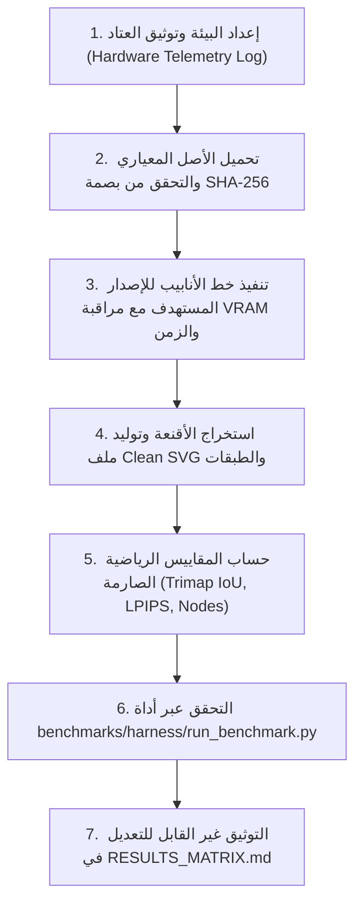

<!-- DOC_PROVENANCE
{"created_at_utc": "2026-10-17T08:58:05Z", "last_action": "CREATED", "last_change_id": "TASK-MULTI-VER-01", "last_edited_at_utc": "2026-10-17T08:58:05Z", "last_editor": "orchestrator-planner", "tracking_started_at_utc": "2026-10-17T08:58:05Z"}
END_DOC_PROVENANCE -->
# بروتوكول القياس المعياري وإجراءات التدقيق التجريبي (`Benchmark Evaluation Protocol`)

**الحالة:** معتمد كبروتوكول تشغيلي إلزامي (`MANDATORY_EVALUATION_PROTOCOL`)  
**سياق الحوكمة:** `benchmarks/EVALUATION_PROTOCOL.md` ضمن نظام التجارب متعدد الإصدارات.

---

## 1. شروط البدء الإلزامية (`Prerequisites & Execution Gate`)

يُحظر تشغيل أي تجربة قياس فعلي تولد استهلاكاً عتادياً أو استدعاءات مدفوعة إلا بعد تحقيق الشروط التالية:
1. صدور موافقة كتابية صريحة من المالك لاعتماد خطة تجارب الجدوى (`FEASIBILITY_EXPERIMENTS_AND_GATES.md`).
2. عزل بيئة الإصدار المعماري داخل دليله المستقل تحت `versions/<version_id>/`.
3. تثبيت العتاد القياسي وتسجيل مواصفاته الكاملة (GPU, VRAM, RAM, CPU, CUDA version).
4. تجهيز الأصول القياسية الأربعة A01–A04 مع بصمات `SHA-256` المعتمدة.

---

## 2. خطوات بروتوكول القياس المعياري الموحد (`7-Step Benchmark Execution Flow`)

### تفاصيل الخطوات:
1. **توثيق العتاد:** تشغيل جامع بيانات العتاد واستخراج مواصفات كارت الشاشة والذاكرة والمعالج بدقة وحفظها في كائن `hardware_telemetry`.
2. **التحقق من الأصل:** قراءة صورة الأصل المعياري والتأكد من مطابقة بصمة `SHA-256` مع `docs/ASSET_AND_EXPERIMENT_CATALOG.md`.
3. **التشغيل والمراقبة:** استدعاء نقطة الدخول `src/pipeline.py` للإصدار المعني، مع تشغيل مؤقت دقيق `time.perf_counter()` ورصد ذروة الذاكرة عبر `torch.cuda.max_memory_allocated()`.
4. **تصدير المخرجات:** حفظ الأقنعة الدلالية بصيغة PNG، وملف المتجه النهائي بصيغة SVG، وطبقات التصميم بصيغة JSON.
5. **حساب المقاييس:** تطبيق معادلات `benchmarks/METRICS.md` لحساب `Trimap Boundary IoU (8px)` و`LPIPS` و`SSIM` وعدد العقد في كل مسار.
6. **التحقق الهيكلي:** تمرير الناتج إلى `benchmarks/harness/run_benchmark.py` للتأكد من مطابقة المخطط `benchmark_schema.json`.
7. **تسجيل النتائج:** إدراج النتائج في `benchmarks/RESULTS_MATRIX.md` وتحديث سجل تجارب الإصدار `experiments/EXPERIMENT_LOG.md`.

---

## 3. التدقيق المستقل وحظر التزييف (`Independent Audit & Non-Fabrication Gate`)

- **قاعدة عدم التزييف الحتمية (`Zero Fabrication`):**
  - أي إدخال في `RESULTS_MATRIX.md` لا يرتبط بملف تشغيل موثق في `benchmarks/harness/` أو يفتقد سجل العتاد الحقيقي يعتبر باطلاً ويُرفض فوراً من قبل أداة التحقق ومراجع الجودة.
- **مراجعة الوكيل المستقل (`qa-reviewer-auditor`):**
  - يقوم وكيل الجودة المستقل بفحص مصفوفة النتائج ومطابقة الأرقام المسجلة مع المخرجات الفعلية والتأكد من عدم تعديل أي نتيجة سلبية أو حذف تجربة غير ناجحة.
