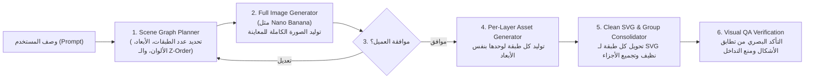
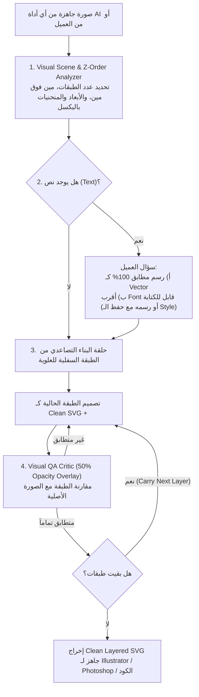

<!-- DOC_PROVENANCE
{"created_at_utc": null, "last_action": "IMPORTED_LEGACY", "last_change_id": "BASELINE-IMPORT", "last_edited_at_utc": null, "last_editor": "governance-baseline", "tracking_started_at_utc": "2026-10-17T06:52:16Z"}
END_DOC_PROVENANCE -->
# التفسير الهندسي المشتق لرؤية المشروع وأوضاع التشغيل (`docs/PRODUCT_VISION_AND_MODES.md`)

**درجة المرجعية (`Authority`):** `DERIVED_ARCHITECTURAL_INTERPRETATION` — **هذه الوثيقة تفسير هندسي مشتق وليست بديلاً عن كلمات المالك الأصلية.**
**المصدر الأصلي الحرفي المعتمد (`Authoritative Verbatim Source`):** اقرأ دائماً [docs/product/OWNER_ORIGINAL_VISION.md](product/OWNER_ORIGINAL_VISION.md) للرجوع إلى نص المالك الأصلي حرفياً، واقرأ [docs/product/VISION_TO_REQUIREMENTS_TRACEABILITY.md](product/VISION_TO_REQUIREMENTS_TRACEABILITY.md) لتتبع كل فقرة أصلية إلى متطلباتها المشتقة.
**حالة الاعتماد (`Approval Status`):** المتطلبات الوظيفية مستمدة من `OWNER_REQUIREMENT`، بينما الخوارزميات والنماذج المقترحة هنا في حالة `PROPOSED / UNDER_RESEARCH` وتنتظر تجارب الجدوى (`docs/architecture/FEASIBILITY_EXPERIMENTS_AND_GATES.md`) واعتماد المالك.

## 1. المشكلة الجوهرية التي يحلها المشروع

أدوات التصميم بالذكاء الاصطناعي الحالية تعاني من فجوة كبيرة بين "توليد صورة جميلة كبكسلات (`Raster Image`)" وبين "إعطاء المصمم ملف طبقات وفيكتور نظيف (`Clean Layered SVG`) يصلح للتعديل الاحترافي":
1. **في Canva وأدوات العزل البسيطة:** الـ Magic Layers تفصل العناصر كصور مقصوصة (`Raster Cutouts`) وليست مسارات فيكتور هندسية قابلة للتعديل بـ `Pen Tool`.
2. **في أدوات تحويل الـ SVG الحالية (حتى مع أقوى الـ LLMs وأدوات الـ Auto-Trace):**
   - عندما تواجه عنصراً فيه تدرجات لونية وظلال (مثل **الفلافل** أو **البطاطس** فيها جزء غامق وجزء فاتح)، تقوم بتفتيت العنصر إلى **مئات الشظايا والمسارات الصغيرة العشوائية** بدل رسم شكل أساسي نظيف وفوقه طبقة ظل نظيفة داخل Group واحد.
   - عندما تواجه عنصرين متجاورين بألوان متقاربة (مثل **البطاطس والعيش** في ساندوتش)، تدمج جزءاً من البطاطس مع جزء من العيش في مسار واحد (`Layer Bleeding`)، مما يدمّر إمكانية تحريك أو تعديل كل عنصر لوحده.

## 2. الأوضاع الثلاثة المتكاملة للنظام (`The Three Core Modes`)

### الوضع الأول: توليد الصور المخطط بالطبقات (`Mode 1: Planned-Layers Image Generation`)

- **التفاصيل الدقيقة للوضع الأول:**
  1. يكتب العميل وصف التصميم المطلوب.
  2. قبل توليد الصورة، يحدد الـ AI المخطط الهيكلي (`Scene Graph`): كم طبقة يتكون منها التصميم، الأشكال الهندسية، الأبعاد الدقيقة (`Dimensions` من أين إلى أين)، والألوان لكل جزء.
  3. يولّد موديل الصور (مثل `Nano Banana` / Gemini Image) الصورة الكاملة ويعرضها على العميل.
  4. إذا وافق العميل، يبدأ النظام بتوليد كل طبقة على حدة بنفس المواصفات الهندسية التي حددها (مثال: لو التصميم فيه درع فضي وبداخله عناصر برتقالية وحمراء، يولد طبقة الدرع الفضي بأبعاده لوحدها، ثم الطبقات الداخلية طبقة فوق طبقة كما يرسم المصمم بالـ Pen Tool).
  5. تمر كل طبقة على أداة تحويل الـ SVG النظيف (`Clean SVG Tool`) مع مرحلة التجميع والتنظيف البصري (`Visual Consolidation`):
     - مقارنة الأجزاء المتجاورة بالبكسل، ودمج الأجزاء التي تمثل شكلاً واحداً في رسمة منتظمة نظيفة (`Clean Design`).
     - التأكد من عدم خروج جزء فوق جزء بالخطأ، وفصل العناصر المستقلة (مثل البطاطس في Layer/Group لوحدها والعيش في Layer/Group لوحده).

### الوضع الثاني: التفكيك الذكي للصور الجاهزة (`Mode 2: Magic Layers Decomposition`)

- **التفاصيل الدقيقة للوضع الثاني:**
  1. يستقبل النظام صورة جاهزة (مولدة بأداة AI أخرى أو مرفوعة من المصمم) بهدف استخدامها في Adobe Illustrator أو Adobe Photoshop أو ككود SVG نظيف مباشرة.
  2. يحلل الـ AI الأول الصورة بالكامل: كم طبقة؟ أي طبقة تحت وأي طبقة فوق (`Z-Order`)؟ ما هي الإحداثيات بالبكسل من اليمين للشمال ومن فوق لتحت وأماكن الانحناءات (`Curves`)؟
  3. يحول هذه المواصفات إلى مخطط إرشادي (`Wireframe / Spec`) ويسلم الطبقة السفلية أولاً للـ AI المصمم للفيكتور.
  4. بعد تصميم الطبقة، يستلمها **AI المراجع البصري (`Visual QA Critic`)** ويضعها فوق صورة العميل بشفافية `50% Opacity` ليقارن تطابق الأبعاد والمنحنيات؛ فإذا تطابقت تماماً، ينتقل للطبقة الثانية (`Carry Layer 2`) وهكذا حتى نهاية التصميم.
  5. تطبق نفس قواعد النظافة الصارمة: فصل العناصر المنفصلة بصرياً، وتجميع كل عنصر مع الظل بتاعه داخل Group منظم (مثل جروب `Potato` أو `بطاطس` وبداخله البطاطس بتصميم نظيف + الشادو بتاعها كقطعة نظيفة غير مفتتة).

### الوضع الثالث: التعديل الذكي على الطبقات والنصوص (`Mode 3: Layer-Aware Vector & Text Editing`)

1. ينفذ النظام أولاً خطوات الـ **Magic Layers + Clean Design** لتفكيك الصورة إلى طبقات ومجموعات `<g>` نظيفة واستخلاص هوية الخطوط (`Font Style Identity`).
2. يستقبل طلب التعديل من العميل (سواء تعديل شكل، لون، عنصر، أو تعديل كلمة مكتوبة).
3. ينفذ التعديلات جراحياً على الـ `Art Layers` المستهدفة فقط دون تشويه باقي التصميم.
4. إذا كان التعديل على نص (`Text`)، يعيد النظام رسم النص الجديد **بنفس الـ Style والـ Identity الخاصة بالفونت الأصلي** (نفس السمك، الانحناءات، الألوان، والتأثيرات) ثم يصدر التصميم بصيغة **Clean SVG** بنفس الجودة العالية.
