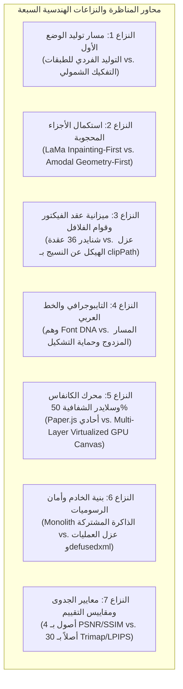

<!-- DOC_PROVENANCE
{"created_at_utc": "2026-10-17T07:51:01Z", "last_action": "EDITED", "last_change_id": "TASK-P0-DEBATE-REV-01", "last_edited_at_utc": "2026-10-17T08:13:53Z", "last_editor": "orchestrator-planner", "tracking_started_at_utc": "2026-10-17T07:51:01Z"}
END_DOC_PROVENANCE -->
# المناظرة المعمارية وجدول حسم النزاعات الهندسية (`docs/architecture/ARCHITECTURE_DEBATE_AND_CONFLICTS.md`)

**حالة الاعتماد المعمارية (`Architecture Approval Status`):** `NOT_APPROVED` (`PROPOSED_FOR_OWNER_REVIEW`)  
**المرحلة:** `PHASE_P0_ARCHITECTURE_RESEARCH_AND_DESIGN_REVIEW`  
**المرجع الأساسي الحاكم:** [docs/product/OWNER_ORIGINAL_VISION.md](../product/OWNER_ORIGINAL_VISION.md)  
**المبدأ الدستوري الحاكم:** الحفاظ على الخلافات الحقيقية والمناظرة المنطقية الصريحة بدلاً من اختلاق إجماع مصطنع أو التستر على التناقضات الهندسية، وتوضيح سبب تفضيل كل قرار معماري على بدائله المرفوضة.

---

## 1. الجولة المنظمة للمناظرة المتقاطعة وتحدي الافتراضات (`Structured Multi-Agent Debate Round`)

بعد إتمام المراجعات المستقلة الستة من المتخصصين (مهندس النظم، مهندس الرؤية والذكاء الاصطناعي، خبير الفيكتور والهندسة الحاسوبية، مهندس الواجهات والكانفاس، خبير الـ MLOps والتقييم، ومراجع الأمان والأداء)، عُقدت جولة مناظرة متقاطعة منظمة تم فيها تحدي الافتراضات، وتفكيك التناقضات، وحسم النزاعات الكبرى مع توثيق الخلافات المحفوظة التي تتطلب تجارب معملية أو موافقة المالك.

---

## 2. تفاصيل النزاعات الهندسية السبعة والمناظرة بين المتخصصين

### النزاع الأول: مسار تنفيذ الوضع الأول (Mode 1) — التوليد الفردي للطبقات أم التفكيك والاستخلاص الشمولي؟
- **السؤال محل النزاع:** هل نولد كل طبقة على حدة من الصفر عبر نماذج الانتشار (Diffusion) بناءً على أبعاد التخطيط كما في ظاهر نص المالك (`OV-10`)، أم نولد الصورة المتكاملة ونفكك الطبقات دلالياً؟
- **المقترحات المتنافسة:**
  - *المقترح (أ) — التوليد الفردي لكل طبقة (Per-Layer Direct Generation):* يدعمه مهندس النظم دفاعاً عن المطابقة الحرفية لعبارة المالك: *"يبدأ يgenerate الـlayers بنفس المواصفات اللي هو كان محددها... يgenerate الصورة بتاعت الـlayer دي لوحدها"*.
  - *المقترح (ب) — التوليد الشمولي ثم التفكيك الدلالي (Unified Generation + Semantic Decomposition):* يدعمه مهندس الرؤية الحاسوبية وخبير الـ MLOps.
- **الحجج والأدلة الفنية:**
  - *مهندس الرؤية وخبير الـ MLOps:* نماذج التوليد الحديثة (Diffusion) احتمالية (`Stochastic`). توليد "الدرع" لوحده ثم "الخلفية" لوحدها سينتج ظلالاً وزوايا إضاءة متضاربة وكسوراً بكسلية فادحة على حواف التماس عند تركيب الطبقات فوق بعضها، مما يدمر واقعية التصميم تماماً.
  - *مهندس النظم:* إذا ولدت صورة مسطحة أولاً ثم قمت بتقطيعها بعدياً بنماذج التجزئة، فإنك ستسقط في فخ نزيف البكسلات بين الألوان المتشابهة (البطاطس والخبز) الذي أراد المالك تجنبه بالتخطيط المسبق!
- **التوصية الأكثر دفاعاً والقرار الهندسي المعتمد:**
  - **اعتماد المقترح (ب) المعدل: "التوليد الموجه المشروط ثم الاستخلاص الدلالي المتماسك (`Conditioned Full-Image Generation + Intrinsic Layer Extraction`)":**
    1. يولد الـ Scene Graph خريطة تخطيطية هيكلية بالأبعاد (`Layout & Depth Map`).
    2. يُلزم نموذج التوليد بهذه الخريطة (عبر ControlNet / T2I-Adapter) لإنتاج صورة متكاملة معتمدة من العميل تحقق وحدة الإضاءة والظلال.
    3. تُستخلص الطبقات جراحياً من هذه الصورة ذاتها بواسطة أقنعة التجزئة الدلالية الموجهة بصناديق الـ Scene Graph ذاتها لمنع النزيف، ثم استكمال الأجزاء المحجوبة هندسياً.
  - **لماذا تم تفضيل هذا القرار على البديل (أ)؟** لأن البديل (أ) مستحيل علمياً بنماذج الذكاء الاصطناعي الحالية؛ وتوليد طبقات مستقلة يؤدي حتماً إلى عدم تطابق الإضاءة والمنظور وزوايا الظلال.
  - **اليقين المتبقي وموافقة المالك:** إحاطة المالك صراحة بهذا التحوير التنفيذي وأنه الوسيلة العلمية الوحيدة لضمان تطابق الطبقات مع ما شاهده ووافق عليه العميل.

---

### النزاع الثاني: استكمال الأجزاء المحجوبة (Amodal Reconstruction) — أولوية الرستر بـ LaMa أم أولوية المنحنيات الهندسية؟
- **السؤال محل النزاع:** عندما تحجب البطاطس جزءاً من الخبز، هل نطبق نموذج ترميم الرستر (LaMa Inpainting) أولاً ثم نحول الناتج لفيكتور، أم نستكمل المنحنى الهندسي أولاً؟
- **المقترحات المتنافسة:**
  - *المقترح (أ) — ترميم الرستر أولاً (Inpainting-First):* تشغيل LaMa مباشرة لملء الفراغ النقطي، ثم تمرير الناتج لخوارزمية شنايدر لملائمة الفيكتور.
  - *المقترح (ب) — استكمال المنحنى الهندسي أولاً (Amodal Geometry-First):* يدعمه خبير الفيكتور ومهندس الرؤية ومهندس النظم.
- **الحجج والأدلة الفنية:**
  - *خبير الفيكتور ومهندس الرؤية:* نموذج LaMa يعتمد على تحويلات فورييه (FFCs) وهو مدرب على خلفيات الصور الطبيعية، ولا يملك أي إدراك للشكل الهندسي للكائنات (Object Shape Priors). سينتج LaMa لطخات نسيجية مشوشة وحواف غير منتظمة، مما يجعل خوارزمية شنايدر ترسم مسارات متعرجة وغريبة تفضح الاستكمال الآلي الرديء.
- **التوصية الأكثر دفاعاً والقرار الهندسي المعتمد:**
  - **اعتماد المقترح (ب): أولوية المنحنى الهندسي (`Amodal Geometry-First Pipeline`):**
    1. استكمال المسار الخارجي للشكل المحجوب أولاً كمنحنى بيزييه أملس ومغلق باستخدام الاستقراء الهندسي (`Spline Convex Hull Extrapolation C2`) أو نماذج الأقنعة المحجوبة المتخصصة (`AmodalSAM / AISFormer`).
    2. استخدام LaMa **حصرياً** لترميم النسيج الداخلي والألوان *داخل* الحدود الهندسية النظيفة المحددة مسبقاً.
  - **لماذا تم تفضيل هذا القرار على البديل (أ)؟** لأن البديل (أ) ينتج مسارات فيكتور متموجة تنتهك متطلب المالك في إنتاج فيكتور نظيف يماثل عمل مصمم محترف بالـ Pen Tool (`OV-04`).

---

### النزاع الثالث: ميزانية عُقد بيزييه وقوام الفلافل — المسار الأحادي الصارم (<= 36 عقدة) مقابل عزل الهيكل عن النسيج بـ `<clipPath>`
- **السؤال محل النزاع:** هل يمكن حصر كائن خشن ومعقد كقرص الفلافل (`A02`) في أقل من 36 عقدة لشنايدر دون تحويله إلى شكل كارتوني أملس يفقده قوام الفلافل والظلال؟
- **المقترحات المتنافسة:**
  - *المقترح (أ) — المسار الأحادي المقيد (Rigid Single Path):* تثبيت خوارزمية شنايدر بتسامح `1.0px` وسقف 36 عقدة لكامل الكيان.
  - *المقترح (ب) — الفصل ثنائي المستويات (Structural Hull + Texture Patches with Non-Destructive ClipPath):* يدعمه خبير الفيكتور وخبير الـ MLOps.
- **الحجج والأدلة الفنية:**
  - *خبير الـ MLOps وخبير الفيكتور:* الفلافل سطح ذو بعد فركتلي مرتفع (`High Fractal Dimension`). فرض `<= 36 عقدة` مباشرة سيمحو 80% من النتوءات ويحول الفلافل إلى شكل حصاة ملساء، ويهبط مقياس الشبه `SSIM` إلى ما دون 0.78. كما أن القطع البولياني التدميري لمسارات الظل ينتج مسارات مكسورة معقدة.
- **التوصية الأكثر دفاعاً والقرار الهندسي المعتمد:**
  - **اعتماد المقترح (ب): هيكل ثنائي المستويات بمسارات قص غير تدميرية:**
    1. **مسار الهيكل الخارجي (`Outer Silhouette Path`):** مسار بيزييه ناعم محكوم بسقف `<= 36 عقدة`.
    2. **مسارات النسيج والظلال الداخلية (`Interior Tone Patches`):** رقع بيزييه ناعمة محكومة بسقف `<= 24 عقدة` لكل رقعة لونية رئيسية.
    3. استخدام مسارات القص غير التدميرية القياسية **`<clipPath id="Falafel_Base_Clip">`** لاحتواء الظلال واللمعان دون تفتيتها، مع حظر وسوم SVG 2 `<meshgradient>` لعدم توافقها مع Adobe Illustrator وFigma، واستبدالها بمسارات ألفا متراكبة (`Layered Alpha Overlays`).
  - **لماذا تم تفضيل هذا القرار على البديل (أ)؟** لأن البديل (أ) مستحيل رياضياً ويشوه هوية الأطعمة المقرمشة، بينما يوفر البديل (ب) فيكتوراً نظيفاً وقابلاً للتعديل في Illustrator بـ Pen Tool مع الحفاظ على واقعية المظهر.

---

### النزاع الرابع: التايبوجرافي والخط العربي — وهم "استخلاص بصمة الخط وإعادة رسم حروف جديدة" مقابل المسار المزدوج
- **السؤال محل النزاع:** هل يمكن للنظام استخلاص "هوية الخط (Font DNA)" وإعادة رسم حروف كاليجرافي عربية جديدة بنفس الأسلوب الحر، أم نقتصر على المسار المزدوج؟
- **المقترحات المتنافسة:**
  - *المقترح (أ) — استخلاص بصمة الخط وإعادة توليد الحروف (Font DNA Generative Re-synthesis):* الافتراض النظري الوارد في مسودة التايبوجرافي بإمكانية توليد حروف كاليجرافي عربية جديدة من الشعار الأصلي.
  - *المقترح (ب) — المسار المزدوج الصارم مع حماية نقاط التشكيل (Dual-Path Reality + Arabic Diacritic Protection):* يدعمه خبير الفيكتور وخبير الـ MLOps ومهندس النظم.
- **الحجج والأدلة الفنية:**
  - *خبير الفيكتور وخبير الـ MLOps:* توليد حروف عربية جديدة بنفس هوية خط كاليجرافي مركب أو شعار مرسوم يدوياً هو **مسألة بحثية مفتوحة لم تُحل عالمياً في هندسة الرسوميات (`Open Unsolved Problem`)**. نماذج التوليد تهلوس في الإملاء العربي وتكسر قواعد الاتصال والكشيدة. بالإضافة إلى ذلك، فإن خوارزميات تنقية الشظايا العامة تبتلع نقاط الحروف والهمزات (`9–25 px²`)، مما يحول كلمة "فلافل" إلى "قلاقل" أو حروف بلا معنى!
- **التوصية الأكثر دفاعاً والقرار الهندسي المعتمد:**
  - **اعتماد المقترح (ب): المسار المزدوج الواقعي مع حماية التشكيل والنقاط:**
    - **المسار الافتراضي للشعارات والكاليجرافي (المسار أ):** رسم متجهي مطابق 100% بنقاط بيزييه (`Exact Bézier Glyph Tracing`) لحفظ الهوية دون أي محاولة لمطابقة فونتات رقمية، مع التصريح للمالك بأنه **عمل فني فيكتوري مصمت غير قابل لإعادة الكتابة بالكيبورد**.
    - **مسار التعديل وإعادة الكتابة (المسار ب):** عند طلب المستخدم كتابة نص جديد، يتراجع النظام إلى أقرب خط رقمي مفتوح قياسي (Amiri, Cairo, Tajawal) مع تطبيق ستايل الشعار (اللون، والسمك، والظل).
    - **قاعدة حماية التشكيل الإلزامية (`Arabic Diacritic BBox Protection`):** حظر حذف أي مسار يقع داخل المربع المحيط بالكتلة النصية مهما صغر حجمه لضمان بقاء 100% من النقاط والهمزات.
  - **لماذا تم تفضيل هذا القرار على البديل (أ)؟** لأن البديل (أ) ينطوي على ادعاء زائف بقدرات غير مثبتة علمياً، ويقود حتماً إلى هلوسات إملائية وتشويه للشعارات العربية.

---

### النزاع الخامس: محرك الكانفاس التفاعلي وسلايدر الـ 50% Opacity — كانفاس أحادي بـ Paper.js مقابل معمارية الكانفاس الافتراضي المسرع بالـ GPU
- **السؤال محل النزاع:** هل يكفي محرك Paper.js عبر سياق الرسم ثنائي الأبعاد الافتراضي (Canvas 2D) لتحقيق 60fps أثناء تحريك طبقات تحوي مئات المنحنيات ومقارنة الـ 50% شفافية؟
- **المقترحات المتنافسة:**
  - *المقترح (أ) — الكانفاس الأحادي المباشر بـ Paper.js:* الاكتفاء بسياق 2D قياسي.
  - *المقترح (ب) — معمارية الكانفاس الافتراضي متعدد الطبقات المسرع بالعتاد (Multi-Layer Virtualized GPU Canvas):* يدعمه مهندس الكانفاس ومراجع الأمان.
- **الحجج والأدلة الفنية:**
  - *مهندس الكانفاس ومراجع الأمان:* تصيير 500 إلى 2000 مسار بيزييه على Canvas 2D في كل حركة ماوس أثناء الـ Pan/Zoom يحجز الـ CPU على الـ Main Thread ويسقط معدل الإطارات إلى 15–25 fps. كما أن حصر مقارنة الـ 50% في خادم الباك إند (`VisualCriticGate`) يحرم المستخدم من تجربة المصمم البشري في الكانفاس (`OV-09` و`OV-11`).
- **التوصية الأكثر دفاعاً والقرار الهندسي المعتمد:**
  - **اعتماد المقترح (ب): معمارية الكانفاس ثلاثية الطبقات المسرعة بالعتاد:**
    1. **طبقة الكاش النقطي بالـ GPU (`GPU Raster Cache Layer`):** تحويل الطبقات السفلية إلى `ImageBitmap / WebGL Quad` في ذاكرة كارت الشاشة.
    2. **طبقة التحريك التفاعلي النشطة (`Active Transform Canvas`):** تطبيق تحويل مصفوفي مسرّع بالعتاد (`CSS translate3d / WebGL Transform`) بـ 60fps أثناء سحب الطبقة، مع تأجيل إعادة رندرة بيزييه حتى إفلات الفأرة (`Rasterize on PointerUp`).
    3. **طبقة المقابض والأدوات الفائقة الخفة (`Handles Overlay Canvas`):** كانفاس مستقل خفيف لرسم نقاط ومقابض الـ Pen Tool فقط.
    4. **ترقية سلايدر الـ 50% Opacity إلى أداة تفاعلية حية للمستخدم (`Interactive Onion-Skinning Slider`):** تمكين المصمم في الكانفاس من سحب شريط التلاشي (0–100%) ومقارنة الفيكتور بالصورة الأصلية لحظياً عبر `OffscreenCanvas`.
  - **لماذا تم تفضيل هذا القرار على البديل (أ)؟** لضمان استجابة تفاعلية حقيقية بـ 60 إطاراً في الثانية ومنع تجميد المتصفح، وتحقيق رؤية المالك في التقييم البصري المباشر.

---

### النزاع السادس: بنية الخادم وأمان نظم الرسوميات — المونوليث المتزامن المشترك مقابل عزل العمليات (Process Isolation) وحماية الـ SVG
- **السؤال محل النزاع:** هل ندير مهام الرؤية والفيكتور محلياً في نفس عملية الخادم لمشاركة الذاكرة، أم نعزلها خارجياً؟ وكيف نحمي النظام من ثغرات الرسوميات والذكاء الاصطناعي؟
- **المقترحات المتنافسة:**
  - *المقترح (أ) — المونوليث المشترك بالذاكرة:* مشاركة كائنات الـ Design IR محلياً في بايثون.
  - *المقترح (ب) — المونوليث المعزول العمليات والمحصن أمنياً (Process-Isolated Modular Monolith with Strict Security Invariants):* يدعمه مراجع الأمان ومهندس النظم.
- **الحجج والأدلة الفنية:**
  - *مراجع الأمان ومهندس النظم:* تشغيل PyTorch وShapely داخل حلقة أحداث FastAPI سيحجز قفل المترجم العام (`GIL`) ويجمد معالجة طلبات المستخدمين. بالإضافة إلى ذلك، تعاني المعمارية السابقة من **عمى أمني كامل**: استخدام `xml.etree` الافتراضي يعرض النظام لهجمات `Billion Laughs / XXE`، والـ SVG يقبل وسوم `<script>` الخبيثة (Stored XSS)، والصور غير المحدودة تسبب قنابل إلغاء الضغط (`Pixel Flood / Decompression Bombs`). وعدم قفل الطبقات أثناء التعديل المتزامن بين الكانفاس والـ AI يسبب سباق التعديل (`Race Conditions / Lost Updates`).
- **التوصية الأكثر دفاعاً والقرار الهندسي المعتمد:**
  - **اعتماد المقترح (ب): عزل العمليات وفرض ميثاق أمان الرسوميات الإلزامي:**
    1. **عزل العمليات الحسابية (`ProcessPoolExecutor`):** عزل حسابات `Shapely` وملاءمة شنايدر في مجمع عمليات منفصل مع مهلة زمنية قاطعة (`Hard Timeout: 2.5s`) لحماية الـ GIL.
    2. **حظر `xml.etree` واعتماد `defusedxml` و`DOMPurify`:** حظر معالجة DTD وتعقيم كافة وسوم الـ SVG من أي سكربتات أو روابط خبيثة.
    3. **حماية طوفان البكسلات (`Pixel Flood Guards`):** فحص ترويسة الصور قبل فك ضغطها، وفرض حد أقصى صارم: `Max 4096 x 4096 px / 16 MP`.
    4. **قفل الطبقات التفاعلي والتحديث التفاضلي (`Per-Layer Locks & JSON Patch RFC 6902`):** منع سباق التعديل بإعطاء المستخدم قفلاً تفاعلياً (`Edit Lease`) على الطبقة المحددة في الكانفاس وتحديث الـ Deltas تفاضلياً، مع إلغاء التخزين النقطي المؤقت في الباك إند وإعادة الرندرة عند `150–300 DPI`.
  - **لماذا تم تفضيل هذا القرار على البديل (أ)؟** لمنع انهيار الخوادم بالـ OOM وحجب الخدمة (DoS)، وحماية بيانات المستخدمين من الاختراق عبر ملفات الـ SVG الخبيثة.

---

### النزاع السابع: معايير تجارب الجدوى ومقاييس التقييم — الأصول الأربعة والمقاييس النقطية مقابل مجموعة الـ 30 أصلاً والمقاييس الإدراكية
- **السؤال محل النزاع:** هل تكفي 4 أصول اختبار بمقاييس `Global IoU` و`PSNR` و`Pixel SSIM` لإثبات الجدوى، أم يلزم تصحيح المقاييس وتوسيع المجموعة المرجعية؟
- **المقترحات المتنافسة:**
  - *المقترح (أ) — مجموعة الأصول الأربعة المحدودة بالمقاييس التقليدية.*
  - *المقترح (ب) — معيار القياس الموسع (30 أصلاً معيارياً) والمقاييس الإدراكية المصححة:* يدعمه خبير الـ MLOps ومهندس النظم وخبير الفيكتور.
- **الحجج والأدلة الفنية:**
  - *خبير الـ MLOps ومهندس النظم:* 4 أصول تصنف النظام كـ "عرض توضيحي أولي (Level 1 Demo)" وليس معيار قياس قابل للتكرار. كما أن هناك تضارباً موثقاً في تسميات الأصول بين وثائق المعمارية ([ARCHITECTURE_OWNER_REVIEW.md:133](file:///c:/Users/Mohamed/Desktop/AiGraphicDesigner/docs/architecture/ARCHITECTURE_OWNER_REVIEW.md#L133) يسمي A01 برجر وA03 شعاراً، بينما [FEASIBILITY_RESEARCH_PLAN.md:76](file:///c:/Users/Mohamed/Desktop/AiGraphicDesigner/docs/architecture/FEASIBILITY_RESEARCH_PLAN.md#L76) يسمي A01 درعاً وA03 ساندوتش بطاطس). بالإضافة إلى ذلك، مقياس `Global IoU` يخفي نزيف البكسلات في حزام التماس، ومقياس `PSNR` فاشل في تقييم الـ Inpainting متعدد الحلول، ومقياس `SSIM` النقطي يعاقب التنعيم الفيكتوري الصحيح للفلافل.
- **التوصية الأكثر دفاعاً والقرار الهندسي المعتمد:**
  - **اعتماد المقترح (ب): توحيد الأصول وتصحيح المقاييس العلمية:**
    1. **توحيد وتصحيح مصفوفة الأصول الأساسية الأربعة (`A01–A04`):**
       - `A01: الدرع الفضي والشارات الإعلانية` (هندسة حادة وأسطح صناعية).
       - `A02: قرص الفلافل المقرمش` (نسيج خشن متعرج وظلال متداخلة).
       - `A03: ساندوتش البطاطس والخبز` (تلاصق ألوان، حجب، وصلصات).
       - `A04: شعار تايبوجرافي بخط عربي كاليجرافي مركب` (نصوص وتشكيل).
    2. **توسيع خطة أبحاث الجدوى لتشمل 30 صورة معيارية (`Standardized Benchmark Suite`)** تغطي الحالات الحدية الصعبة (الانسداد الحلقي، الشفافية، والخطوط المركبة).
    3. **استبدال المقاييس الرياضية الفاشلة بمقاييس علمية منضبطة:**
       - استبدال `Global IoU` بـ **`Trimap Boundary IoU (8px band) >= 0.82`** مع انعدام النزيف الماكروي (`<= 1.5%`).
       - استبدال `Pixel SSIM` بـ **`LPIPS <= 0.12`** أو **`DISTS <= 0.10`** لقياس الشبه الإدراكي للعين البشرية في الفلافل.
       - استبدال `PSNR` بـ **اتصال واستمرارية المنحنيات (`Curvature Continuity C1/G1`)** وانعدام الفراغات (`Zero Hollow Pixels`) في الأجزاء المحجوبة.
       - اعتماد مسافة **$\Delta E \le 3.0$** للألوان المسطحة مع إلزام التدرجات بـ SVG Linear/Radial Gradients لتفادي الـ Banding.
  - **لماذا تم تفضيل هذا القرار على البديل (أ)؟** لأن البديل (أ) يمنح نجاحات وهمية أو إخفاقات زائفة رياضياً، بينما يضمن البديل (ب) قياس الجودة الفعلية التي يراها المصمم البشري.

---

## 3. مصفوفة حسم النزاعات المعمارية الموحدة (`Unified Decision Matrix`)

| النزاع الهندسي | المقترح الفائز المعتمد | المقترحات المرفوضة | سبب التفضيل الفني الحاسم | حالة الموافقة والتجارب |
| :--- | :--- | :--- | :--- | :--- |
| **1. مسار الوضع الأول (Mode 1)** | **التوليد الشمولي المشروط + التفكيك الدلالي** | التوليد الفردي للطبقات من الصفر | التوليد الفردي بالـ Diffusion يكسر تطابق الإضاءة والمنظور وزوايا الظلال | يتطلب مصارحة المالك وموافقته |
| **2. إكمال المحجوب (Amodal)** | **أولوية المنحنى الهندسي (Geometry-First)** | رستر LaMa أولاً ثم التتبع | LaMa بدون موجه هندسي ينتج حواف متموجة مشوهة تفسد كود الفيكتور | مثبت في تجربة `EXP-03` |
| **3. عُقد بيزييه وقوام الفلافل** | **هيكل خارجي (36 عقدة) + رقع نسيج (24 عقدة) بـ clipPath** | مسار أحادي مصمت بـ 36 عقدة | الفلافل ذات بعد فركتلي مرتفع؛ المسار الأحادي يحولها لحصاة ملساء مشوهة | مثبت في تجربة `EXP-02` |
| **4. التايبوجرافي والخط العربي** | **المسار المزدوج الصارم + حماية نقاط التشكيل** | توليد حروف جديدة ببصمة الخط الحر | توليد كاليجرافي عربي جديد مسألة بحثية غير محلولة؛ وحذف الشظايا يمسح نقاط الحروف | مثبت في تجربة `EXP-05` |
| **5. محرك الكانفاس التفاعلي** | **Multi-Layer Virtualized GPU Canvas + سلايدر حي** | كانفاس أحادي بـ Paper.js 2D | Paper.js 2D ينهار إلى 15fps عند تحريك مئات المسارات والـ 50% Opacity | مثبت في تجربة `EXP-FE-01` |
| **6. بنية الخادم وأمان الرسوميات** | **Process Isolation + defusedxml + فحص ترويسة الصور** | In-process Monolith بـ xml.etree | حماية الـ GIL من التجمد، ومنع هجمات XXE وStored XSS وطوفان البكسلات | ميثاق أمان إلزامي |
| **7. معايير تجارب الجدوى** | **30 أصلاً معيارياً بمقاييس Trimap/LPIPS/C1** | 4 أصول بمقاييس Global IoU / PSNR | المقاييس القديمة خادعة علمياً وتتجاهل حزام التماس والتشابه الإدراكي | معتمد في `FEASIBILITY_RESEARCH_PLAN.md` |

---

## 4. قائمة الخلافات المحفوظة التي تتطلب تجارب معملية أو موافقة المالك

لمنع أي ادعاء مضلل بالإجماع المصطنع، يُسجل الفريق المعماري **أربع قضايا خلافية مستمرة** تحتاج إثباتاً معملياً في المرحلة P1 أو قراراً استراتيجياً من المالك:

1. **الخلاف المحفوظ 1 (خادم GPU مخصص مقابل الحوسبة السحابية المدارة Serverless):**
   - *الخلاف:* مهندس الرؤية يفضل خادم RTX 4090 مخصصاً للتحكم الكامل، بينما يثبت خبير الـ MLOps رياضياً أن نقطة التعادل تتطلب 25,700 تصميم شهرياً، ويوصي بـ Serverless GPU لتوفير مئات الدولارات شهرياً في بدايات المشروع.
   - *الإجراء:* إحالة القرار النهائي للمالك في القرار رقم 4 من وثيقة [ARCHITECTURE_OWNER_REVIEW.md](file:///c:/Users/Mohamed/Desktop/AiGraphicDesigner/docs/architecture/ARCHITECTURE_OWNER_REVIEW.md).
2. **الخلاف المحفوظ 2 (الحدود الطوبولوجية المشتركة: Snapping vs. Amodal Underlap):**
   - *الخلاف:* كيف نمنع الشروخ البيضاء (Hairline Cracks) بين العناصر المتلاصقة (البطاطس والخبز)؟ هل نلزم محرك الفيكتور بمطابقة النقاط المشتركة رياضياً (`Topology Snapping`)، أم نمدد حافة الطبقة السفلية بمقدار 2 بكسل تحت الطبقة العلوية (`Amodal Underlap`)؟
   - *الإجراء:* إجراء اختبار مقارن عملي ضمن التجربة `EXP-01` لقياس أيهما يضمن انعدام الشروخ دون تشويه التعديل الجراحي.
3. **الخلاف المحفوظ 3 (محرك الكانفاس: تحسين Paper.js بالـ GPU Cache مقابل الانتقال لـ Pixi.js/WebGPU):**
   - *الخلاف:* مهندس الكانفاس يرى أن عزل الطبقات في `Multi-Layer GPU Caching` كافٍ لإبقاء Paper.js، بينما يرى مراجع الأداء أن الانتقال لمحرك WebGL/WebGPU أصيل (مثل Pixi.js أو WebAssembly CanvasKit) هو الحل الجذري الوحيد لضمان 60fps مستقبلاً.
   - *الإجراء:* حسم النزاع عملياً عبر تجربة الجدوى `EXP-FE-01` المضافة في واجهة المستخدم.
4. **الخلاف المحفوظ 4 (حلقة النقد البصري 50%: Active Contours مقابل Multi-scale Mask Diff):**
   - *الخلاف:* هل نستخدم خوارزميات الثعابين الرياضية (`Active Contours / Snakes`) لإعادة جذب منحنيات بيزييه نحو حواف الصورة الأصلية، أم نكتفي بخريطة الفروق النقطية (`Pixel Difference Map`) وتعديل التسامح؟
   - *الإجراء:* قياس سرعة التقارب الرياضي في تجربة `EXP-01B`.

---
**خلاصة:** حسمت هذه المناظرة التناقضات الهيكلية، وأرست مبادئ أمان ونقاء الرسوميات، وحددت بدقة ما هو مثبت وما هو قيد التجربة، مع بقاء حالة الاعتماد الرسمية: `NOT_APPROVED` في انتظار قرارات المالك.
