<!-- DOC_PROVENANCE
{"created_at_utc": "2026-10-17T07:49:42Z", "last_action": "CREATED", "last_change_id": "TASK-P0-ARCH-REVIEW", "last_edited_at_utc": "2026-10-17T07:49:42Z", "last_editor": "orchestrator-planner", "tracking_started_at_utc": "2026-10-17T07:49:42Z"}
END_DOC_PROVENANCE -->
# مقارنة وتقييم البدائل المعمارية للنظام (`docs/architecture/ARCHITECTURE_OPTIONS.md`)

**حالة الاعتماد المعمارية (`Architecture Approval Status`):** `NOT_APPROVED` (`PROPOSED_FOR_OWNER_REVIEW`)  
**المرحلة:** `PHASE_P0_ARCHITECTURE_RESEARCH_AND_DESIGN_REVIEW`  
**المرجع:** [docs/product/OWNER_ORIGINAL_VISION.md](../product/OWNER_ORIGINAL_VISION.md)  
**الغرض:** مقارنة ثلاثة خيارات معمارية متنافسة بشكل موضوعي ومستقل عبر 13 بُعداً هندسياً لاختيار المعمارية الأنسب لتحقيق رؤية المالك.

---

## 1. الخيارات المعمارية الثلاثة المتنافسة

لتحقيق متطلبات نظام `AI Graphic Designer`، تبرز ثلاثة نماذج معمارية هندسية رئيسية:

```mermaid
flowchart TD
    subgraph OptionA["الخيار (أ): Image-First Reconstruction"]
        A1["وصف المستخدم"] --> A2["توليد صورة نقطية مدمجة\n(Black-Box Diffusion)"]
        A2 --> A3["تفكيك وتحليل الرؤية الحاسوبية\n(Segmentation & Vectorization)"]
        A3 --> A4["كود Clean SVG النهائي"]
    end

    subgraph OptionB["الخيار (ب): Structure-First Generation"]
        B1["وصف المستخدم"] --> B2["توليد كود الـ Vector مباشرة\n(LLM to Direct SVG / Code)"]
        B2 --> B3["تصيير كود الـ Vector للعرض"]
    end

    subgraph OptionC["الخيار (ج): المعمارية الهجينة المقترحة (Hybrid Architecture)"]
        C1["وصف المستخدم"] --> C2["تخطيط هيكل التصميم مسبقاً\n(Design IR Scene Planner)"]
        C2 --> C3["توليد الصورة النقطية والمعاينة\n(Conditioned Image Generation)"]
        C3 --> C4["بوابة موافقة العميل"]
        C4 --> C5["فصل الطبقات دلالياً وإكمال المخفي\n(SAM 2 + Amodal Inpainting)"]
        C5 --> C6["تحويل Vector نظيف وتجميع دلالي\n(Clean Bézier + <g> Groups)"]
        C6 --> C7["حلقة المراجعة البصرية 50%\n(Visual Critic Feedback Loop)"]
        C7 --> C8["كود Clean SVG معتمد وقابل للتعديل"]
    end
```

---

### الخيار (أ): التوليد الصوري أولاً ثم إعادة البناء الفيكتوري (`Option A: Image-First Reconstruction`)

- **فلسفة المعمارية:**
  - الاعتماد على نماذج توليد الصور الحديثة (مثل Midjourney أو Flux أو SDXL) لتوليد صورة نقطية فائقة الجمال بدقة عالية في مسار واحد.
  - تمرير الصورة بعد ذلك بالكامل إلى خط أنابيب رؤية حاسوبية بعدي (`Post-hoc CV Pipeline`) يقوم بـ: كشف العناصر، تجزئة الأقنعة، تتبع الحواف، وتوليد مسارات الـ SVG.
- **نقاط القوة:**
  1. الاستفادة الكاملة من أحدث موديلات التوليد الصوري دون الحاجة لتعديل بنيتها الداخلية.
  2. جودة بصرية مبهرة وواقعية في الصورة النقطية الأولية.
  3. ملاءمة مباشرة لوضع الـ `Magic Layers` على الصور الجاهزة المرفوعة من الخارج.
- **نقاط الضعف والقصور الجوهري:**
  1. **فقدان النوايا الهندسية (`Loss of Design Intent`):** الصورة النقطية تدمج الألوان وتطمس الحدود المنفصلة (تداخل البطاطس والعيش)، مما يجعل مهمة الفصل البعدي مهمة احتمالية غير مضمونة (`Ill-posed Inverse Problem`).
  2. **فشل التخطيط المسبق:** يتعارض مباشرة مع متطلب المالك في `OV-02` الذي يوجب تحديد عدد الطبقات والأبعاد والأشكال الهندسية **قبل** توليد الصورة الكاملة.
  3. **استحالة ضمان الاتساق عند التعديل:** أي تعديل طفيف يتطلب إعادة توليد للصورة أو Inpainting نقطي يغير باقي عناصر التصميم دون قصد.

---

### الخيار (ب): التوليد الهيكلي المباشر للفيكتور (`Option B: Structure-First Direct Vector Generation`)

- **فلسفة المعمارية:**
  - توليد كود الـ SVG أو الـ Scene Graph مباشرة من خلال نماذج لغوية ضخمة (LLMs / Multimodal Code Generators مثل GPT-4o أو Claude 3.5 Sonnet) دون المرور بصورة نقطية على الإطلاق.
- **نقاط القوة:**
  1. نظافة فائقة لكود الـ SVG؛ حيث يُكتب الكود مباشرة كعناصر `<circle>`, `<rect>`, `<path>` منظمة.
  2. سرعة فائقة وزمن استجابة منخفض جداً (ثوانٍ معدودة لتوليد الكود دون الحاجة لـ GPUs ثقيلة لمعالجة الصور).
  3. سهولة تحرير وتعديل المعاملات البرمجية مباشرة.
- **نقاط الضعف والقصور الجوهري:**
  1. **عجز تام عن الرسم المعقد والتظليل الفني:** تفشل النماذج اللغوية في رسم أشكال فنية معقدة (مثل شطيرة برجر واقعية أو درع معدني معقد) وتنتج رسومات كرتونية بدائية جداً تشبه رسوم الأطفال (Clip-art بسيط).
  2. **غياب التدرجات والظلال الطبيعية:** عجز الموديل عن حساب الظلال الواقعية وتأثيرات الإضاءة المتداخلة التي طلبها المالك في `OV-05` و`OV-12`.
  3. **لا يدعم وضع الـ Magic Layers إطلاقاً:** لا يملك هذا الخيار أي قدرة على تفكيك الصور الجاهزة التي يرفعها المستخدم.

---

### الخيار (ج): المعمارية الهجينة التفاعلية الموصى بها (`Option C: Hybrid Architecture`)

- **فلسفة المعمارية:**
  - الجمع بين **التخطيط الهيكلي الواعي (Structure-Aware Planning)** و**قوة التوليد البصري (High-Fidelity Diffusion)** و**إعادة البناء الهندسي الدقيق (Deterministic Geometric Vectorization)** مع **حلقة تدقيق بصري مستمرة (Iterative 50% Opacity Visual Critic)**.
  - تدفق العمل في المعمارية الهجينة:
    1. يحلل مخطط الـ `Scene Planner` طلب المستخدم ويخرج تمثيل الـ `Design IR` المبدئي (الأبعاد، الكيانات، لوحة الألوان، وعلاقات Z-order).
    2. يُوجّه موديل التوليد الصوري بالمخطط الهيكلي لإنتاج معاينة الصورة الكاملة.
    3. يُعرض التصميم على العميل للموافقة في بوابة مراجعة صريحة.
    4. تُفكك الطبقات عبر Foundation Vision Models (SAM 2 + Grounding DINO) مع إكمال الأجزاء المحجوبة للطبقات السفلية (`Amodal Inpainting via LaMa`).
    5. يحول محرك الفيكتور النظيف كل قناع إلى مسارات Bézier ناعمة مع تقليص لوني دلالي لمنع تشظي الألوان وتجميع العنصر وظله في `<g id="...">`.
    6. يفحص الوكيل الناقد (`Visual Critic`) الطبقة بمقارنتها بنسبة شفافة 50% فوق الأصل ويقيس `IoU / SSIM` حتى تصل الدقة للحد المقبول.
- **نقاط القوة:**
  1. تحقق 100% من متطلبات المالك بجميع أوضاعها الثلاثة.
  2. تجمع بين الواقعية البصرية الفائقة لرسوم الـ Diffusion ونظافة وهندسة مسارات الـ Pen Tool في الـ SVG.
  3. تعالج مشكلة الفلافل والبطاطس جذرياً بفضل التوجيه الدلالي المسبق.
  4. تحتوي على آلية تصحيح ذاتي حتمية عبر بوابة الـ 50% Opacity.
- **التحدي الرئيسي:** زيادة التعقيد الهندسي وعدد المكونات البرمجية مقارنة بالخيارين الآخرين، وتطلب أجهزة خوادم تدعم استدعاء نماذج الرؤية.

---

## 2. مصفوفة المقارنة الهندسية الشاملة عبر 13 بُعداً

| البُعد الهندسي (`Dimension`) | الخيار (أ): Image-First | الخيار (ب): Structure-First | الخيار (ج): المعمارية الهجينة (Hybrid) | الملاحظات والتحليل المعماري |
| :--- | :--- | :--- | :--- | :--- |
| **1. الجودة البصرية (`Visual Quality`)** | ممتازة جداً في الـ Raster، رديئة ومشظاة في الـ SVG الناتج | ضعيفة وبدائية جداً (Clip-art بدائي) | **فائقة وتجمع بين الجمال البصري ونظافة الفيكتور** | الهجين يعالج شظايا الـ Raster في مرحلة التنعيم الهندسي. |
| **2. جودة التجميع الدلالي (`Semantic Grouping`)** | ضعيفة جداً (تتشتت الطبقات لآلاف الأجزاء) | ممتازة (كود منظم مباشرة) | **ممتازة وموجهة بنواة الـ Scene Graph** | الهجين ينشئ مجموعات `<g>` متماسكة للكيان وظله. |
| **3. الظلال والتدرجات الواقعية** | واقعية لكن تتحول لآلاف الشظايا | شبه منعدمة أو مسطحة بدائية | **تدرجات نظيفة مع ظلال متصلة كقطعة موحدة** | يطبق خوارزمية الدمج الهندسي لمسارات الظلال المتجاورة. |
| **4. مطابقة التصميم للأصل (`Fidelity`)** | عالية بصرياً، سيئة طوبولوجياً | منخفضة جداً | **عالية ومقاسة كمياً بحلقة الـ 50% Opacity Critic** | تتجاوز نسبة التطابق `IoU >= 0.94` المقاسة في `EXP-04`. |
| **5. قابلية التحرير الاحترافي (`Editability`)** | صعبة جداً (آلاف النقاط العشوائية المكسورة) | سهلة نظرياً ولكن لتصاميم تافهة | **مثالية كأنها مرسومة بـ Pen Tool في Illustrator** | الحد الأقصى لنقاط التحكم `<= 36` نقطة للمسار. |
| **6. توفر الموديلات (`Model Availability`)** | متوفرة وجاهزة | متوفرة (LLMs تجارية) | **متوفرة كأدوات مفتوحة وتجارية (SAM 2, LaMa, Gemini)** | تعتمد على أحدث معايير الـ Foundation Vision Models. |
| **7. تكلفة الاستدعاء (`Inference Cost`)** | متوسطة (توليد صورة + tracing) | منخفضة جداً (استدعاء LLM واحد) | **متوسطة إلى مرتفعة نسبياً (GPU Vision Pipeline)** | يمكن تحسينها عبر Cache للأصول والتشغيل المحلي. |
| **8. التعقيد الهندسي (`Engineering Complexity`)** | متوسط | منخفض | **مرتفع (يتطلب خط أنابيب متعدد المراحل متزامن وغير متزامن)** | يتطلب معمارية معيارية صارمة وحدوداً برمجية واضحة. |
| **9. زمن الاستجابة (`End-to-End Latency`)** | 10–25 ثانية | 3–8 ثوانٍ | **15–35 ثانية للمسار الكامل (توليد + تفكيك + نقد)** | يمكن تجزئتها بعرض المعاينة فوراً في 3 ثوانٍ ثم إكمال الفيكتور. |
| **10. قابلية النقل والتصدير (`Portability`)** | مقبولة | ممتازة | **ممتازة وتتوافق 100% مع معايير W3C SVG 1.1/2** | اختبارات استيراد حتمية في Adobe Illustrator وFigma. |
| **11. قابلية التوسع لخصائص جديدة (`Extensibility`)** | صعبة (Black Box لا يفهم الطبقات) | محدودة بقدرات كود الـ LLM | **فائقة بفضل الـ Design IR المستقل عن نماذج الـ AI** | إضافة أي موديل رؤية أو فيكتور جديد دون المساس بالنواة. |
| **12. معالجة حالات الفشل (`Failure Handling`)** | صعبة وتنتج أخطاء بصرية صامتة | فشل كود أو أخطاء تصيير | **حتمية ومحمية ببوابات تحقق ونقاط تراجع محددة** | إذا فشلت طبقة يُعاد ضبط مسارها دون انهيار كامل التصميم. |
| **13. الصيانة طويلة المدى (`Maintainability`)** | هشة وتعتمد على ترقيعات الـ Heuristics | معتمدة كلياً على هندسة الـ Prompts | **عالية جداً لاعتمادها على Clean Architecture ونواة موحدة** | فصل Domain عن الـ Infrastructure وتوثيق 1:1 في الذاكرة. |

---

## 3. التوصية المعمارية النهائية الصريحة

توصي مراجعة الهندسة بالإجماع بـ: **اعتماد الخيار (ج) — المعمارية الهجينة (Hybrid Architecture)** كأساس معتمد وحيد للمشروع للأسباب التالية:
1. **الخيار الوحيد الذي يفي برؤية المالك بالكامل:** الخياران (أ) و(ب) يفشلان بنيوياً في تلبية متطلبات جوهرية (تخطيط الطبقات مسبقاً، منع تشظي الفلافل، مقارنة 50% Opacity، ودعم التعديل على الصور الجاهزة).
2. **عزل النواة الهندسية عن تقلبات الذكاء الاصطناعي:** يضمن الخيار (ج) أن تمثيل التصميم (`Design IR`) محكوم بقواعد هندسية صارمة وقابلة للاختبار، بحيث يمكن استبدال أي موديل ذكاء اصطناعي (مثل استبدال Nano Banana أو ترقية SAM 2 إلى إصدار أحدث) دون كسر منطق النظام أو واجهة المستخدم.
3. **معالجة تحدي زمن الاستجابة والتكلفة:** يتم التعامل مع بطء العمليات المعقدة عبر **بوابة المعاينة التفاعلية السريعة (`Fast Preview Gate`)**؛ حيث يحصل المستخدم على المعاينة الكاملة خلال ثوانٍ، ولا ينطلق محرك الحوسبة الثقيلة للـ Vectorization والنقد البصري إلا بعد نيل رضا العميل وتأكيد الاستمرار.

> **تنبيه حوكمي صارم:** هذا الاختيار هو توصية معمارية مقترحة (`PROPOSED`) لتقديمها للمالك، ولا تصبح نافذة للتنفيذ إلا بعد مراجعة المالك وصدور توقيعه في `memory/decisions/DECISION_LOG.md`.
