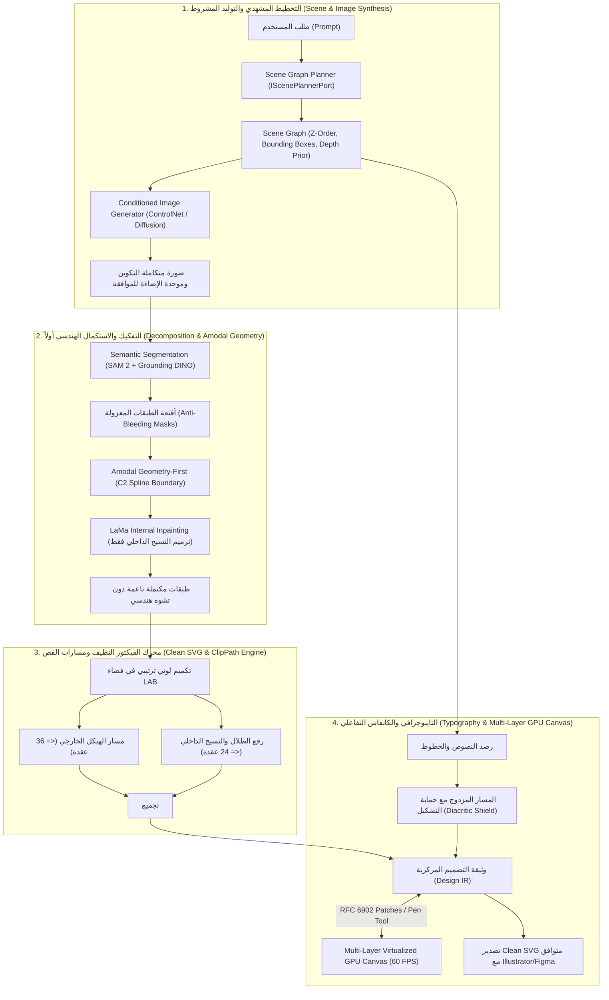

<!-- DOC_PROVENANCE
{"created_at_utc": "2026-10-17T07:56:17Z", "last_action": "EDITED", "last_change_id": "TASK-P0-DEBATE-REV-01", "last_edited_at_utc": "2026-10-17T08:19:15Z", "last_editor": "orchestrator-planner", "tracking_started_at_utc": "2026-10-17T07:56:17Z"}
END_DOC_PROVENANCE -->
# التقرير التنفيذي الشامل لمراجعة المعمارية والمقترحات المرفوعة للمالك (`docs/architecture/ARCHITECTURE_OWNER_REVIEW.md`)

**حالة الاعتماد المعمارية (`Architecture Approval Status`):** `NOT_APPROVED` (`PROPOSED_FOR_OWNER_REVIEW`)  
**المرحلة:** `PHASE_P0_ARCHITECTURE_RESEARCH_AND_DESIGN_REVIEW`  
**المرجع الأساسي الحاكم:** [docs/product/OWNER_ORIGINAL_VISION.md](../product/OWNER_ORIGINAL_VISION.md)  
**المبدأ الدستوري:** حظر بدء أي كود تطبيقي للمنتج قبل اعتماد المالك الصريح لهذه المعمارية، ونجاح تجارب الجدوى العشر المقاسة، والحفاظ على الرؤية الأصلية كاملة دون تحوير.

---

## 1. الملخص التنفيذي ورسالة المنسق المعماري إلى المالك

عزيزي مالك ومؤسس المشروع،  
بصفتنا المنسق المعماري الرئيسي وParent Orchestrator لفريق المهندسين المتخصصين، قمنا بإجراء مراجعة معمارية وبحثية شاملة وتفصيلية، تلتها **مناظرة هندسية متعددة الوكلاء (Multi-Agent Structured Debate)** شملت سبعة تخصصات هندسية مستقلة:
1. معمارية النظم والبرمجيات (Principal Systems Architect)
2. الذكاء الاصطناعي والرؤية الحاسوبية (Computer Vision & Generative AI Architect)
3. هندسة الرسوميات والفيكتور النظيف (SVG & Computational Geometry Specialist)
4. واجهة المستخدم والكانفاس التفاعلي (Frontend & Interactive Canvas Architect)
5. أبحاث الـ MLOps والتقييم واقتصاديات الحوسبة (AI Research & MLOps Specialist)
6. الأمن السيبراني والأداء وقابلية التوسع (Security & Performance Reviewer)
7. الناقد المعماري ومدقق الجودة المستقل (Independent QA Reviewer & Auditor)

**نؤكد لك بشكل قاطع وموثق في سجلات النظام:**
1. **لم يتم كتابة سطر واحد من كود المنتج الفعلي حتى هذه اللحظة**؛ العمل بالكامل انحصر في البحث المعماري، وتصميم العقود، وتحديد حدود الموديولات، والمناظرة الفنية، وبناء شبكة الأمان والحوكمة الصارمة.
2. **حالة اعتماد المعمارية هي `NOT_APPROVED`** وستظل كذلك حتى صدور قرارك المستقل والواعي بعد قراءة هذا التقرير وملحقاته.
3. تم إعداد وتطوير حزمة معمارية متكاملة من **10 وثائق رسمية** في `docs/architecture/` تجيب على كافة التحديات التقنية، وتحدد المخاطر بوضوح، وترسم خارطة طريق هندسية محكمة.

---

## 2. فهرس الوثائق المعمارية العشر المرفوعة للاعتماد

| الرقم | اسم الوثيقة ومسارها | الغرض الأساسي منها وما تحتويه |
| :---: | :--- | :--- |
| **1** | [VISION_REQUIREMENTS_ANALYSIS.md](VISION_REQUIREMENTS_ANALYSIS.md) | تفكيك تفصيلي للرؤية الأصلية (`OV-01..18`)، وفصل المتطلبات عن الفرضيات، وحصر الأسئلة المعلقة. |
| **2** | [ARCHITECTURE_OPTIONS.md](ARCHITECTURE_OPTIONS.md) | مقارنة علمية شاملة بين الخيارات الثلاثة (Image-First مقابل Structure-First مقابل Hybrid) عبر 13 بُعداً هندسياً. |
| **3** | [SPECIALIST_REVIEWS.md](SPECIALIST_REVIEWS.md) | تقارير مستقلة ومعمقة من التخصصات الهندسية تكشف الخيارات والبدائل المرفوضة والمخاطر ومستوى الثقة. |
| **4** | [ARCHITECTURE_DEBATE_AND_CONFLICTS.md](ARCHITECTURE_DEBATE_AND_CONFLICTS.md) | جولة المناظرة الهندسية الموسعة عبر 7 محاور، ومصفوفة القرارات المعتمدة، مع حفظ الخلافات غير المحسومة. |
| **5** | [DESIGN_IR_PROPOSAL.md](DESIGN_IR_PROPOSAL.md) | مواصفة نموذج التمثيل الوسيط (`Design IR`) بمسارات القص غير التدميرية، ومسارات التجاويف `evenodd`، وعزل الألوان. |
| **6** | [MODULE_BOUNDARIES_AND_CONTRACTS.md](MODULE_BOUNDARIES_AND_CONTRACTS.md) | تقسيم النظام إلى 4 أنظمة فرعية و14 موديولاً، وتوثيق عقود الواجهات (Protocols)، وهندسة عزل العمليات. |
| **7** | [TECH_STACK_RECOMMENDATION.md](TECH_STACK_RECOMMENDATION.md) | توصيات المكدس البرمجي، وكانفاس الـ GPU متعدد الطبقات، وتدابير الأمان السيبراني (`defusedxml`, `DOMPurify`). |
| **8** | [FEASIBILITY_RESEARCH_PLAN.md](FEASIBILITY_RESEARCH_PLAN.md) | خطة تجارب الجدوى العشر (`EXP-01..07` و`SEC/PERF/CONC`)، وتوحيد الأصول القياسية (`A01..A04`)، وضبط المقاييس علمياً. |
| **9** | [RISK_REGISTER.md](RISK_REGISTER.md) | سجل تفصيلي لـ 14 خطراً تقنياً وأمنياً مع خطط التخفيف والبدائل ومصفوفة التتبع الحتمية. |
| **10** | [ARCHITECTURE_OWNER_REVIEW.md](ARCHITECTURE_OWNER_REVIEW.md) | **هذه الوثيقة:** التقرير التنفيذي الجامع وقائمة القرارات الصريحة المطلوبة من المالك للانتقال إلى المرحلة التالية. |

---

## 3. المعمارية الهندسية الموصى بها: المعمارية الهجين المعدلة بمخرجات المناظرة (`Refined Hybrid Architecture`)

يوصي الفريق المعماري بالإجماع باعتماد **المعمارية الهجين (Option C)** بعد إدماج النتائج الحاسمة للمناظرة الهندسية:

### أبرز قرارات المناظرة الهندسية المدمجة في المعمارية:
1. **مسار توليد الوضع الأول:** التوليد المشروط للصورة الكاملة لضمان وحدة الإضاءة وزوايا الظلال ونيل موافقة العميل، ثم استخلاص الطبقات جراحياً بأقنعة دلالية مطابقة لصناديق التخطيط.
2. **استكمال الأجزاء المحجوبة (Amodal Reconstruction):** اعتماد مبدأ **Amodal Geometry-First**؛ استكمال المنحنى الخارجي للشكل كمسار بيزييه C2 أملس أولاً، ثم حصر ترميم LaMa للنسيج الداخلي فقط لمنع تشوه المنحنيات.
3. **ميزانية عُقد بيزييه وقوام الفلافل:** الفصل ثنائي المستويات: هيكل أملس (`<= 36 عقدة`) ورقع نسيج وظلال (`<= 24 عقدة`) محتواة بمسار قص غير تدميري **`<clipPath>`**، مع حظر وسوم SVG 2 غير المتوافقة.
4. **التايبوجرافي والخط العربي:** رسم متجهي مطابق 100% للشعارات والكاليجرافي الحر (المسار أ) كعمل فني مصمت، وتوفير خطوط رقمية بديلة عند طلب التعديل (المسار ب)، مع فرض **حماية التشكيل والهمزات (`Diacritic Shield`)**.
5. **محرك الكانفاس وسلايدر الشفافية:** كانفاس افتراضي مسرع بالـ GPU متعدد الطبقات (`Multi-Layer Virtualized GPU Canvas`) يحافظ على 60 FPS ثابتة أثناء تحريك الطبقات وضبط الشفافية من 0 إلى 100%.
6. **الأمن وعزل العمليات:** اعتماد `defusedxml` و`DOMPurify` ضد هجمات الـ SVG، وفرض حدود البكسلات (16MP كحد أقصى لمنع قنابل فك الضغط)، وعزل حسابات Schneider وShapely في `ProcessPoolExecutor` بسقف زمني 2.5 ثانية لحماية مفسر بايثون من القفل (GIL).

---

## 4. المكدس التقني وجدوى الحوسبة الاقتصادية (`Compute & Financial Feasibility`)

- **الواجهة الخلفية (`Backend Core`):** بايثون (`Python 3.12`) مع `FastAPI` للـ APIs غير المتزامنة، و`Pydantic v2` للتحقق الصارم من الـ Schema، و`ProcessPoolExecutor` لعزل حسابات المنحنيات.
- **نماذج الذكاء الاصطناعي (`Vision Foundation Models`):** `SAM 2 Large` مع `Grounding DINO` للتجزئة الدلالية، و`LaMa` للاستكمال النسيجي، وواجهة محايدة للتوليد تدعم `Gemini Image` محلياً أو سحابياً.
- **محرك الفيكتور والأمان (`Vector & Security Engine`):** `Shapely` و`pyclipper` و`Schneider Bézier Fitting` مع تطهير كامل بـ `defusedxml`.
- **واجهة الكانفاس (`Interactive Canvas UI`):** تطبيق `React 18+` مع `TypeScript` وكانفاس طبقي مسرع بـ GPU يدعم التعديل بالـ Pen Tool وتكامل `RFC 6902 JSON Patch`.
- **النموذج الاقتصادي للحوسبة (Serverless GPU):**
  - نوصي بشدة بالاعتماد على **الحوسبة السحابية الخادمة عند الطلب (`Serverless GPU: Modal / RunPod`)** بدلاً من استئجار خادم مخصص باهظ الثمن؛ حيث تبلغ تكلفة الاستدلال في مرحلة التجارب **أقل من 40 دولاراً إجمالياً**، وتوفر عزلاً كاملاً لكل طلب يمنع أخطاء نفاد الذاكرة (`Zero Out-Of-Memory Collisions`).

---

## 5. قائمة القرارات الصريحة المطلوبة من المالك للاعتماد (`Owner Sign-Off Decisions`)

لكي ننتقل من مرحلة التصميم المعماري (P0) إلى مرحلة تجارب الجدوى (P1)، نرفع لسعادتكم القرارات الخمسة التالية لاعتمادها:

### القرار 1: اعتماد النمط المعماري الهجين المعدل (`Refined Hybrid Architecture`)
- **المطلوب من المالك:** الموافقة على اعتماد الخيار الهجين المعدل بمخرجات المناظرة (التوليد المشروط + التفكيك الدلالي + الفيكتور النظيف بـ clipPath) كأساس هندسي وحيد للمشروع.
- **توصية الفريق:** **موافقة تامة (Recommended).**

### القرار 2: اعتماد استراتيجية المسار المزدوج للخط العربي مع حماية التشكيل (`Dual-Path & Diacritic Shield`)
- **المطلوب من المالك:** إقرار سياسة التعامل مع الخطوط؛ بحيث يكون السلوك الافتراضي للشعارات والكاليجرافي هو **الرسم المتجهي المطابق بنسبة 100% بنقاط بيزييه (المسار أ)** كعمل فني مصمت، مع تفعيل حماية نقاط التشكيل والهمزات، وإتاحة التراجع لفونتات رقمية قياسية عند طلب كتابة نص جديد (المسار ب).
- **توصية الفريق:** **موافقة تامة (Recommended).**

### القرار 3: اعتماد معمارية الاستكمال الهندسي أولاً للأجزاء المخفية (`Amodal Geometry-First Policy`)
- **المطلوب من المالك:** إقرار سياسة استكمال الأشكال المحجوبة (مثل الخبز تحت البطاطس) باستقراء المسار الخارجي كمنحنى هندسي C2 ناعم أولاً، وترميم النسيج بـ LaMa، ووضع علامة `uncertain_geometry: true` عند تجاوز الانسداد نسبة 65%.
- **توصية الفريق:** **موافقة تامة (Recommended).**

### القرار 4: اعتماد الحوسبة السحابية الخادمة عند الطلب للتجارب (`Serverless GPU Mode`)
- **المطلوب من المالك:** الموافقة على تشغيل نماذج الذكاء الاصطناعي في التجارب عبر خوادم سحابية خادمة بنظام الدفع بالثانية (`Modal / RunPod - Serverless GPU`) بتكلفة اقتصادية ضئيلة (< 40$) بدلاً من استئجار سيرفر ثابت مكلف.
- **توصية الفريق:** **موافقة تامة (Recommended).**

### القرار 5: الإذن ببدء تجارب الجدوى العشر واعتماد مصفوفة الأصول الذهبية (`Phase P1 Feasibility Authorization`)
- **المطلوب من المالك:** الموافقة على خطة الأبحاث وتجارب الجدوى العشر الموضحة في وثيقة `FEASIBILITY_RESEARCH_PLAN.md` لاختبار عتبات التجزئة، وعقد بيزييه، والأمان، واستقرار المعالج على أصول الاختبار الأربعة المعتمدة (`A01` الدرع، `A02` الفلافل، `A03` البطاطس والخبز، `A04` الشعار والخط العربي).
- **توصية الفريق:** **الموافقة والانطلاق.**

---

## 6. بروتوكول الانتقال إلى المرحلة التالية (`Transition Protocol to Phase P1`)

1. **كيف تصدر موافقتك؟**  
   - يمكنك الرد مباشرة في المحادثة بتأكيد موافقتك وتوجيهاتك للقرارات الخمسة المذكورة أعلاه.
   - عند صدور موافقتك الصريحة، سنقوم كـ Orchestrator بتسجيل حدث الاعتماد في `OWNER_APPROVAL_PROVENANCE.json` و`memory/decisions/DECISION_LOG.md` وتحويل حالة الاعتماد رسمياً من `NOT_APPROVED` إلى `OWNER_APPROVED`.
2. **ماذا سيحدث فور صدور الموافقة؟**  
   - لن نبدأ بكتابة كود الإنتاج النهائي أيضاً، بل سننتقل إلى **المرحلة P1 (Feasibility Experiments)**: تجهيز أصول الاختبار المعيارية الأربعة (`A01: الدرع والشعار الهندسي`، `A02: قرص الفلافل المقرمش`، `A03: ساندوتش البطاطس والخبز`، `A04: الشعار والخط العربي المركب`) وتشغيل سكريبتات القياس المعزولة للتحقق بالأرقام من صحة الفرضيات الهندسية.

**نحن بكامل الجاهزية لتلقي توجيهاتكم الكريمة للاعتماد والانطلاق.**
