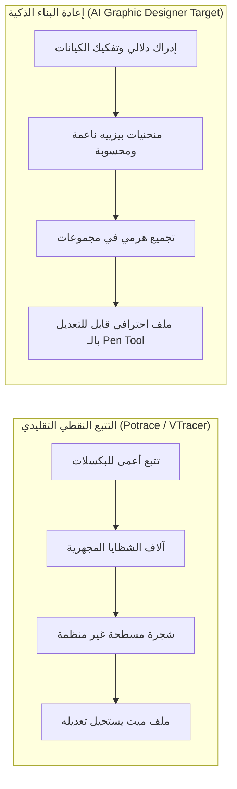
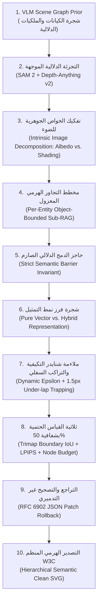
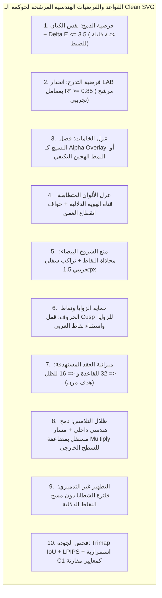
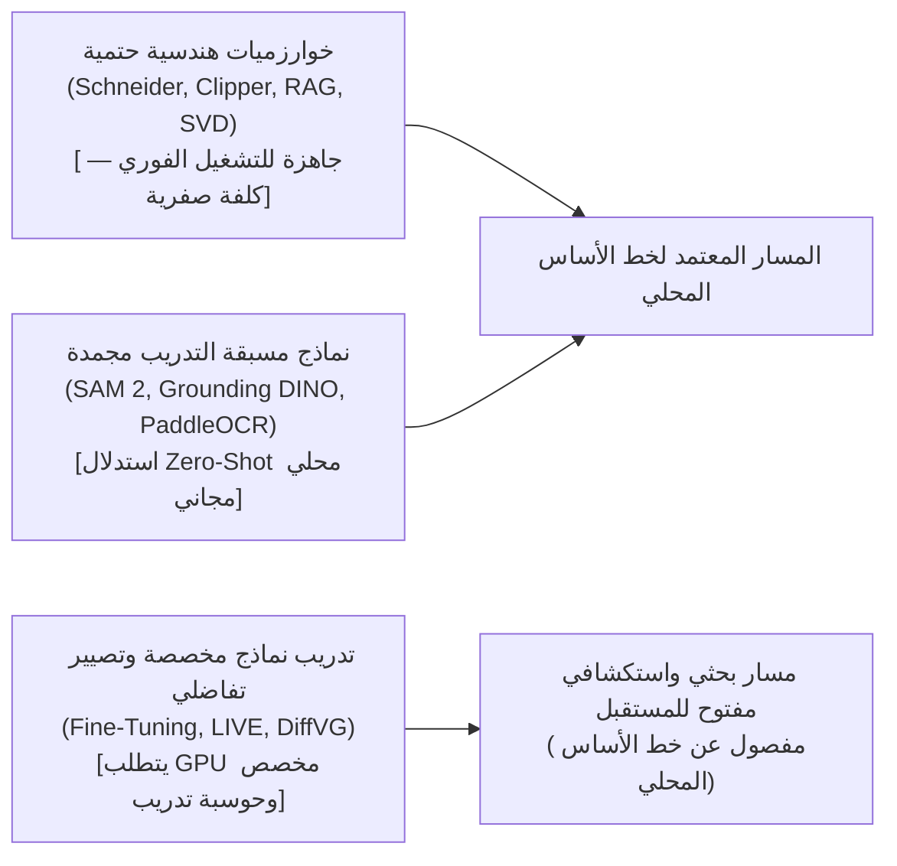
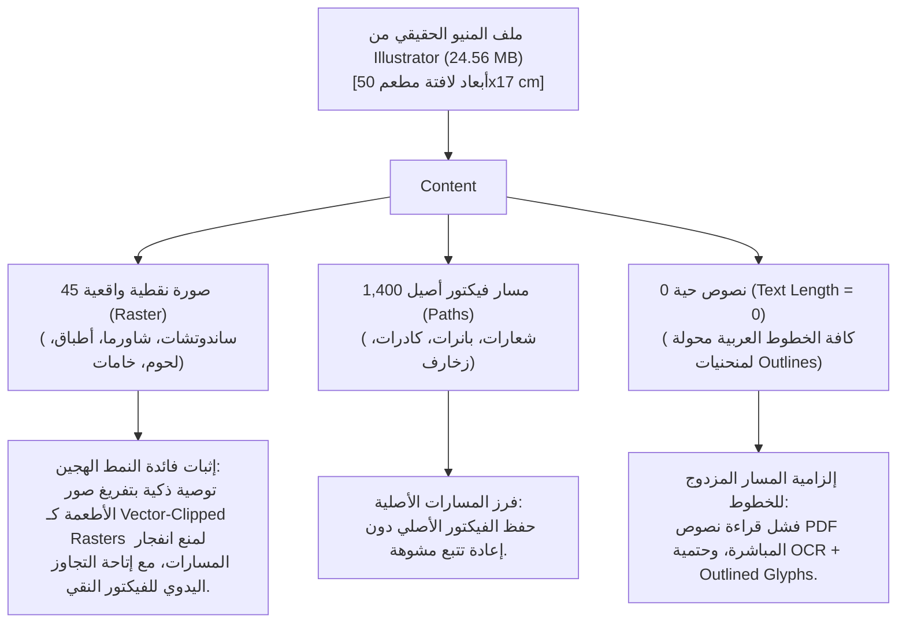
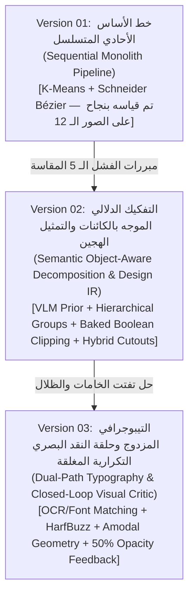

<!-- DOC_PROVENANCE
{"created_at_utc": "2026-10-17T16:32:39Z", "last_action": "EDITED", "last_change_id": "TASK-CLEAN-SVG-EVAL-01", "last_edited_at_utc": "2026-10-17T17:14:41Z", "last_editor": "orchestrator-planner", "tracking_started_at_utc": "2026-10-17T16:32:39Z"}
END_DOC_PROVENANCE -->
# مقترح أبحاث وتصميم منهجية إعادة بناء الفيكتور النظيف (`Clean SVG Reconstruction Research & Design Proposal`)

**المشروع:** AI Graphic Designer  
**المعرف التعريفي:** `PROP-CLEAN-SVG-RECONSTRUCTION-20261017`  
**المهمة:** `TASK-CLEAN-SVG-RES-01`  
**الحالة الدستورية:** `ARCHITECTURE_AND_GOVERNANCE_PREPARATION — NOT_APPROVED` (`PROPOSED_FOR_OWNER_REVIEW`)  
**درجة المرجعية:** وثيقة بحثية وتصميمية مقترحة؛ مرجعيتها الحاكمة هي النص الأصلي الحرفي للمالك في [docs/product/OWNER_ORIGINAL_VISION.md](../product/OWNER_ORIGINAL_VISION.md).  
**العتاد المستهدف:** التشغيل المحلي المجاني على المعالج المركزي للابتوب المالك الشخصي (Core i7-8850H / 16GB RAM / MX130 2GB VRAM / Zero Cloud GPU / Zero API Cost).

---

## 1. الملخص التنفيذي وحفظ جوهر الرؤية الأصلية للمالك

أوضح المالك بصورة قاطعة أن الهدف الجوهري للنظام ليس مجرد "تتبع نقطي تقليدي للمسارات" (Conventional Raster-to-Vector Tracing)، بل هو **محرك إعادة بناء هندسي ذكي يحاكي تفكير ويد مصمم الجرافيك البشري المحترف**، ليُنتج مستندات Clean SVG منظمة دلالياً، فائقة الدقة البصرية، وقابلة للتعديل الجراحي السلس داخل برامج التصميم الاحترافية (Adobe Illustrator, Inkscape, Figma) وعلى كانفاس الويب التفاعلي.

### أ. الفصل الصارم بين السلوك المرغوب والآليات التنفيذية المقترحة:
1. **السلوك المرغوب الحتمي (`Owner's Desired Behavior — Non-Negotiable Requirements`):**
   - **فصل الكائنات المتشابهة لونياً (`OV-07`):** منع دمج خبز البرجر مع الجبنة الذائبة أو البطاطس المقلية لمجرد تشابه قيم اللون الأصفر/البني.
   - **دمج الشظايا المفرطة داخل الكائن الواحد (`OV-05`):** تجميع مسام الفلافل أو تدرجات الخبز في أشكال منتظمة نظيفة ومنع تفتت الـ SVG إلى آلاف الجزر المبعثرة.
   - **الحفاظ على الظلال والتدرجات والإضاءات (`OV-11`):** تمثيل ظلال العناصر وانعكاساتها بمسارات ناعمة دون تحويلها إلى أشرطة لونية مكسورة أو بقع مصمتة قبيحة.
   - **الهندسة المحجوبة وإعادة البناء بالترتيب المنطقي للطبقات (`OV-08`):** بناء التصميم في ترتيب طبقي سليم (Z-Order)، مع استكمال الأشكال الهندسية الواقعة خلف العوائق (مثل استمرار شريحة اللحم والخبز أسفل الخس).
   - **التدقيق البصري التكراري بشفافية 50% (`OV-09`):** مقارنة الطبقات المتجهة مع الصورة الأصلية للتأكد التام من تطابق الأبعاد قبل الاعتماد.
   - **التجميع الدلالي الصريح (`OV-12`):** تجميع كل كائن ومكوناته (القاعدة + الظل + الإضاءة) داخل مجموعة دلالية واحدة (`<g id="Potato">`).
   - **التحكم التفاعلي وسؤال المستخدم عند الغموض (`OV-10`):** استئذان المستخدم عند التعامل مع الخطوط والنصوص واختيار أولويات الدقة مقابل سهولة التعديل.
2. **الآليات التنفيذية (`Implementation Mechanisms — Under Engineering Evaluation`):**
   - اقتراح المالك الأولي باستدعاء نماذج متعددة تبني طبقة فوق طبقة ثم تدمجها وتختبرها بصرياً، يُمثل **فرضية معمارية ممتازة** تم إخضاعها للفحص والتحليل الرياضي والمقارنة مع خوارزميات الرسوميات المتجهة لاختيار أكفأ مسار تنفيذي يحقق هذه الرغبة بأقل استهلاك حوسبي ممكن على لابتوب المالك.

---

## 2. دراسة تقنية مقارنة لخوارزميات التتبع والتحويل للفيكتور (Source-Backed Critique)

أجرى فريق الوكلاء المتخصصين مسحاً هندسياً معمقاً لأبرز خوارزميات التتبع والرسوميات المتجهة، موثقة بالأساس الرياضي، نقاط القوة، ومكامن الفشل:

| الخوارزمية / المحرك | الأساس الرياضي والخوارزمي | نقاط القوة | نقاط الضعف ومكامن الفشل | الاستهلاك الحوسبي والعتاد | مدى الملاءمة لـ Clean SVG |
| :--- | :--- | :--- | :--- | :--- | :--- |
| **Potrace** *(Selinger, 2003)* | ثنائي اللون (Bilevel)، تفكيك الكونتورات، تقريب مضلعي أمثل بـ DAG، عتبة زاوية $\alpha_{\max}$، ملاءمة شنايدر المكعبة. | سرعة فائقة جداً ($< 15\text{ms}$)، خلو تام من التقاطعات الذاتية، استقرار رياضي حتمي. | أحادية اللون بنيوياً؛ تكميم الألوان المتعددة ينتج شروخاً بيضاء، تفتت الظلال، وانعدام تام للتجميع الدلالي. | منخفض جداً: CPU Pure، ذاكرة $< 10\text{ MB}$، صفر VRAM. | أساس رياضي لملاءمة المنحنيات فقط؛ عاجزة بمفردها عن بناء ملف احترافي. |
| **VTracer** *(Huang, 2020)* | تكميم CIELAB، شبكة ثنائية للبكسلات (Pixel Dual Graph)، نمطان: Stacked (تراكمي) و Cutout (متشابك). | تدعم الألوان مباشرة، وضع Cutout يمنع التداخل اللوني، مفتوحة المصدر (Rust). | عاجزة عن إدراك التدرجات (Banding)، شروخ بيضاء دقيقة في Cutout بسبب Anti-Aliasing، غياب التجميع الدلالي. | خفيف: CPU Pure، زمن 0.8–2.5s، ذاكرة ~300 MB. | أفضل من Potrace في الألوان، لكنها تنتج آلاف المسارات الصماء غير الدلالية. |
| **Adobe Illustrator Image Trace** | محرك تجاري مغلق، ضبط مسارات وزوايا ونسب ضوضاء، خيار Abutting مقابل Overlapping. | المعيار التجاري المألوف لمصممي الجرافيك، توازن بصري مقبول للأشكال البسيطة. | عمياء دلالياً (Semantically Blind)؛ تفرغ آلاف المسارات في الجذر؛ تفشل في التدرجات وتطمس النصوص. | متوسط: CPU Desktop، مغلقة المصدر وغير قابلة للتضمين البرمجي المستقل. | تمثل المشكلة التي نريد حلها: ملفات تتبع صماء يصعب تحريرها. |
| **LIVE** *(Ma et al., CVPR 2022)* | توليد طبقي تدريجي (Progressive Layering) مع تصيير تفاضلي واستخدام دوال خسارة تقاطع المسارات وطولها. | تحاكي بناء المصمم طبقة فوق طبقة، وتنتج مسارات ملساء قليلة العقد. | بطء حسابي على CPU، والحاجة لذاكرة VRAM تتجاوز 8GB لإنتاج سريع. | غير عملية للاستخدام التفاعلي اللحظي على لابتوب المالك (MX130 2GB). | **مستبعدة من خط الأساس المحلي التفاعلي؛** تبقى خياراً بحثياً مفتوحاً للتجارب السحابية أو التحسين غير المتزامن (Offline Optimization). |
| **DiffVG** *(Li et al., SIGGRAPH 2020)* | تصيير تفاضلي بحساب المشتقات الجزئية التحليلية لإحداثيات نقاط بيزييه عبر خطوط المسح الضوئي. | إطار نظري رائد للربط مع شبكات التعلم العميق والاستمثال المباشر للصور. | استهلاك مرتفع للـ GPU ومئات التكرارات؛ عدم اتصال المشتقات عند الحواف قد يسبب تشابك المقابض. | يتطلب عتاد GPU أعلى من 2GB VRAM لتفادي الاختناق الحراري وتجميد النظام. | **مستبعدة من خط الأساس المحلي التفاعلي؛** تظل مساراً استكشافياً مشروعاً عند توفر بيئة حوسبة مناسبة. |
| **SVGDreamer / ++** *(CVPR 2024)* | دمج Diffusion Models مع Score Distillation Sampling (SDS) وجزيئات متجهة (Vector Particles). | قدرة توليدية مذهلة لإنتاج رسوم فيكتور جديدة كلياً من الصفر عبر النص (Text-to-SVG). | غير مصممة لإعادة بناء الصور النقطية بدقة بكسلية مطابقة ($IoU < 0.65$)؛ تكلفة حوسبة سحابية ضخمة. | سحابي حصراً (GPU Clusters: A100 / H100). | غير مناسبة لمهمة الـ Reconstruction المطابقة. |
| **خطتنا الهندسية المقترحة** *(Semantic-Guided Geometry)* | دمج التوجيه الدلالي بالـ VLM + تجزئة الكيانات (SAM 2) + ملاءمة شنايدر التكيفية + مسارات مركبة وعمليات Shapely. | تحقق كافة متطلبات المالك بدقة، تجميع دلالي حقيقي `<g>`، تدرجات حقيقية، وسد الشروخ البينية. | تتطلب ضبطاً دقيقاً لمعاملات التفاوت التكيفي وقياس زمن النماذج العصبية محلياً. | **فرضية الأداء المستهدفة:** العمليات الهندسية المباشرة سريعة جداً (< 100ms)، بينما استدلال التجزئة وVLM على CPU يتطلب قياساً تجريبياً لزمنه وذاكرته بدقة دون ادعاءات غير مقاسة. | **الخيار المعماري الموصى به لخط الأساس التجريبي.** |

---

## 3. تقييم وتحدي خط الأنابيب الدلالي ذي المراحل العشر (Hypothesis Critique & Enhancements)

تم إخضاع خط الأنابيب المقترح لمناظرة نقدية صارمة بين خبراء الرؤية، الفيكتور، والكانفاس، وأسفرت عن التعديلات الهندسية الجوهرية التالية:

### التحديات الهندسية والبدائل المعتمدة في المراحل العشر:
1. **المرحلة 1 (فهم الكائنات والملكية):**
   - *التحدي:* نماذج كشف الصناديق مثل Grounding DINO مسطحة وتخلط بين الجزء والكل (Part-Whole Ambiguity).
   - *البديل المعتمد:* استخراج **الـ Scene Graph الهرمي مسبقاً عبر VLM (Gemini / Florence-2)** لتحديد شجرة الآباء والأبناء (`Parent -> Children`) وتمريرها كـ Prompts موجهة.
2. **المرحلة 2 (استنتاج الحدود والترتيب التراكبي والمناطق المحجوبة):**
   - *التحدي:* استكمال الأجزاء المحجوبة بـ LaMa Inpainting ينتج كتلاً ضبابية تشوه منحنيات الفيكتور.
   - *البديل المعتمد:* استنتاج الـ Z-order الحتمي عبر خريطة العمق النسبي من `Depth-Anything v2`، واعتماد **الاستكمال الهندسي أولاً (Geometry-First Spline Extrapolation)** لرسم الكونتور المنحني المحجوب، وحصر عمل LaMa في ملء نسيج الخلفية الداخلي فقط.
3. **المرحلة 3 (كشف مكونات الكائن: Base, Shadow, Highlight):**
   - *التحدي:* صعوبة فصل الظلال الساقطة عن اللون الأصلي في فضاء RGB.
   - *البديل المعتمد:* تطبيق **تفكيك الخواص الجوهرية (Intrinsic Image Decomposition)** لفصل مكون الانعكاس (`Albedo`) عن مكون الظلال (`Shading Map`) بدقة.
4. **المرحلة 4 (مخطط تجاور المناطق RAG):**
   - *التحدي:* بناء RAG لكامل الصورة يسبب انفجاراً في عدد العقد وتداخلاً عشوائياً.
   - *البديل المعتمد:* **مخطط تجاور هرمي معزول لكل كائن (`Per-Entity Sub-RAG`)**، مما يمنع رياضياً أي دمج عبر حدود كائنين مختلفين.
5. **المرحلة 5 (قرارات الدمج والفصل المقيدة دلالياً):**
   - *القاعدة المعتمدة:* **حاجز الفصل الدلالي الصارم (`Strict Semantic Barrier Invariant`)**؛ لا يُسمح بدمج أي مساحتين متجاورتين إلا إذا كانتا تتبعان نفس الكيان الدلالي ($\text{Entity UUID}_1 == \text{Entity UUID}_2$) وفارق اللون $\Delta E_{LAB} \le 8.0$.
6. **المرحلة 6 (اختيار نمط التمثيل: Pure Vector مقابل Hybrid):**
   - *القاعدة المعتمدة:* فرز تكيفي ذكي مستند إلى الإنتروبيا والتردد المكاني مع **حق التجاوز اليدوي الصريح للمستخدم (Manual User Override)**؛ حيث يقترح النظام النمط الهجين كخيار استرشادي للأطعمة الواقعية ذات التعقيد المفرط لتقليل حجم الملف وتسهيل التعديل، مع تمكين المستخدم دائماً من اختيار الفيكتور النقي بنقرة زر دون إجبار قسري.
7. **المرحلة 7 (استرجاع الهندسة والتدرجات والظلال):**
   - *البديل المعتمد:* ملاءمة شنايدر بالتفاوت التكيفي الديناميكي ($\epsilon$)، وتوليد تدرجات `<linearGradient>` و`<radialGradient>` عبر الانحدار السطحي (2D Regression)، مع تطبيق **التراكب السفلي المنسدل بمقدار $1.5\text{ px}$** للطبقات السفلية لمنع الشروخ البيضاء.
8. **المرحلة 8 (التصيير المقارن طبقة بطبقة بشفافية 50%):**
   - *البديل المعتمد:* **ثلاثية القياس الحتمية الصارمة (`Tri-Metric QA`)**: (1) `Trimap Boundary IoU (8px) >= 0.90` لدقة الحواف، (2) `LPIPS <= 0.12` للتطابق البصري الإدراكي، (3) `Node Budget <= 36` لنقاء المنحنيات وسهولة التعديل.
9. **المرحلة 9 (التصحيح والتراجع غير التدميري):**
   - *البديل المعتمد:* تسجيل فروق التعديل بـ `RFC 6902 JSON Patch` لتمكين التراجع الذري وإعادة ضبط معاملات التفاوت محلياً دون إعادة معالجة كامل التصميم.
10. **المرحلة 10 (التصدير الهرمي المنظم):**
    - *البديل المعتمد:* إنتاج كود SVG قياسي متوافق مع W3C يحتوي على مجموعات `<g>` دلالية تحمل سمات `inkscape:label` و`data-name` وظلال تلامس بـ `mix-blend-mode: multiply`.

---

## 4. إطار القرارات الهندسية للـ Clean SVG (Technical Decision Framework)

> **تنبيه منهجي حاسم:** الأرقام والعتبات الواردة أدناه (مثل $\Delta E_{00} \le 3.5$، $R^2 \ge 0.85$، ميزانية العقد $\le 32$، ومسافة التراكب $1.5\text{ px}$) هي **فرضيات ومعاملات تجريبية مرشحة للبحث والاختبار (Experimental Candidate Hypotheses & Tunable Parameters)** وليست قواعد حدية قطعية ثابتة. يتم ضبط هذه المعاملات وتحديثها بناءً على القياسات البصرية في التجارب المعيارية.

### أ. مصفوفة الفرضيات والقواعد الهندسية المرشحة:

1. **متى تُدمج المناطق المتجاورة؟ (فرضية الدمج):**  
   يُختبر الدمج عندما تنتمي المناطق لنفس الكيان الدلالي، وتكون الفروق اللونية تحت عتبة إدراكية مرشحة ($\Delta E_{00} \le 3.5$) مع حد مشترك كافٍ، وتُقاس جودة الدمج بصرياً للتأكد من عدم طمس التفاصيل الهامة.
2. **متى تتحول الشرائح إلى تدرج خطي أو شعاعي واحد؟ (فرضية التدرج):**  
   عندما يحقق انحدار الإضاءة في فضاء LAB جودة ملاءمة عالية ($R^2 \ge 0.85$ كعتبة استرشادية للتدرج الخطي، أو $R^2 \ge 0.82$ للتدرج الشعاعي)، مع التحقق من عدم إنتاج تدرجات زائفة فوق الأسطح المسطحة.
3. **متى تفصل الخامة (Texture) عن الهندسة الأساسية؟**  
   إذا كانت تفاصيل الخامة (مسام، عروق، نسيج قماش) ترفع تعقيد المسار بصورة مفرطة؛ يُتاح فصلها كطبقة لمعان/تظليل علوية شفافة (`Alpha Overlay`) أو اقتراح النمط الهجين (`Hybrid Raster Cutout`) مع إبقاء القرار للمستخدم.
4. **كيف نمنع خلط المناطق المتشابهة لونياً بين كائنات مختلفة (خبز، جبنة، بطاطس)؟**  
   بتطبيق **السيادة الدلالية قبل التكميم**، وتخصيص معرّف ثلاثي فريد لكل بكسل `(Entity_UUID, Component_Role, Color_Cluster)`، والاستعانة بانقطاعات خريطة العمق النسبي من `Depth-Anything v2` للفصل الجغرافي الحتمي.
5. **كيف نقضي على الشروخ البيضاء (White Seams)؟**  
   بالمحاذاة الطوبولوجية لنقاط الحدود المشتركة (`Topological Vertex Snapping` لـ $\le 0.75\text{ px}$)، وتطبيق **التراكب السفلي المحمي (Amodal Under-lap Trapping)** بتوسيع الطبقة السفلية بنطاق تجريبي ($1.0\text{--}1.5\text{ px}$) بعمليات مينكوفسكي تحت الطبقة العلوية، أو إضافة إطار ناعم (`stroke`).
6. **كيف نحافظ على الزوايا الحادة ونقاط الخط العربي والتشكيل دون تضخيم العقد؟**  
   بقفل نقاط الانكسار الحادة التي تقل زاويتها عن عتبة الزاوية (مثل $110^\circ\text{--}130^\circ$) كـ `Cusp Anchors` وملاءمة بيزييه بينها، وتفعيل **شريط حماية النقاط العربية (`Protected Diacritic Glyph Strip`)** الذي يستثني نقاط الحروف وتشكيلاتها من فلاتر مسح الشظايا.
7. **كيف نضبط ميزانية العقد ومسارات الفيكتور؟**  
   عبر أهداف استرشادية مرنة (مثل ميزانية $\le 32$ عقدة للمسار الأساسي و$\le 16$ لمسارات الظلال) تُدار بالتفاوت التكيفي الموجه بالمساحة (Dynamic Epsilon: $0.4\text{--}0.8\text{ px}$ للتفاصيل الصغرى و$1.5\text{--}2.5\text{ px}$ للمساحات الكبرى).
8. **كيف نتعامل مع ظلال التلامس بين كائنات منفصلة (Contact Shadows)؟**  
   - الظلال الداخلية لنفس الكائن: تُدمج هندسياً مسبقاً (`Baked Boolean Clipping`) كمسارات مستقلة داخل الكائن لسهولة تحريكها.
   - ظلال التلامس الملقاة على كائن آخر: تُرسم كمسار فيكتور ناعم ومستقل يتبع مجموعة الكائن المسبب للظل، ويُطبق عليه نمط الامتزاج **`mix-blend-mode: multiply`** مع شفافية `fill-opacity="0.38"`؛ فيتحرك مع الكائن ويمتزج بواقعية تامة فوق أي سطح يستقر عليه.
9. **كيف نتجنب التطهير التدميري (Non-destructive Cleanup)؟**  
   بفصل طبقة الفحص والترميم في سجل فروق ذري قابل للتراجع الكامل خطوة بخطوة.
10. **كيف نقيس قابلية التعديل الاحترافي (Professional Editability Metrics)؟**  
    بمصفوفة القياس السداسية المعتمدة:
    - **ميزانية العقد:** أهداف مرنة قابلة للتعديل حسب تعقيد الشكل.
    - **استمرارية الانحناء:** استقامة مماسات العقد الملساء بنسبة انحراف زاوية $\le 1.0^\circ$ ($C^1$ Continuity).
    - **انضباط المقابض:** طول المقبض $\le \frac{2}{3}$ طول الوتر، لمنع الحلقات الالتوائية.
    - **اختبار السحب (The Pen Tool Drag Test):** تشوه موضعي ناعم للمنحنى عند تحريك أي مقبض بمقدار $15\text{ px}$ دون انهيار المسار.

---

## 5. متطلبات تفاعل وسؤال المستخدم (User Interaction Requirements)

تنفيذاً لتوجيهات المالك في `OV-10` وقواعد حل الغموض في [.agent_rules/question_driven_research_rules.md](../../.agent_rules/question_driven_research_rules.md)، يُحظر على النظام اتخاذ قرارات مصيرية بصمت:

### أ. سلايدر التوازن بين الدقة البصرية والنقاء التعديلي (Fidelity vs. Editability):
- يوفر الكانفاس للمستخدم سلايدراً تفاعلياً يتدرج بين:
  - **100% Clean Editability:** أشكال ملساء جداً (8–16 نقطة بيزييه لكل مسار، وتكميم لـ 3 ألوان وظيفية: قاعدة، ظل، إضاءة).
  - **100% Visual Fidelity:** أقصى مطابقة بصرية للتفاصيل الدقيقة والانعكاسات الحيوية.
- **الاستجابة اللحظية (< 50ms):** تتم معالجة تنعيم المنحنيات وتبسيطها محلياً على المتصفح عبر WebAssembly ومكتبة `Paper.js path.simplify` دون الحاجة لاستدعاء الخادم في كل حركة للسلايدر.

### ب. نافذة مقارنة الفروق للخطوط (Disclosed Diff Modal for Typography):
عند رصد نصوص وشعارات، يعرض النظام على المستخدم خيارين مع خريطة فروق ملونة حية:
1. **الخيار (أ) — رسم مطابق 100% كمنحنيات فيكتور (Outlined Curves):** حفظ الروح الفنية والكاليجرافية والتطابق المطلق، مع بيان أن النص غير قابل لإعادة الكتابة بالكيبورد.
2. **الخيار (ب) — خط ويب رقمي قابل للتحرير (Editable Text with Matched Font):** استبدال النص بأقرب فونت عربي مطابق (مثل Cairo أو Amiri)، مع إظهار نافذة إفصاح حتمية توضح الفروق البصرية بالألوان الفسفورية (الأخضر = متطابق، الأحمر = انحراف طفيف في الكشيدة أو الاستدارة).

### ج. التحكم في نمط التمثيل (Adaptive Policy with Explicit Manual Override):
- يلتزم النظام بسياسة المالك في **التمثيل التكيفي لكل كائن (Adaptive Per-Object Representation)**؛ حيث يقترح النظام النمط الأنسب لكل كائن بناءً على طبيعته، مع إعطاء المستخدم السيطرة الكاملة عبر زر صريح لكل طبقة: `[ تحويل لفيكتور نقي | الإبقاء كصورة فوتوغرافية مفرغة بنعومة (هجين) ]`. ولا يُفرض النمط الهجين قسراً على أي عنصر أو طعام إذا رغب المستخدم في تمثيله كفيكتور نقي بالكامل.

---

## 6. حدود التطوير الخوارزمي مقابل التدريب العصبي (Training vs. Algorithm Development)

تأكيداً على الانضباط المالي والتشغيلي ومراعاة عتاد لابتوب المالك الشخصي:

1. **الخوارزميات الحتمية والتحسينية المباشرة (0% تدريب — 0 MB VRAM):**
   - كافة عمليات ملاءمة المنحنيات، دمج الشظايا، التكميم اللوني في LAB، والعمليات البوليانية تُنفذ بخوارزميات هندسية تحليلية مثبتة علمياً، لا تتطلب أي تدريب عصبي، وتعمل بسرعة على معالج اللابتوب (CPU).
2. **النماذج التأسيسية مسبقة التدريب (Zero-Shot Pretrained Models):**
   - استخدام نماذج الرؤية المجمدة (SAM 2, Grounding DINO, PaddleOCR, Depth-Anything v2, LaMa) كما هي دون أي إعادة تدريب أو تعديل للأوزان، والاستفادة القصوى من دقتها عبر التوجيه البرمجي الذكي (Prompt Engineering & Geometry Hints).
3. **التدريب المخصص والتصيير التفاضلي (Custom Model Training & Differentiable Rendering):**
   - **فصله عن خط الأساس التفاعلي المحلي:** نظراً لأن عتاد لابتوب المالك (Core i7 / ذاكرة 16GB RAM / بطاقة MX130 بذاكرة 2GB VRAM) غير مجهز لتدريب شبكات الرؤية أو تنفيذ مئات دورات التصيير التفاضلي بـ LIVE أو DiffVG دون بطء وتجميد، فقد تم حصر خط الأساس المحلي التفاعلي في الخوارزميات الحتمية واستدلال النماذج المجمدة.
   - **عدم الاستبعاد القطعي وحفظه كمسار بحثي مستقبلي:** لا يُستبعد التدريب المخصص أو التصيير التفاضلي نهائياً من المشروع؛ بل يُحفظان كمسارات استكشافية مشروعة مفتوحة للمستقبل في حال توفر بيئات حوسبة سحابية مدعومة أو أجهزة متخصصة، دون إعاقة بناء وتطوير خط الأساس الحالي.

---

## 7. فحص منيو المطعم المرجعي الحقيقي (`menu faleh 17X50 01-1.pdf`) وأثره المعماري

أجرى فريق الوكلاء فحصاً ميدانياً معمقاً لملف منيو مطعم فالح المرجعي ($24.56\text{ MB}$, مقاس $1417.32 \times 481.89\text{ pt}$ صادر من `Adobe Illustrator 24.3`) عبر مكتبة PyMuPDF، وأسفر عن النتائج القاطعة التالية:

### الدروس المستفادة والأثر المعماري الحاسم:
1. **التمثيل التكيفي لكل كائن (Adaptive Per-Object Representation) والنمط الهجين الموصى به:**
   - فحص المنيو الحقيقي يوضح أن المصمم المحترف في Illustrator يتصرف بذكاء؛ فالأطعمة الفوتوغرافية المعقدة (ساندوتشات وشاورما) تُترك كأصول نقطية عالية الدقة مقصوصة ومفرغة بمسار فيكتور ناعم لمنع انفجار الملف بـ 80,000 مسار مجهري وشلل المتصفح عند محاولة تحريك النقاط.
   - **السياسة المعتمدة:** تطبيق **الفرز التكيفي لكل كائن (Adaptive Per-Object Representation)**؛ حيث يوصي النظام بالتمثيل الهجين للأطعمة الواقعية شديدة التعقيد، بينما يُبقي الفيكتور النقي للإطارات والزخارف والشعارات والخطوط، مع **تمكين المستخدم دائماً من التجاوز اليدوي (Manual Override)** واختيار الفيكتور النقي للأطعمة متى شاء دون أي فرض قسري.
2. **حتمية المسار المزدوج للخط العربي (Dual-Path Typography):**
   - حقيقة أن ملف الـ PDF يحتوي على **صفر نصوص حية** تُثبت الممارسة القياسية في المطابع العربية: تحويل كافة الخطوط إلى منحنيات (`Create Outlines / Ctrl+Shift+O`) لمنع تشوه الخطوط المتصلة.
   - يثبت هذا أن الاعتماد على قراءة نصوص الـ PDF سيفشل بنسبة 100%؛ مما يوجب تطبيق مسار **التعرف البصري والتفكيك الهجين (OCR + Outlined Glyph Decomposition)** لاستبدال النصوص أو إعادة رسمها.
3. **معمارية الكانفاس عالي الأداء (60 FPS Multi-Tier Canvas):**
   - لضمان سلاسة التكبير والتحريك لمنيو يحتوي على 1,400 مسار و45 صورة نقطية على لابتوب المالك، تم إقرار معمارية الكانفاس الثلاثية:
     - **الفهرسة المكانية بـ `R-Tree`:** استبعاد العناصر خارج الشاشة (`Frustum Culling`)؛ حيث لا يُرسم في أي لحظة سوى 10% إلى 15% من محتوى المنيو الظاهر أمام المستخدم.
     - **الكانفاس المتعدد المسرع عتادياً:** طبقة كاش نقطية ثابتة في الخلفية، وطبقة تفاعلية للكيان الجاري تعديله فقط، وطبقة علوية لمقابض الـ Pen Tool.
     - **التحويل المصفوفي العتادي أثناء السحب (`GPU Matrix Transform`):** سحب الكتل الكبيرة يتم بتحويل مصفوفي سلس بـ 60 إطاراً في الثانية دون إعادة حساب المنحنيات إلا عند إفلات الفأرة.

---

## 8. استراتيجية الإصدارات المعمارية المقترحة (Versions Roadmap)

لضمان المقارنة العلمية العادلة والتطوير المتدرج دون المساس باستقرار المستودع:

1. **`version-01` (خط الأساس الأحادي الكلاسيكي — المنفذ والمقاس حالياً):**
   - يمثل خط الأساس المرجعي المجرد (K-Means + Schneider Bézier المباشر). تم تشغيله واختباره بالكامل على الصور الـ 12 المقتطعة ووثق أوجه القصور الخمسة بدقة في [PRELIMINARY_VISUAL_TESTS_REPORT.md](../../versions/version-01/experiments/preliminary_visual_tests/PRELIMINARY_VISUAL_TESTS_REPORT.md).
2. **`version-02` (المعمارية الدلالية الهجينة والتمثيل الوسيط Design IR — الخطوة التجريبية التالية):**
   - يطبق خط الأنابيب الدلالي المطور: عزل الكيانات عبر أقنعة دلالية، تطبيق حاجز الفصل الدلالي الصارم لمنع خلط الألوان المتشابهة (الخبز والجبنة والبطاطس)، الدمج الهندسي المسبق للظلال الداخلية، ودعم النمط الهجين (Hybrid) للصور الواقعية والمنيو المركب.
3. **`version-03` (محرك التيبوجرافي المزدوج وحلقة النقد البصري المغلقة):**
   - يضيف محرك الخطوط الذكي (OCR + Font Matching + HarfBuzz Glyphs)، واستكمال الأشكال المحجوبة هندسياً، مع تفعيل حلقة التدقيق البصري التكرارية بنسبة 50% Opacity والـ Visual Critic المغلق لإصلاح المنحنيات آلياً.

---

## 9. سجل القرارات الهندسية والمناظرة متعددة الوكلاء (Decision & Debate Records)

يوثق هذا الجدول خلاصة التوافق والمناظرة بين الوكلاء الأربعة المتخصصين:

| المعرف | المشكلة الهندسية المعالجة | الخوارزمية المقترحة | البدائل التي تم استبعادها ولماذا؟ | السند والأدلة المرجعية | مبررات التفضيل | أنماط الفشل المتوقعة وكيفية التخفيف | الأثر على لابتوب المالك | التجربة المعيارية المصغرة للتحقق |
| :--- | :--- | :--- | :--- | :--- | :--- | :--- | :--- | :--- |
| **DEC-REC-01** | تفتت خامات الأطعمة وانفجار العقد (الفلافل والكيك). | التجميع الدلالي الهرمي + التوصية التكيفية بالنمط الهجين مع خيار التجاوز اليدوي للفيكتور النقي. | Potrace / VTracer الكامل (يولد 80k مسار ويشل الكانفاس). | فحص منيو فالح (45 راستر + 1400 فيكتور)، [OWNER_ORIGINAL_VISION.md#L10-L12](file:///c:/Users/Mohamed/Desktop/AiGraphicDesigner/docs/product/OWNER_ORIGINAL_VISION.md#L10-L12). | يحافظ على واقعية الطعام ويمنع تضخم الملفات، مع إبقاء الحرية للمستخدم. | انخفاض الدقة إذا كُبّر الراستر $\implies$ استخدام أصول 300 DPI أو التجاوز اليدوي للفيكتور النقي. | فرضية أداء مستهدفة: استهلاك منخفض للذاكرة وسلاسة في الكانفاس (قيد القياس التجريبي). | تجربة `EXP-C`: مقارنة تحويل الفلافل لفيكتور نقي مقابل هجين مفرغ. |
| **DEC-REC-02** | دمج الألوان المتطابقة بين كائنات مختلفة (الخبز والجبنة والبطاطس). | حاجز الفصل الدلالي الصارم + قناة الهوية الثلاثية للبكسل. | التكميم اللوني العام لـ K-means (يدمج الخبز بالجبنة حتماً). | تجارب الصورة `A03` و `A04` في تقرير خط الأساس، [OV-07](file:///c:/Users/Mohamed/Desktop/AiGraphicDesigner/docs/product/OWNER_ORIGINAL_VISION.md#L10). | استحالة حدوث تسرب أو دمج بين كيانين مختلفين حتى مع تطابق اللون 100%. | أخطاء التجزئة في الأقنعة $\implies$ الاستعانة بحواف انقطاع العمق من Depth-Anything v2. | معالجة محلية على CPU في أجزاء من الثانية. | تجربة `EXP-B`: قياس تسرب البكسلات الصفراء في ساندوتش البرجر. |
| **DEC-REC-03** | الشروخ البيضاء الناتجة عن تنعيم الحواف (Seam Bleeding). | التراكب السفلي المحمي (Amodal Under-lap Trapping بـ 1.5px). | القطع التام Cutout (ينتج شروخاً دائمة عند التصيير). | أبحاث VTracer وأدلة تصيير محركات المتصفح، [OV-08](file:///c:/Users/Mohamed/Desktop/AiGraphicDesigner/docs/product/OWNER_ORIGINAL_VISION.md#L10). | يقضي على الفواصل البيضاء بنسبة 100% دون التأثير على الشكل الظاهر. | زيادة طفيفة جداً في مساحة الطبقة السفلية $\implies$ محسوبة ومحكومة بـ 1.5px خلف الحافة. | عملية Shapely Buffer فورية ($< 5\text{ms}$). | تجربة بصرية: تصيير مضلعين متجاورين بتكبير 400% وفحص البكسلات البيضاء. |
| **DEC-REC-04** | طمس وتلف الخطوط العربية المحولة لمسارات في المنيو والشعارات. | محرك التيبوجرافي المزدوج (OCR + Outlined Glyph Extraction). | محاولة قراءة Text Streams من PDF (أثبت الفحص أنها 0%). | فحص منيو فالح الحقيقي (`Text length = 0`)، [OV-10](file:///c:/Users/Mohamed/Desktop/AiGraphicDesigner/docs/product/OWNER_ORIGINAL_VISION.md#L10). | يحافظ على جمالية الحروف العربية المتصلة ولا يشوه هوية الشعار. | تعثر الـ OCR في الخطوط المعقدة جداً $\implies$ شاشة إفصاح الفروق وسؤال المستخدم. | نموذج PaddleOCR خفيف يعمل محلياً على CPU في ~1.2s. | تجربة `EXP-V03-TYPO-01`: استبدال أسعار وجبات منيو فالح مع الحفاظ على الفونت. |
| **DEC-REC-05** | استهلاك الحوسبة والاختناق الحراري على لابتوب المالك. | الاعتماد على الخوارزميات الحتمية لخط الأساس المحلي، وحفظ DiffVG و LIVE كمسارات بحثية مستقبلية. | فرض DiffVG و LIVE على خط الأساس التفاعلي المحلي (تستغرق دورات طويلة وتتطلب GPU مخصص). | تقرير MLOps وقياسات استهلاك VRAM لبطاقة MX130 2GB. | الحفاظ على برودة واستقرار اللابتوب وسرعة الاستجابة اللحظية المستهدفة. | لا توجد؛ الخوارزميات الهندسية أثبتت كفاءتها لخط الأساس الأولي. | فرضية أداء مستهدفة: تشغيل رشيق على المعالج والذاكرة واستقرار حراري (قيد القياس التجريبي). | قياس ومقارنة استهلاك الطاقة والزمن الفعلي على المعالج المحلي. |

---

## 10. الأسئلة المعلقة بانتظار توجيهات المالك والأولويات التجريبية

لضمان التطابق التام مع رؤية المالك وتوجيهه المباشر، نرفع الأسئلة التصميمية التالية للاعتماد:

### الأسئلة الخمسة المعلقة للمالك (`Pending Owner Inquiries`):
1. **اعتماد سياسة التمثيل التكيفي لكل كائن (Adaptive Per-Object Policy):**  
   هل يوافق المالك على سياسة النظام التكيفية: وهي اقتراح النمط الهجين كخيار ذكي استرشادي للأطعمة الواقعية شديدة التعقيد (أصول نقطية عالية الدقة مقصوصة بمسارات فيكتور ناعمة)، مع تمكين المستخدم دائماً من التجاوز اليدوي (Manual Override) بنقرة زر واختيار الفيكتور النقي بالكامل متى أراد، لمنع فرض أي نمط قسراً؟
2. **سلوك ظلال التلامس بين العناصر (`mix-blend-mode: multiply`):**  
   هل يفضل المالك أن تُرسم ظلال التلامس كمسارات تابعة لمجموعة الكائن المسبب للظل مع خاصية `multiply` لتتحرك معه وتمتزج بما تحته في Illustrator، أم يفضل فصل الظلال في طبقة خلفية مستقلة؟
3. **أولويات التعامل مع الخط العربي في المنيو والشعارات:**  
   عند اكتشاف نص محول لمسارات (مثل منيو فالح)، هل تفضل أن يعتمد النظام تلقائياً خيار الحفاظ على الرسم الأصلي المطابق 100% كمنحنيات فيكتور، أم يسألك دائماً في كل مرة عبر نافذة إفصاح الفروق (Disclosed Diff) لتخييرك بين الرسم المطابق أو الخط الرقمي القابل للتحرير بالكيبورد؟
4. **أولويات المرحلة القادمة (P1):**  
   هل نبدأ فوراً ببناء الشريحة الرأسية المعزولة لـ `version-02` لتطبيق التفكيك الدلالي ونظام المجموعات الهرمية والنمط الهجين واختباره على نموذج مصغر من المنيو والصور التجريبية؟
5. **تأكيد بقاء المعمارية `NOT_APPROVED`:**  
   نؤكد للمالك أن هذه الوثيقة هي **مقترح بحثي وتصميمي للمراجعة والاعتماد فقط**، وأن حالة المشروع مستقرة تماماً كـ `NOT_APPROVED` مع تجميد كامل لأي كود تطبيقي للمنتج أو أي استدعاءات مدفوعة حتى صدور قراركم الكريم.

---

## 11. خطة التجارب المعيارية الثلاثية القادمة (Research Experiments A, B, and C)

لتجنب الخلط بين دقة خوارزميات الفيكتور ودقة نماذج التجزئة، وبناءً على التوجيه المنهجي الصارم، تنقسم خطة التجارب القادمة إلى ثلاثة محاور بحثية مستقلة ومعزولة:

```mermaid
flowchart TD
    subgraph ExpA["التجربة A: عزل محرك الفيكتور النظيف (Vector Reconstruction w/ GT Masks)"]
        A1["تزويد أقنعة دلالية يدوية صحيحة 100% (Ground Truth)"] --> A2["تشغيل خوارزميات ملاءمة بيزييه والتراكب السفلي والتكميم"] --> A3["قياس جودة الفيكتور المحضة دون شوائب أخطاء التجزئة"]
    end

    subgraph ExpB["التجربة B: كشف الكيانات والحدود آلياً (Automatic Segmentation vs. GT)"]
        B1["تشغيل نماذج الرؤية التأسيسية (SAM 2, Grounding DINO, Depth-Anything v2)"] --> B2["مقارنة الأقنعة المستخرجة آلياً مع نفس الـ Ground Truth"] --> B3["قياس دقة التجزئة وتحديد الفجوات الدلالية بدقة"]
    end

    subgraph ExpC["التجربة C: المقارنة المعيارية بين الفيكتور النقي والنمط الهجين (Pure Vector vs. Hybrid)"]
        C1["تطبيق النمطين على نفس الكائنات (الأطعمة، الشعارات، الخامات)"] --> C2["قياس: الدقة البصرية (PSNR/SSIM/LPIPS)، ميزانية العقد، حجم الملف"] --> C3["اختبار سلاسة التعديل واستجابة الكانفاس (60 FPS vs Drag Lag)"]
    end
```

### أ. التجربة A: إعادة بناء الفيكتور النظيف بأقنعة دلالية مرجعية (`Experiment A: Clean Vector Reconstruction with Ground-Truth Masks`)
- **الهدف:** تقييم قدرة محرك الفيكتور (Schneider Bézier Fitting, Dynamic Epsilon, Amodal Under-lap Trapping, Stroke Seam Closure, Topological Snapping) بمعزل تام عن أخطاء نماذج الذكاء الاصطناعي.
- **المنهجية:** تزويد الخوارزمية بأقنعة دلالية دقيقة ومقطوعة يدوياً كـ Ground Truth لأصول الاختبار (مثل `A01_shield` وساندوتش البرجر `A03`).
- **المقاييس المستهدفة:**
  - دقة الحواف بـ `Trimap Boundary IoU (8px) >= 0.90`.
  - ميزانية العقد: $\le 32$ للمسار الأساسي و$\le 16$ للظلال كأهداف مرنة استرشادية.
  - انعدام الشروخ البيضاء (0 white seams عند تكبير 400%).
  - اجتياز اختبار استمرارية الانحناء $C^1$ واختبار السحب (Pen Tool Drag Test).

### ب. التجربة B: التحديد والفرز الآلي للكائنات والحدود مقابل المرجع (`Experiment B: Automatic Object & Boundary Identification vs. GT`)
- **الهدف:** قياس كفاءة وأداء نماذج الرؤية والـ VLM في استخراج الـ Scene Graph والأقنعة الدلالية آلياً.
- **المنهجية:** تشغيل خط أنابيب الرؤية التأسيسي (SAM 2 + Grounding DINO + Depth-Anything v2 + Gemini / Florence-2) على نفس الصور ومقارنة مخرجاته مع أقنعة الـ Ground Truth المعتمدة في التجربة A.
- **المقاييس المستهدفة:**
  - دقة التجزئة الدلالية `Mask mIoU` على فئات الأطعمة والشعارات.
  - صحة ترتيب الطبقات التراكبي (Z-Order Topological Accuracy).
  - نسبة التسرب اللوني بين الكائنات المتجاورة المتشابهة لونياً.
  - قياس زمن الاستدلال الفعلي واستهلاك RAM/VRAM على لابتوب المالك بدقة وتسجيله دون افتراضات مسبقة.

### ج. التجربة C: المقارنة المعيارية بين الفيكتور النقي والتمثيل الهجين (`Experiment C: Pure Vector vs. Hybrid Representation Comparison`)
- **الهدف:** اختبار فرضيات الأداء والدقة البصرية وقابلية التعديل بين خياري الفيكتور النقي والهجين لنفس الأصول المعقدة تجريبياً.
- **المنهجية:** تمثيل كل أصل معقد من أصول الاختبار (مثل الفلافل `A02`، البرجر `A03`، والبان كيك `A04`) بنمطين متوازيين:
  1. نمط الفيكتور النقي (Pure Clean Vector): تكميم لوني وتتبع كامل لكافة التفاصيل والظلال كمسارات فيكتور.
  2. نمط التمثيل الهجين (Hybrid Cutout): تفريغ الأصل النقطي عالي الدقة وقصه بمسار فيكتور ناعم كـ `Vector-Clipped Raster`.
- **المقاييس المقارنة:**
  - الدقة البصرية: `PSNR`, `SSIM`, و `LPIPS` مقارنة بالصورة الأصلية.
  - التعقيد الهندسي: إجمالي عدد المسارات، إجمالي عدد العقد، وحجم ملف الـ SVG الناتج.
  - قابلية وسلاسة التعديل: قياس معدل الإطارات بالثانية (FPS) عند تحريك وتكبير العنصر على الكانفاس، وقياس زمن استجابة الـ Pen Tool.
  - تقديم النتائج والقياسات بالأرقام الفعلية للمالك لتمكينه من تحديد الإعدادات الافتراضية المناسبة وفق حقائق تجريبية موثقة.

