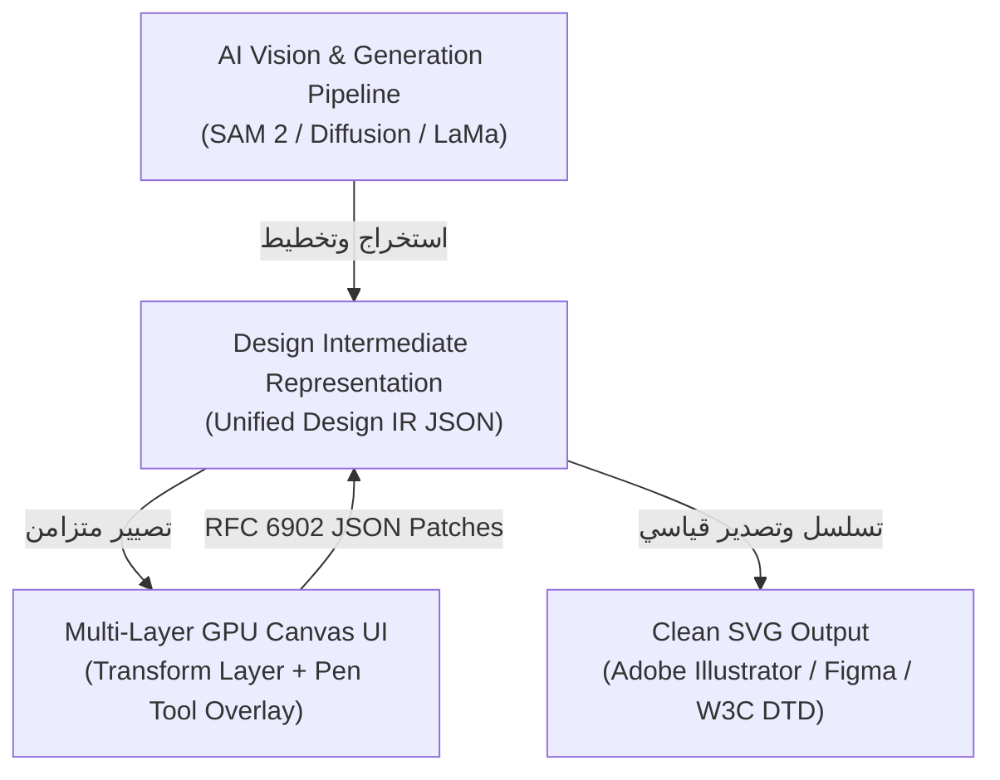

<!-- DOC_PROVENANCE
{"created_at_utc": "2026-10-17T07:51:42Z", "last_action": "EDITED", "last_change_id": "TASK-P0-DEBATE-REV-01", "last_edited_at_utc": "2026-10-17T08:16:25Z", "last_editor": "orchestrator-planner", "tracking_started_at_utc": "2026-10-17T07:51:42Z"}
END_DOC_PROVENANCE -->
# مقترح ومواصفات تمثيل التصميم الداخلي الموحد (`docs/architecture/DESIGN_IR_PROPOSAL.md`)

**حالة الاعتماد المعمارية (`Architecture Approval Status`):** `NOT_APPROVED` (`PROPOSED_FOR_OWNER_REVIEW`)  
**المرحلة:** `PHASE_P0_ARCHITECTURE_RESEARCH_AND_DESIGN_REVIEW`  
**المرجع:** [docs/product/OWNER_ORIGINAL_VISION.md](../product/OWNER_ORIGINAL_VISION.md)  
**الأهمية المعمارية:** هذا التمثيل هو حجر الزاوية الهندسي (`The Core Invariant`) الذي يربط بين جميع أوضاع النظام، ويفصل بين نماذج الرؤية/التوليد ومحرك الـ SVG وواجهة الكانفاس.

---

## 1. الفلسفة والدور المحوري للـ Design IR

في أنظمة الجرافيك الذكية، لا يجوز الاعتماد على كود الـ SVG الخام أو كود HTML Canvas كمصدر وحيد للحقيقة (`Source of Truth`)؛ لأن الـ SVG بطبيعته تنسيق عرض مسطح لا يفهم بالضرورة النوايا الدلالية للتصميم (مثل: "هذه حبة بطاطس وهذا ظلها"، أو "هذا الجزء من العيش محجوب مؤقتاً بالبطاطس").

يقوم **Design Intermediate Representation (Design IR)** بدور شجرة الـ DOM الهندسية الدلالية للنظام:
- يمثل كيانات التصميم وخصائصها المجردة قبل تصييرها لأي منصة.
- يضمن بقاء الكيانات المنفصلة معزولة حتى لو تماثلت ألوانها.
- يحفظ العلاقات الهرمية (الكيان، قاعدته، ظله، لمعانه) دون تسطيح.
- يدعم المسارات المركبة ذات التجاويف (`Compound Paths with Holes`) عبر قاعدة `fill-rule="evenodd"`.
- يدعم مسارات القص غير التدميرية (`Non-Destructive <clipPath>`) لاحتواء الظلال والنسيج الداخلي دون تفتيت الفيكتور.
- يوفر جسراً ثنائي الاتجاه بين:
  1. مخرجات نماذج الرؤية والتوليد (الـ AI Pipeline).
  2. شجرة الكانفاس التفاعلي في المتصفح (`React Multi-Layer GPU Canvas`).
  3. محرك التصدير لملفات الـ Clean SVG المتوافقة مع Adobe Illustrator وFigma.



---

## 2. بنية ومخطط الـ Design IR الشامل (`Schema Specification`)

يُعرّف الـ Design IR هيكل شجرة مستند التصميم عبر المكونات الأساسية التالية:

### 2.1. لوحة العمل والأبعاد العامة (`Artboard & Global Canvas`)
- يدعم المحرك تصيير الدقة التفاعلية بدقة 150 DPI ودقة الطباعة الاحترافية بدقة 300 DPI:
```json
{
  "ir_version": "1.1.0",
  "document_id": "doc_20261017_001",
  "title": "Potato Sandwich Clean Design",
  "artboard": {
    "width": 1024,
    "height": 1024,
    "coordinate_space": "ABSOLUTE_PIXEL",
    "background_color": "#FFFFFF",
    "dpi": 300,
    "interactive_dpi": 150,
    "units": "px"
  }
}
```

### 2.2. الكيانات الدلالية والمجموعات الهرمية ومسارات القص (`Semantic Object Groups & ClipPaths`)
- **قاعدة منع التسطيح (`Non-Flattening Invariant`):** الكيان الواحد لا يُضغط في مسار واحد هجين، بل يُحفظ كمجموعة `<g>` تضم عناصره الفرعية مع مسار قص غير تدميري لحصر الظلال:
```json
{
  "node_type": "GROUP",
  "id": "grp_potato_01",
  "semantic_label": "Potato",
  "localized_labels": {
    "ar": "بطاطس",
    "en": "Potato"
  },
  "entity_class": "food_item",
  "transform": {
    "matrix": [1, 0, 0, 1, 0, 0]
  },
  "z_index": 20,
  "clip_path_ref": "clip_potato_01_base",
  "children": [
    {
      "node_type": "PATH",
      "id": "potato_01_base",
      "role": "BASE_GEOMETRY",
      "fill_rule": "nonzero",
      "is_clip_source": true,
      "segments": [
        { "point": [200.0, 420.0], "handle_in": [190.0, 400.0], "handle_out": [215.0, 380.0], "point_type": "SMOOTH" }
      ],
      "d_svg_cached": "M 200.0 420.0 C 215.0 380.0 290.0 385.0 315.0 425.0 Z",
      "fill": { "type": "SOLID", "color": "#E5A93C", "opacity": 1.0 },
      "stroke": null
    },
    {
      "node_type": "PATH",
      "id": "potato_01_shadow",
      "role": "SHADOW",
      "clipped_by": "clip_potato_01_base",
      "fill_rule": "nonzero",
      "fill": { "type": "SOLID", "color": "#8A5A1A", "opacity": 0.65 },
      "stroke": null
    },
    {
      "node_type": "PATH",
      "id": "potato_01_highlight",
      "role": "HIGHLIGHT",
      "clipped_by": "clip_potato_01_base",
      "fill_rule": "nonzero",
      "fill": { "type": "SOLID", "color": "#FFD97D", "opacity": 0.8 },
      "stroke": null
    }
  ]
}
```

### 2.3. تمثيل المسارات الهندسية والمسارات المركبة المفرغة (`Compound Paths & Holes`)
- الحقل المرجعي الحاكم لنقاط المنحنى هو `segments`، بينما يعتبر `d_svg_cached` حقلاً مشتقاً ومخزناً مؤقتاً للتصيير السريع:
- لدعم الأجسام ذات التجاويف (مثل حلقة الدونات، أو تجويف الفلافل، أو ثقوب الحروف العربية كالميم والعين)، يُحدد خيار `fill_rule="evenodd"`:
```json
{
  "node_type": "COMPOUND_PATH",
  "id": "falafel_01_body",
  "closed": true,
  "fill_rule": "evenodd",
  "anchor_nodes_count": 28,
  "subpaths": [
    {
      "subpath_role": "OUTER_BOUNDARY",
      "segments": [
        { "point": [100.0, 150.0], "handle_in": [95.0, 120.0], "handle_out": [105.0, 180.0], "point_type": "SMOOTH" }
      ]
    },
    {
      "subpath_role": "INNER_HOLE",
      "segments": [
        { "point": [120.0, 150.0], "handle_in": [118.0, 140.0], "handle_out": [122.0, 160.0], "point_type": "SMOOTH" }
      ]
    }
  ],
  "d_svg_cached": "M 100 150 C 105 180 ... Z M 120 150 C 122 160 ... Z"
}
```

### 2.4. التدرجات اللونية والظلال والإضاءة (`Gradients & Shading`)
- دعم التدرجات الخطية والشعاعية كعناصر مستقلة في معجم الأنماط دون الاعتماد على SVG 2 mesh gradients غير المتوافقة:
```json
{
  "gradients": {
    "grad_silver_shield": {
      "type": "LINEAR",
      "start": [0.0, 0.0],
      "end": [1.0, 1.0],
      "stops": [
        { "offset": 0.0, "color": "#D4D8DD", "opacity": 1.0 },
        { "offset": 0.5, "color": "#FFFFFF", "opacity": 1.0 },
        { "offset": 1.0, "color": "#9AA0A6", "opacity": 1.0 }
      ]
    }
  }
}
```

### 2.5. الهندسة المخفية وتتبع الأجزاء المحجوبة (`Occluded / Amodal Geometry`)
- لتنفيذ `OV-08` وتجنب ثقوب الطبقات السفلية عند إخفاء ما يعلوها:
```json
{
  "node_type": "GROUP",
  "id": "grp_bread_bottom",
  "semantic_label": "Bread",
  "z_index": 10,
  "amodal_completion": {
    "is_partially_occluded": true,
    "occluded_by": ["grp_potato_01"],
    "reconstruction_method": "AMODAL_GEOMETRY_FIRST",
    "reconstruction_confidence": 0.94,
    "complete_boundary_d": "M 150 400 C 250 350 400 360 ... Z",
    "visible_boundary_d": "M 150 400 C ... Z"
  }
}
```

### 2.6. التايبوجرافي وهوية الخط وحماية التشكيل (`Typography & Diacritic Shield`)
- لتنفيذ `OV-10` ودعم المسارين (رسم فيكتور كاليجرافي مطابق أو نص حي مع هوية الخط):
```json
{
  "node_type": "TYPOGRAPHY",
  "id": "text_brand_title",
  "text_content": "شاورما وبطاطس",
  "language": "ar",
  "script": "Arabic",
  "mode": "EXACT_BEZIER_TRACING",
  "diacritic_shield_enabled": true,
  "protected_subpaths_count": 6,
  "font_matching": {
    "matched_font_family": "Cairo",
    "font_source": "GOOGLE_FONTS",
    "match_confidence": 0.89,
    "exact_vector_fallback_available": true
  },
  "font_style_dna": {
    "weight": 700,
    "italic": false,
    "stroke_width_ratio": 0.12,
    "curvature_index": 0.74,
    "corner_treatment": "ROUNDED",
    "primary_color": "#D9381E",
    "shadow_offset": [2.0, 3.5],
    "shadow_color": "#4A1005"
  }
}
```

### 2.7. إدارة حالة التعديل وعقود الحيازة (`Document State & Edit Leases`)
- تم فصل سجل العمليات (Undo/Redo History) عن كيان الـ Domain ليبقى كائناً نقياً (`Pure Current State`).
- يُدار التراجع والتعديل عبر نمط الـ Command Pattern وفروق **RFC 6902 JSON Patch** على مستوى جلسة العمل:
```json
{
  "state_metadata": {
    "revision_id": 4,
    "active_leases": [
      {
        "layer_id": "grp_potato_01",
        "session_id": "sess_user_alpha",
        "leased_at": "2026-10-17T08:15:00Z",
        "expires_at": "2026-10-17T08:16:00Z"
      }
    ]
  }
}
```

---

## 3. حل معضلات التصميم الجوهري في الرؤية عبر الـ Design IR

### أولاً: كيف تظل العناصر غير المترابطة منفصلة عند تماثل الألوان؟
- **المشكلة في الـ Vectorization التقليدي:** إذا لامست قطعة بطاطس صفراء حافة خبز مائل للصفرة، تدمجهما أدوات التتبع في مضلع واحد مشوه (`OV-07`).
- **الحل في الـ Design IR:**
  - كل عنصر له **معرف قناع دلالي (`Semantic Mask UUID`)** مستقل يتم استخلاصه في مرحلة SAM 2 قبل أي عملية تتبع مسارات.
  - حتى لو كانت قيمة اللون `#E8A838` متطابقة تماماً في البكسلين المتجاورين، فإن البكسل (x1, y1) مسجل لمجموعة `grp_potato_01` والبكسل (x2, y2) مسجل لمجموعة `grp_bread_bottom`.
  - الخوارزمية تبني مسارات الفيكتور داخل نطاق القناع الدلالي المخصص فقط، مما يمنع انتقال أي مسار عبر الحدود المشتركة نهائياً.

### ثانياً: كيف تتجمع المكونات المرئية في مجموعة واحدة مفيدة دون تسطيح التصميم؟
- **المشكلة في الـ Auto-Trace:** إما أن يُسطح الكيان وظله ولمعانه في طبقة واحدة ميتة يستحيل فصلها، أو تُرمى مئات المسارات العشوائية في جذر الملف دون أي تجميع.
- **الحل في الـ Design IR:**
  - يعتمد الـ IR على نمط **الشجرة الهرمية الدلالية (`Semantic Grouping Composite Pattern`)**:
    - المجموعة الأب تمثل الكيان الكلي (`id="Potato"`).
    - الأبناء يمثلون الأدوار الضوئية والتشريحية للكيان (`Base`, `Shadow`, `Highlight`, `Texture`).
    - مسار القص غير التدميري `<clipPath>` يحتوي الظلال داخل حدود الشكل الأساسي دون الحاجة إلى عمليات قطع بولياني تشوه المسارات.
  - عند التصدير للـ SVG، يُترجم هذا التمثيل مباشرة إلى وسم `<g id="Potato" data-label="بطاطس">` يضم الأبناء مع مسار القص، ليفتحها المصمم في Adobe Illustrator ويجد طبقة واحدة باسم "بطاطس" وعند فتحها يجد مسار الشكل ومسار الظل ومسار اللمعان جاهزة للتعديل المستقل بالـ Pen Tool.

---

## 4. آليات التحقق والتحويل والتوافق العكسي (`Validation, Serialization & Compatibility`)

1. **التحقق من المخطط (`Strict Schema Validation`):**
   - يُعرّف الـ IR بـ JSON Schema صارم ويُطابق برمجياً عبر نماذج Pydantic v2 في Python، وواجهات TypeScript الصارمة في واجهة الكانفاس.
   - أي تكرار لمعرّفات الكائنات أو خروج للإحداثيات عن حدود لوحة العمل يرفضه المحرك فوراً قبل التصيير (`Deterministic Pre-render Validation`).
2. **التسلسل والتخزين (`Serialization`):**
   - يُحفظ المستند كملف JSON قياسي ومضغوط، أو يُضمّن داخل وسم مخصص للبيانات الوصفية في ملف الـ SVG الناتج:
     ```xml
     <svg xmlns="http://www.w3.org/2000/svg" viewBox="0 0 1024 1024">
       <metadata id="ai-graphic-designer-metadata">
         <!-- serialized Design IR JSON here for lossless re-editing -->
       </metadata>
       <!-- clean SVG elements here -->
     </svg>
     ```
   - هذا يضمن أنه عند إعادة فتح ملف الـ SVG في نظامنا مستقبلاً، يُستعاد الـ Design IR الكامل فوراً بدقة 100% دون الحاجة لإعادة تحليل الرؤية من الصفر!
3. **التوافق العكسي (`Backward Compatibility`):**
   - يتضمن كل تمثيل حقل `ir_version`. إذا طرأت ترقية مستقبلية لهيكل الـ IR، يوفر النظام دوال هجرة تلقائية (`Schema Migration Adapters: v1.0.0 -> v1.1.0`).
