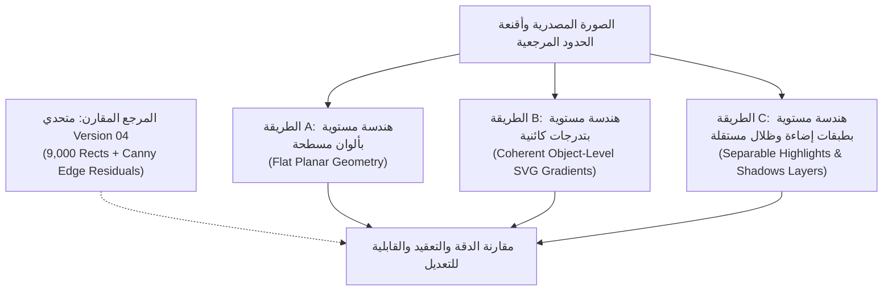

<!-- DOC_PROVENANCE
{"created_at_utc": "2026-10-18T01:07:23Z", "last_action": "CREATED", "last_change_id": "TASK-V04-V09-CORRECTION-01", "last_edited_at_utc": "2026-10-18T01:07:23Z", "last_editor": "orchestrator-planner", "tracking_started_at_utc": "2026-10-18T01:07:23Z"}
END_DOC_PROVENANCE -->
# وثيقة المواصفات التجريبية المقترحة: تجربة المظهر المستوي المنضبط (`EXP-PLANAR-APPEARANCE-01`)

> [!CAUTION]
> **حالة الاعتماد والتنفيذ (`Approval & Execution Gate`):**
> **هذه الوثيقة مقترح بحثي تجريبي فقط (`PROPOSED_RESEARCH_SPECIFICATION — NOT_APPROVED`).**  
> **يُحظر تماماً بدء تنفيذ هذه التجربة أو كتابة كودها البرمجي قبل المراجعة والاعتماد الصريح والموثق من المالك.**  
> **حالة المعمارية الشاملة للمشروع لا تزال strictly:** `NOT_APPROVED` (`PROPOSED_FOR_OWNER_REVIEW`).

---

## 1. السؤال العلمي والفرضيات البحثية (`Scientific Question & Hypotheses`)

### السؤال العلمي المركزي:
> *كيف يمكن تمثيل المظهر البصري المستمر (Continuous Appearance: التدرجات الناعمة، الانعكاسات المعدنية، والظلال واللمعان) فوق حدود هندسية مستوية مغلقة ونظيفة دون الوقوع في الفسيفساء الشبكية المفتتة (مثل V04: 9,000 مستطيل) ودون انفجار تعقيد العقد أو تشويه الحدود (مثل V09-m4: 14,497 منحنى)؟*

### الفرضيات الخاضعة للاختبار (`Empirical Hypotheses`):
- **الفرضية H1 (التمثيل الطبقي للمظهر):** فصل الكائن إلى هيكل أساسي نظيف محكوم الحواف (`Base Planar Geometry`) تعلوه طبقات تدرج وظلال وإضاءة مستقلة (`Independent Shading/Highlight Layers`) يحقق دقة بصرية تضاهي V04 ($\text{PSNR} \ge 29.0\text{ dB}$ على $A01$) مع خفض عدد عناصر الـ DOM بنسبة $> 95\%$ مقارنة بـ V04.
- **الفرضية H2 (التدرج الكائني بـ SVD):** تطبيق انحدار SVD الخطي المستعار من V04 على مصفوفة بكسلات الكائن الدلالي بالكامل يولد تدرجات SVG متصلة ($C^\infty$) دون أي شروخ شبكية وبحجم ملف يقل عن $40\text{ KiB}$.
- **الفرضية H3 (القابلية للتعديل):** تمثيل الظلال واللمعان كمسارات متجهة مستقلة يتيح للمصمم تعديل الألوان أو إخفاء الظل بنقرة واحدة في Illustrator دون الإخلال بطوبولوجيا الشكل الأساسي.

---

## 2. الطرق الثلاث المتنافسة والمرجع المقارن (`Competing Approaches & Reference`)

سيتم اختبار ومقارنة 3 بدائل هندسية متنافسة مقيدة بحدود الكائنات المعلومة:

### تفصيل الطرق:
1. **الطريقة A (Planar Geometry with Flat Colors):**
   - استخراج الوجوه المستوية للحدود المشتركة بـ `DualGridPlanarTracer`.
   - تلوين كل منطقة مستوية بلونها المتوسط الثابت ($\text{RGB} / \text{CIELAB}$).
   - تمثل خط الأساس الهندسي الصلب (خالٍ من التدرجات تماماً).
2. **الطريقة B (Planar Geometry with Coherent Object-Level SVG Gradients):**
   - استخدام نفس الحدود المستوية النظيفة للطريقة A.
   - حساب زاوية التدرج ومحطات الألوان عبر تطبيق انحدار SVD الخطي للصور التكاملية ($O(1)$) على كامل بكسلات الوجه/الكائن.
   - توليد وسوم `<linearGradient>` حقيقية تعبئ المسار.
3. **الطريقة C (Planar Geometry with Editable, Independently Represented Highlights & Shadows):**
   - رسم الكائن الأساسي بلونه الجوهري (`Albedo / Base Color`).
   - استخلاص مكونات الإضاءة عبر التفكيك الضوئي الجوهري (`Intrinsic Image Decomposition`).
   - تحويل مناطق اللمعان (`Highlights`) والظلال (`Shadows`) إلى مسارات فيكتور ناعمة مستقلة ذات شفافية وخصائص مزج (`mix-blend-mode: multiply / screen`).
4. **المرجع المقارن (`Comparison Reference`):**
   - استخدام مخرجات متحدي Version 04 كمرجع مقارن للدقة البصرية الإحصائية (المعيار الذهبي للأرقام: $30.87\text{ dB}$ على $A01$).

---

## 3. الأصول الاختبارية والأرضية المرجعية الحقيقية (`Test Assets & Ground Truth`)

### أ. المرحلة 1: الأشكال الاصطناعية المعلومة هندسياً (Ground Truth Shapes):
لضمان العزل التام للمظهر عن أخطاء التجزئة، تبدأ التجربة على الأصول الاصطناعية الأربعة ذات المعالم الرياضية الدقيقة:
- **`S01_flat_red`:** دائرة حمراء مسطحة على خلفية رمادية (اختبار دقة الحواف والحدود المشتركة).
- **`S02_smooth_red_sphere`:** كرة ثلاثية الأبعاد بتظليل ناعم ونقطة لمعان ساطعة (اختبار انحناءات التظليل ثلاثي الأبعاد).
- **`S03_metallic_gold`:** شارة معدنية بتدرج متعدد الترددات وانعكاسات قطارية حادة بزاوية 135° (اختبار بريق الذهب).
- **`S04_transparency`:** قرص زجاجي نصف شفاف فوق رقعة شطرنج عالية التباين (اختبار شفافية الطبقات).

### ب. المرحلة 2: درع الانحدار الحقيقي (`A01_shield`):
- درع الشعار الذهبي ($369 \times 249$ بكسل) مع كونتورات معلومة ومحطات انعكاس معدني.

### ج. المرحلة 3: التوسع المشروط على الصور الـ 12 (`Conditional 12-Image Extension`):
- إذا نجحت المرحلة 1 و 2 في تحقيق معايير القبول، تُمدد التجربة للصور الـ 12 ذات الصلة (خاصة الشعارات والأطعمة ذات التدرجات مثل A02 و A03 و A10).

---

## 4. مصفوفة المقاييس المعتمدة (`Evaluation Metrics Matrix`)

### أ. مقاييس الدقة البصرية (`Visual Fidelity`):
- **PSNR (dB):** نسبة الإشارة للضوضاء (الهدف: $\ge 29.0\text{ dB}$ على A01).
- **MSE:** متوسط مربع الخطأ الإحصائي (الهدف: $\le 75.0$ على A01).
- **SSIM:** التشابه الهيكلي (الهدف: $\ge 0.90$).

### ب. مقاييس سلامة الحدود والهيكل (`Boundary & Silhouette Integrity`):
- **تسريب الهيكل الخارجي (`Silhouette Bloat Pixels`):** عدد بكسلات الإطار الزائدة (الهدف: **0 بكسل** / $0.000\%$).
- **تقاطع الهيكل (`Silhouette IoU`):** مقياس التطابق المساحي (الهدف: **$1.0000$**).
- **دقة الحواف Canny (`Canny F1-Score`):** مقياس استرجاع الحواف الدقيقة عند 1 بكسل.

### ج. مقاييس التعقيد الهندسي الحقيقي (`Geometric Complexity`):
- **عدد المسارات المركبة (`Compound Path Count`):** (الهدف: $\le 30$ مساراً لـ A01).
- **عدد العقد الكلي (`Total Node Count`):** (الهدف: $\le 1,500$ عقدة لـ A01).
- **أوامر بيزييه المكعبة (`C` commands):** حصر المنحنيات الحقيقية.
- **حجم ملف الـ SVG:** (الهدف: $\le 45\text{ KiB}$ لـ A01، مقارنة بـ 911 KiB لـ V04 و 1,016 KiB لـ V09-m4).

### د. مقاييس القابلية للتعديل الاحترافي (`Professional Editability`):
- **فحص مقابض التوجيه (Tangent Handles):** التأكد من أن كل نقطة تحكم تخضع لشرط الاستمرارية $C^1$ وطول المقبض $\le \frac{1}{3}$ الوتر.
- **فحص العزل الكائني (Layer Isolation):** القدرة على تحديد ونقل عنصر الإضاءة أو تغيير لونه دون تشويه حدود الكائن الأساسي.
- **خلو الـ DOM من التسمم:** عدد عناصر الملف الكلية $\le 50$ عنصراً.

### هـ. مقاييس الأداء والتيليميتري على لابتوب المالك (`Laptop Telemetry`):
- **زمن المعالجة المحلي (`Generation Latency`):** $\le 400\text{ ms}$ على المعالج المركزي (CPU).
- **استهلاك الذاكرة العشوائية (`Peak RSS RAM`):** $\le 120\text{ MB}$.
- **استهلاك كارت الشاشة (`VRAM`):** **0 MB** (لا يتطلب أي GPU).

---

## 5. شروط الفشل، التراجع، والمسارات البديلة (`Failure Criteria & Contingency`)

### شروط فشل التجربة (`Failure Criteria`):
1. عجز الطريقتين B و C عن تجاوز $\text{PSNR} = 26.0\text{ dB}$ على درع A01.
2. تجاوز حجم ملف SVG الناتج حاجز $100\text{ KiB}$ أو تجاوز عدد العقد $3,000$ عقدة لدرع A01.
3. حدوث تسريب في الهيكل الخارجي يتجاوز $0.1\%$ ($> 88$ بكسلاً).
4. عدم استقرار زوايا التدرج في الطريقة B وظهور شروخ لونية حادة تفوق الطريقة A.

### استراتيجية التراجع والبدائل (`Rollback & Next Steps`):
- في حال فشل التجربة:
  1. الإبقاء على كود ومخرجات التجربة كأثر بحثي محفوظ ومفهرس دون أي تغيير في الفروع الرئيسية.
  2. الرجوع إلى خيار **التمثيل الهجين المنضبط (Adaptive Hybrid Representation)** الذي ينص عليه مقترح الفيكتور النظيف (عزل العناصر المعقدة كراستر عالي الدقة محكوم بقناع فيكتور، وتحويل العناصر الهندسية والشعارات لفيكتور نقي).
  3. حظر أي ادعاء غير مثبت، وعرض النتائج بأمانة على المالك لاتخاذ القرار.
