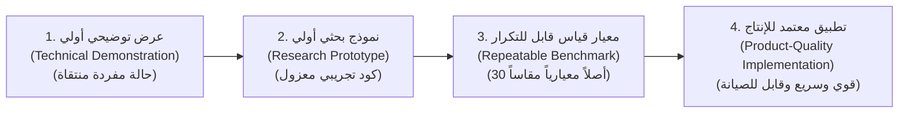

<!-- DOC_PROVENANCE
{"created_at_utc": "2026-10-17T07:54:17Z", "last_action": "EDITED", "last_change_id": "TASK-P0-DEBATE-REV-01", "last_edited_at_utc": "2026-10-17T08:17:43Z", "last_editor": "orchestrator-planner", "tracking_started_at_utc": "2026-10-17T07:54:17Z"}
END_DOC_PROVENANCE -->
# خطة أبحاث وتجارب الجدوى وبوابات التحقق الكمي (`docs/architecture/FEASIBILITY_RESEARCH_PLAN.md`)

**حالة الاعتماد المعمارية (`Architecture Approval Status`):** `NOT_APPROVED` (`PROPOSED_FOR_OWNER_REVIEW`)  
**المرحلة:** `PHASE_P0_ARCHITECTURE_RESEARCH_AND_DESIGN_REVIEW`  
**المرجع:** [docs/product/OWNER_ORIGINAL_VISION.md](../product/OWNER_ORIGINAL_VISION.md) و[docs/architecture/FEASIBILITY_EXPERIMENTS_AND_GATES.md](FEASIBILITY_EXPERIMENTS_AND_GATES.md)  
**القاعدة الحاكمة:** حظر ادعاء الجدوى أو إعلان النجاح دون تجارب مقاسة بأدلة موثقة، والتمييز الصارم بين العرض التوضيحي البسيط والتطبيق عالي الجودة للإنتاج، وتوحيد أصول الاختبار القياسية ومقاييس التقييم المعيارية.

---

## 1. التمييز المنهجي الرباعي لمستويات النضج التقني

لمنع الخلط الشائع في مشاريع الذكاء الاصطناعي بين تجربة تعمل على صورة واحدة وتطبيق جاهز للمستخدمين، نعرّف أربعة مستويات نضج هندسية:

1. **المستوى 1: العرض التوضيحي (Technical Demonstration):** كود يعمل على صورة واحدة أو اثنتين في ظروف مثالية (مثل رسم دائرة ومثلث)، ولا يثبت صلاحية النظام للتصاميم الحقيقية.
2. **المستوى 2: النموذج البحثي (Research Prototype):** سكريبت معزول يختبر خوارزمية محددة على حالات متعددة ويوثق متى تنجح ومتى تفشل.
3. **المستوى 3: معيار القياس القابل للتكرار (Repeatable Benchmark):** بيئة اختبار معيارية بأصول قياسية موحدة (`A01–A04`) وموسعة إلى 30 أصلاً متنوعاً ومقاييس حتمية مبرمجة ومفتوحة للتدقيق المستقل.
4. **المستوى 4: التطبيق المعتمد للإنتاج (Product-Quality Implementation):** موديول متكامل يتعامل مع الصور المشوهة، والألوان الصعبة، والنصوص العربية المعقدة، ويصدر كود Clean SVG متوافقاً مع برامج التصميم في زمن استجابة مقبول ومحمي أمنياً.

---

## 2. جدول الأصول المعيارية الذهبية الموحدة (`Gold Standard Test Assets A01–A04 & 30-Asset Suite`)

لتوحيد لغة التخاطب بين كافة التخصصات والوثائق ومنع أي تضارب في المسميات:

| رمز الأصل | اسم الأصل المعتمد | نوع التحدي والتصميم | متطلب الرؤية الأصلية | التحدي الهندسي الجوهري |
| :--- | :--- | :--- | :--- | :--- |
| **`A01`** | **الدرع والشعار الهندسي (`The Knight's Shield / Crest`)** | أشكال هندسية حادة، لمعان معدني، تدرجات شعاعية وخطية منتظمة | `OV-02` (الدرع وتوليد الطبقات) | تماثل المنحنيات، دقة نقاط التماس، ونقاء التدرجات دون انكسار لوني (`Color Banding`). |
| **`A02`** | **قرص الفلافل المقرمش (`The Crispy Falafel Disc`)** | نسيج غذائي عضوي خشن، بعد فركتلي مرتفع، ظلال متراكبة متعرجة | `OV-05` (قوام الفلافل والظل والضوء) | احتواء النسيج بـ `<clipPath>` دون تجاوز سقف 36 عقدة ودون تفتيته لآلاف الشظايا. |
| **`A03`** | **ساندوتش البطاطس والخبز (`The Potato & Bread Sandwich`)** | عناصر متماسة متطابقة اللون (أصفر/بيج) مع حجب جزئي (Occlusion) | `OV-06`, `OV-07`, `OV-08` | منع نزيف البكسلات بين البطاطس والعيش، واستكمال العيش المحجوب بهندسة C2 دون ثقوب. |
| **`A04`** | **الشعار والخط العربي المركب (`Arabic Calligraphic Typography`)** | كاليجرافي عربي حر، حروف متداخلة، نقاط تشكيل وهمزات منفصلة | `OV-10` (التايبوجرافي وهوية الخط) | حماية نقاط التشكيل (`Diacritic Shield`)، ورسم المنحنيات المتجهية المطابقة 100% (المسار أ). |

> **توسعة معيار القياس (Benchmark Expansion):** بالإضافة إلى الأصول الأربعة الذهبية، تشتمل حزمة القياس على **30 صورة مرجعية متنوعة** (10 شعارات هندسية، 10 أطعمة معقدة، 5 شارات مركبة، 5 مخطوطات كاليجرافي عربية) لضمان عدم تخصيص الخوارزميات على عينات محدودة (Anti-Overfitting).

---

## 3. النقد والتقييم العلمي للعتبات وتصحيح المقاييس (`Scientific Metric Calibration`)

تصحح هذه الخطة المقاييس الرياضية السابقة استناداً إلى نتائج المناظرة الهندسية:

1. **استبدال الـ Global IoU بـ Trimap Boundary IoU (8px band):**
   - *السبب العلمي:* الـ Global IoU خادع؛ لأن مساحة الجسم الكبيرة (مثل جسم الخبز) قد تعطي IoU يتجاوز 95% حتى لو نزفت حواف البطاطس بالكامل في الخبز!
   - *المقياس المعتمد:* قياس `Boundary IoU` ضمن شريط محيطي بعرض `8px` حول خط التماس، بشرط أن يتجاوز `>= 0.82`.
2. **استبدال الـ Pixel SSIM بـ LPIPS للمظهر البصري:**
   - *السبب العلمي:* الـ SSIM يعاقب الإزاحات الدقيقة للبكسلات حتى لو كان المظهر البصري متطابقاً ممتازاً، بينما يتغاضى عن تشوهات المنحنيات الهندسية.
   - *المقياس المعتمد:* استخدام مقياس الإدراك الحسي `LPIPS <= 0.12` بجانب فحص النقاء الطوبولوجي.
3. **تصحيح مقاييس الاستكمال المحجوب (Amodal Inpainting Metrics):**
   - *السبب العلمي:* مقياس PSNR لا معنى له في المناطق المحجوبة؛ لأن البكسلات الأصلية غير موجودة أصلاً للمقارنة بها!
   - *المقياس المعتمد:* استمرارية انحناء الحافة الخارجية (`Curvature Continuity C1 / G1`) مع فحص انعدام الثقوب (`Zero Hollow Pixels`).

---

## 4. قائمة تجارب الجدوى العشر الإلزامية (`Ten Feasibility Experiments EXP-01..07 & SEC/PERF/CONC`)

> **تنبيه صارم:** لا يجوز تنفيذ هذه التجارب أو استدعاء أي نموذج ذكاء اصطناعي مدفوع أو تشغيل GPU إلا بعد الحصول على اعتماد صريح وموثق من المالك لهذه الخطة.

### 4.1. تجربة `EXP-01`: الفصل الدلالي المانع لنزيف البكسلات (`Anti-Bleeding Semantic Segmentation`)
- **الهدف:** إثبات إمكانية فصل عنصرين متجاورين متقاربين في اللون (البطاطس صفراء والعيش بيج في `A03`) دون انتقال بكسلات أحدهما للآخر.
- **الحقيقة الأرضية (`Ground Truth`):** أقنعة بكسل مرسومة يدوياً بدقة فائقة من فنان بشري.
- **المقاييس وعتبات النجاح:** `Trimap Boundary IoU (8px) >= 0.84` و`Cross-Entity Bleed <= 1.5%`.
- **خطة الفشل:** تطبيق معالجة مورفولوجية تسبق استخراج المسار (`Morphological Watershed Boundary Refinement`).

### 4.2. تجربة `EXP-02`: توليد الـ Clean SVG ومنع تشظي الفلافل وتجميع `<g>` (`Anti-Fragmentation Vectorization`)
- **الهدف:** تحويل قرص الفلافل `A02` وظل البطاطس `A03` إلى مسارات Bézier ناعمة محكومة بسقف العقد ومجمعة في `<g id="...">` مع مسارات القص `<clipPath>`.
- **المقاييس وعتبات النجاح:**
  - عدد الشظايا المجهرية (`Micro-shards < 16px²`): **صفر تماماً (0)**.
  - عدد نقاط التحكم: مسار الهيكل الأساسي `<= 36 عقدة`، رقع التظليل والنسيج `<= 24 عقدة`.
  - النقاء الطوبولوجي: `Zero Self-intersections` و`LPIPS <= 0.12`.
  - زمن المعالجة: `< 2.5s` للشكل الواحد على CPU.

### 4.3. تجربة `EXP-03`: استنتاج الـ Z-Order والاستكمال الهندسي أولاً (`Amodal Geometry-First Reconstruction`)
- **الهدف:** استنتاج الترتيب التراكبي للطبقات، واستقراء المسار الخارجي للخبز المحجوب كمنحنى بيزييه C2 أولاً، ثم ترميم النسيج بـ LaMa دون ترك ثقوب.
- **المقاييس وعتبات النجاح:**
  - دقة ترتيب الـ Z-order الزوجي: `>= 95%`.
  - انعدام الثقوب في الطبقة السفلية: `Zero Hollow Pixels`.
  - استمرارية وانسيابية حواف الشكل المستكمل: `C1 Continuity Angle Deviation < 5 degrees`.

### 4.4. تجربة `EXP-04`: حلقة المراجعة البصرية 50% شفافة (`50% Opacity Visual Critic Convergence`)
- **الهدف:** إثبات تقارب حلقة النقد البصري الآلية عبر تصيير الـ SVG بشفافية 50% وإرجاع مصفوفة التغذية الراجعة لإعادة ضبط المقابض تلقائياً.
- **المقاييس وعتبات النجاح:**
  - وصول التطابق إلى `Boundary IoU >= 0.82` خلال `<= 3` تكرارات.
  - شرط التوقف المبكر: التوقف الفوري إذا لم يتحسن التطابق بنسبة تتجاوز `2%` في الدورة الثانية.

### 4.5. تجربة `EXP-05`: التايبوجرافي والخط العربي وحماية التشكيل (`Smart Typography & Diacritic Shield`)
- **الهدف:** إثبات دقة التعرف على النصوص، وحماية نقاط الحروف والهمزات من الحذف، وتوليد مسارات فيكتور مطابقة 100% (المسار أ للشعار `A04`).
- **المقاييس وعتبات النجاح:**
  - نسبة الحفاظ على نقاط التشكيل والهمزات العربية: **100% دون فقد أي نقطة**.
  - دقة قراءة النص العربي: `Word Accuracy >= 95%`.
  - دقة الرسم المتجهي المطابق للشعار: `Boundary IoU >= 0.90`.

### 4.6. تجربة `EXP-06`: استعادة الخطوط الدقيقة والتنعيم تحت البكسلي (`Subpixel Anti-Aliasing & Thin Stroke Recovery`)
- **الهدف:** قياس قدرة المحرك على التقاط وتنعيم الخطوط المتجهة التي يقل سمكها عن 2 بكسل دون أن تختفي أو تتحول إلى كتل متقطعة.
- **معيار النجاح:** استعادة ما لا يقل عن `90%` من طول الخطوط الدقيقة بسماكة 1.5px.

### 4.7. تجربة `EXP-07`: كفاءة استهلاك ذاكرة كارت الشاشة والتقليص الكمي (`VRAM Footprint & Model Quantization`)
- **الهدف:** قياس استهلاك ذاكرة الـ GPU لنماذج SAM 2 وLaMa تحت تقنيات التكميم (`FP16` و`INT8`) للتحقق من إمكانية العمل الآمن داخل كارت 16GB VRAM دون OOM.
- **معيار النجاح:** تشغيل التجزئة والاستكمال في حدود `<= 11.5GB VRAM` مع الحفاظ على `IoU Degradation < 1.0%`.

### 4.8. تجربة `SEC-EXP-01`: فحص مناعة خادم الرسوميات ضد هجمات الـ SVG (`SVG Attack Resistance & Fuzzing`)
- **الهدف:** إخضاع محلل ومطهر الـ SVG (`defusedxml` و`DOMPurify`) لملفات خبيثة تتضمن Billion Laughs وQuadratic Entity Expansion وXSS payloads.
- **معيار النجاح:** حجب وتحييد 100% من الهجمات وزمن معالجة لا يتجاوز 100ms دون استهلاك الذاكرة.

### 4.9. تجربة `PERF-EXP-01`: قياس عزل العمليات والوقاية من التعليق (`Bézier ReDoS & GIL Isolation Benchmarking`)
- **الهدف:** حقن مضلعات عشوائية معقدة تحوي 50,000 نقطة لاختبار قدرة `ProcessPoolExecutor` على قطع العملية بعد `2.5s` مع بقاء الخادم الرئيسي مستجيباً بـ 60 FPS.
- **معيار النجاح:** استجابة خادم FastAPI خلال أقل من 10ms أثناء تشغيل الهجوم الحسابي في الخلفية.

### 4.10. تجربة `CONC-EXP-01`: محاكاة تعديل الطبقات المتزامن ومنع تضارب التعديل (`WebSocket Layer Concurrency Simulation`)
- **الهدف:** محاكاة جلستي عمل تحاولان تعديل نفس الطبقة والطبقات المجاورة بالتزامن عبر WebSockets للتحقق من فاعلية عقود الحيازة `Per-Layer Edit Leases` وفروق `RFC 6902`.
- **معيار النجاح:** قبول تعديل الحائز الشرعي ورفض التعديل المتضارب مع تحديث شجرة الـ IR بصفر أخطاء تكاملية.

---

## 5. مصفوفة التكاليف التقديرية للأبحاث والجدول الزمني

| التجربة | بيئة التشغيل المقترحة | ساعات الحوسبة التقديرية | التكلفة المالية المتوقعة |
| :--- | :--- | :--- | :--- |
| `EXP-01` إلى `EXP-05` (التجارب الأساسية) | Serverless GPU (Modal / RunPod) | 12 ساعة استدلال متقطع | 15$ - 25$ |
| `EXP-06` و`EXP-07` (الدقة والذاكرة) | Serverless GPU (RTX 4090 / A10G) | 6 ساعات استدلال | 8$ - 12$ |
| `SEC`, `PERF`, `CONC` (الأمان والتزامن) | Local CPU / Test Suite | صفر GPU (معالجة CPU محلية) | 0.0$ |
| **الإجمالي العام لحزمة التجارب العشر** | **حوسبة سحابية خادمة عند الطلب** | **حوالي 18–20 ساعة استدلال** | **أقل من 40$ إجمالاً** |

> **تأكيد الأمان الحوكمي:** لن يتم إنفاق أي سنت أو استدعاء أي سيرفر قبل موافقة المالك الصريحة على بدء مرحلة التجارب واعتماد هذه الخطة.
