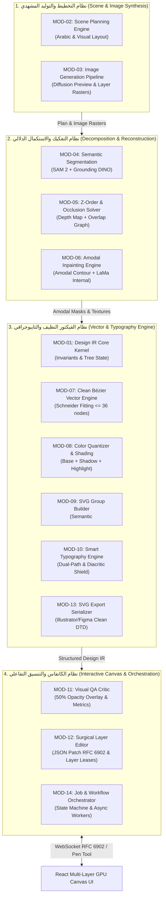

<!-- DOC_PROVENANCE
{"created_at_utc": "2026-10-17T07:52:11Z", "last_action": "EDITED", "last_change_id": "TASK-P0-DEBATE-REV-01", "last_edited_at_utc": "2026-10-17T08:15:43Z", "last_editor": "orchestrator-planner", "tracking_started_at_utc": "2026-10-17T07:52:11Z"}
END_DOC_PROVENANCE -->
# حدود الموديولات والعقود البرمجية للنظام (`docs/architecture/MODULE_BOUNDARIES_AND_CONTRACTS.md`)

**حالة الاعتماد المعمارية (`Architecture Approval Status`):** `NOT_APPROVED` (`PROPOSED_FOR_OWNER_REVIEW`)  
**المرحلة:** `PHASE_P0_ARCHITECTURE_RESEARCH_AND_DESIGN_REVIEW`  
**المرجع:** [docs/product/OWNER_ORIGINAL_VISION.md](../product/OWNER_ORIGINAL_VISION.md)  
**المبدأ الحاكم:** المعمارية النظيفة (Clean Architecture) والحدود المعيارية الصارمة (Strict Module Boundaries) بنمط Modular Monolith مدعوماً بعزل العمليات (Process Isolation) لتفادي قفل مفسر بايثون (GIL) وحماية الخادم من الإنهاك.

---

## 1. الطوبولوجيا المعمارية والأنظمة الفرعية الأربعة المحصورة (`4 Bounded Subsystems`)

لتحقيق متطلبات المشروع دون الوقوع في فخ الـ Microservices المبكرة المعقدة أو فخ الـ Spaghetti Monolith الهش، يقسم النظام إلى **4 أنظمة فرعية محصورة الحدود (Bounded Subsystems)** تعمل ضمن معمارية **Modular Monolith** مدعومة بنظام عزل عمليات (`Process Isolation`) للعمليات الحسابية الثقيلة:



### معمارية عزل العمليات وإدارة التزامن (`Process Isolation & Concurrency Architecture`):
1. **حماية خيط المعالجة الرئيسي وتجاوز قفل الـ GIL:**
   - الحسابات الهندسية الكثيفة (خوارزمية Schneider Bézier fitting، وعمليات الاتحاد البولياني بـ Shapely) تستهلك وحدة المعالجة المركزية (CPU-Bound).
   - تُعزل هذه العمليات إلزامياً داخل مجمع عمليات منفصل (`ProcessPoolExecutor`) مع سقف زمني صارم (`Hard Timeout = 2.5s`) لحماية خادم الـ API من التعليق أو هجمات حجب الخدمة عبر مدخلات مجهدة هندسياً.
2. **عزل استدلال نماذج الذكاء الاصطناعي:**
   - استدعاء نماذج التجزئة والتوليد والترميم (SAM 2, LaMa, Diffusion) يتم خارج مسار طلبات الـ HTTP المتزامن، إما عبر مجمع عمال خلفيين (`Async Task Workers`) أو عبر نقاط استدلال سحابية خادمة (`Serverless Container GPU: Modal / RunPod`).
3. **حماية التزامن ومنع سباق التعديل (Race Conditions):**
   - يدير النظام تعديلات الطبقات عبر نظام **عقود حيازة الطبقة المؤقتة (`Per-Layer Edit Leases`)**.
   - لا يجوز تعديل الطبقة ذاتها من جلستين متزامنتين، وتُنقل التعديلات بصيغة فروق JSON قياسية (`RFC 6902 JSON Patch`) لضمان عدم الكتابة فوق تعديلات طبقات أخرى.

---

## 2. تفكيك الموديولات الأربعة عشر وتوزيع المسؤوليات (`14 Core Modules`)

| كود الموديول | اسم الموديول (`Module Name`) | النظام الفرعي التابع له | المسؤولية الأساسية الوحيدة (`Single Responsibility`) | المدخلات (`Inputs`) | المخرجات (`Outputs`) |
| :--- | :--- | :--- | :--- | :--- | :--- |
| `MOD-01` | **Design IR Core Kernel** | Vector & Typography | تعريف كيانات الـ Scene Graph وقواعد التحقق الهندسي وإدارة حالة الشجرة غير القابلة للكسر. | أوامر تعديل أو بيانات شجرة خام | شجرة `DesignIRDocument` متحققة |
| `MOD-02` | **Scene Planning Engine** | Scene & Image Synthesis | تحليل نص الوصف واستخراج مخطط الطبقات والأبعاد والألوان ودعم العربية كخيار أصيل. | نص وصف المستخدم (Prompt) | `SceneGraphPlan` مهيكل |
| `MOD-03` | **Image Generation Pipeline** | Scene & Image Synthesis | توليد صورة المعاينة الكاملة المشروطة بالتخطيط لتوحيد الإضاءة، وتوليد أصول الرستر للطبقات. | `SceneGraphPlan` + موافقة العميل | صورة نقطية كاملة أو أصول طبقات |
| `MOD-04` | **Semantic Segmentation** | Decomposition & Reconstruction | استخراج أقنعة البكسل الدقيقة لكل كيان دلالي ومنع نزيف الألوان بين الكيانات المتماسة. | صورة نقطية + Bounding Boxes | قائمة `SemanticMasks` معزولة |
| `MOD-05` | **Z-Order & Occlusion Solver** | Decomposition & Reconstruction | استنتاج ترتيب الطبقات من الأسفل للأعلى وحساب مناطق التداخل والترتيب الطوبولوجي. | صورة نقطية + أقنعة العناصر | مصفوفة علاقات الـ `Z-Order Graph` |
| `MOD-06` | **Amodal Inpainting Engine** | Decomposition & Reconstruction | استكمال الأجزاء المخفية: استقراء المنحنى الهندسي أولاً (C2 Continuity) ثم ترميم النسيج بـ LaMa. | قناع الكيان المحجوب + الصورة | قناع وصورة الكيان المكتمل هندسياً |
| `MOD-07` | **Clean Bézier Vector Engine** | Vector & Typography | تحويل الأقنعة إلى مسارات Bézier ناعمة مع تقييد عدد النقاط (`<= 36` للهيكل، `<= 24` للرقع). | قناع دلالي معزول + معايير التسامح | قائمة مسارات `BézierPath` ناعمة |
| `MOD-08` | **Color Quantizer & Shading** | Vector & Typography | تقليص ألوان الكيان دلالياً وفصل القاعدة عن مسارات الظلال واللمعان في فضاء LAB. | صورة الطبقة المفردة + قناعها | ألوان القاعدة ومسارات الظل واللمعان |
| `MOD-09` | **SVG Group Builder** | Vector & Typography | تجميع مسار الكيان وظله المدمج في `<g id="...">` وربط مسارات القص غير التدميرية `<clipPath>`. | مسار القاعدة + مسار الظل + التسمية | كائن `GroupNode` مهيكل وجاهز |
| `MOD-10` | **Smart Typography Engine** | Vector & Typography | كشف النصوص، حماية التشكيل والنقاط (`Diacritic Shield`)، تتبع المسار المزدوج (A/B). | منطقة النص في الصورة + تفضيل العميل | مسار فيكتور مطابق أو نص حي `<text>` |
| `MOD-11` | **Visual QA Critic** | Interactive & Orchestration | تصيير الـ SVG بشفافية 50% فوق الأصل وحساب `Boundary IoU` و`LPIPS` وإرجاع خرائط الفروق. | صورة الأصل + مسار الـ SVG المولد | تقرير التطابق `VisualMatchReport` |
| `MOD-12` | **Surgical Layer Editor** | Interactive & Orchestration | تطبيق تعديلات المستخدم الجراحية على طبقة مستهدفة عبر `RFC 6902 JSON Patch` وتحديث الـ IR. | أمر التعديل + معرف الطبقة المستهدفة | شجرة `DesignIRDocument` معدلة |
| `MOD-13` | **SVG Export Serializer** | Vector & Typography | تصدير الـ Design IR إلى كود SVG قياسي نظيف متوافق مع Illustrator وFigma بنسبة 100%. | `DesignIRDocument` | ملف `clean_export.svg` |
| `MOD-14` | **Job & Workflow Orchestrator** | Interactive & Orchestration | إدارة حالات المهام وتنسيق بوابات موافقة العميل والعمال الخلفيين وعقود حيازة الطبقات. | طلب العميل والـ Webhook Events | حالة المهمة `JobStatusDTO` |

---

## 3. تعريف العقود والـ Interfaces البرمجية (`Data Contracts & Ports`)

تعتمد المعمارية نمط **Ports and Adapters (Hexagonal Architecture)**؛ حيث تعرّف طبقة الـ Application واجهات تجريد (`Protocols`) تطبقها طبقة الـ Infrastructure لضمان استبدال المزودين دون كسر النظام:

### 3.1. عقد مخطط المشهد (`IScenePlannerPort`)
```python
class IScenePlannerPort(Protocol):
    """Port for decomposing prompt text into a structured SceneGraph plan."""
    async def plan_scene_structure(
        self,
        prompt: str,
        canvas_width: int = 1024,
        canvas_height: int = 1024,
        language: str = "ar",
    ) -> SceneGraphPlanDTO:
        """Decompose user intent into explicit layers with bounding boxes and depth."""
        ...
```

### 3.2. عقد توليد الصور التخطيطية والطبقات (`IImageGeneratorPort`)
```python
class IImageGeneratorPort(Protocol):
    """Port for generating preview images and conditioned layer rasters."""
    async def generate_conditioned_image(
        self,
        prompt: str,
        layout_hints: dict[str, Any],
        negative_prompt: str = "",
        seed: int | None = None,
    ) -> bytes:
        """Generate a coherent reference image conditioned on the layout plan for lighting unity."""
        ...

    async def generate_layer_raster(
        self,
        layer_prompt: str,
        dimensions: tuple[int, int],
        conditioning_mask: bytes | None = None,
    ) -> bytes:
        """Generate an isolated single layer raster when direct per-layer generation is needed."""
        ...
```

### 3.3. عقد تجزئة الطبقات الدلالية (`ISemanticSegmentationPort`)
```python
class ISemanticSegmentationPort(Protocol):
    """Port for extracting pixel-precise semantic instance masks from a raster image."""
    async def extract_instance_masks(
        self,
        image_bytes: bytes,
        target_entities: list[str],
        confidence_threshold: float = 0.5,
    ) -> list[SemanticMaskDTO]:
        ...
```

### 3.4. عقد استنتاج الترتيب الرأسي والعمق (`IZOrderSolverPort`)
```python
class IZOrderSolverPort(Protocol):
    """Port for inferring depth relations and topological Z-order graph among layers."""
    async def solve_z_order_graph(
        self,
        image_bytes: bytes,
        masks: list[SemanticMaskDTO],
        depth_prior: np.ndarray | None = None,
    ) -> ZOrderGraphDTO:
        """Construct a directed acyclic graph (DAG) of occlusion dependencies."""
        ...
```

### 3.5. عقد إكمال الأجزاء المحجوبة (`IAmodalInpaintingPort`)
```python
class IAmodalInpaintingPort(Protocol):
    """Port for reconstructing hidden regions of an under-layer behind an occluding object."""
    async def inpaint_occluded_region(
        self,
        under_layer_image: bytes,
        occlusion_mask: bytes,
        boundary_contour_prior: list[tuple[float, float]] | None = None,
    ) -> bytes:
        """Complete texture within the extrapolated smooth geometric boundary."""
        ...
```

### 3.6. عقد محرك الفيكتور النظيف (`ICleanVectorEnginePort`)
```python
class ICleanVectorEnginePort(Protocol):
    """Port for turning a raster mask into clean cubic Bézier curves with minimal anchor nodes."""
    def trace_clean_bezier(
        self,
        binary_mask: np.ndarray,
        max_anchor_nodes: int = 36,
        tolerance_px: float = 1.5,
    ) -> list[BezierPathDTO]:
        """Convert binary mask contour into minimal C1-continuous cubic Bézier curves."""
        ...

    def consolidate_shadow_paths(
        self,
        shadow_paths: list[BezierPathDTO],
        base_geometry: BezierPathDTO,
    ) -> list[BezierPathDTO]:
        """Merge adjacent shadow patches and attach to non-destructive <clipPath>."""
        ...
```

### 3.7. عقد محرك التايبوجرافي والخط العربي (`ITypographyEnginePort`)
```python
class ITypographyEnginePort(Protocol):
    """Port for Arabic and multilingual text detection, classification, and vectorization."""
    async def detect_and_recognize_text(
        self,
        image_bytes: bytes,
        diacritic_protection_zone: bool = True,
    ) -> list[TextRegionDTO]:
        """Detect text regions and isolate bounding boxes protecting dots and harakat."""
        ...

    async def extract_typography_style(
        self,
        image_bytes: bytes,
        bbox: tuple[int, int, int, int],
    ) -> TypographyStyleDTO:
        """Extract dominant colors, stroke weight, and font visual attributes."""
        ...

    def trace_exact_glyphs(
        self,
        text_mask: np.ndarray,
        preserve_diacritics: bool = True,
    ) -> list[BezierPathDTO]:
        """Path A: Generate exact Bézier curves preserving 100% of custom lettering shape."""
        ...
```

### 3.8. عقد الناقد البصري غير المتزامن بشفافية 50% (`IVisualCriticPort`)
```python
class IVisualCriticPort(Protocol):
    """Port for evaluating geometric and visual fidelity of a reconstructed SVG layer."""
    async def verify_layer_overlay(
        self,
        reference_image_bytes: bytes,
        svg_layer_code: str,
        opacity: float = 0.5,
    ) -> VisualVerificationResultDTO:
        """Render SVG at 150/300 DPI, blend at 50% opacity, and compute Boundary IoU and LPIPS."""
        ...
```

---

## 4. حدود الاختبارات وضمان الجودة المعمارية (`Architecture Testing Boundaries`)

1. **اختبارات عزل الـ Domain (Pure Unit Tests):**
   - تُختبر كيانات الـ Scene Graph وخوارزميات دمج مسارات Bézier دون استدعاء أي سيرفر أو قاعدة بيانات أو نموذج ذكاء اصطناعي.
   - سرعة تنفيذ الاختبارات: أجزاء من الثانية.
2. **اختبارات عزل العمليات والـ ReDoS Guard:**
   - اختبارات حقن منحنيات معقدة بآلاف النقاط والتحقق من قيام `ProcessPoolExecutor` بقطع العملية عند `2.5s` مع بقاء الخادم مستقراً.
3. **اختبارات عقود المحولات (Adapter Contract Tests):**
   - لكل محول في Infrastructure (مثل `Sam2SegmentationAdapter` أو `LaMaInpaintingAdapter`) اختبارات معيارية تعتمد على عينات ثابتة (`Gold Standard Fixtures A01–A04`) ومحاكاة (`Mock`) لخدمات السحابة الخارجية.
4. **اختبارات التوافق مع برامج الجرافيك (Compatibility Export Tests):**
   - فحص آلي للـ SVG الناتج للتأكد من خلوه من أي وسوم غير متوافقة مع Adobe Illustrator وتحققه من معايير W3C SVG 1.1 Valid DTD ووسوم `<clipPath>` المتوافقة.
