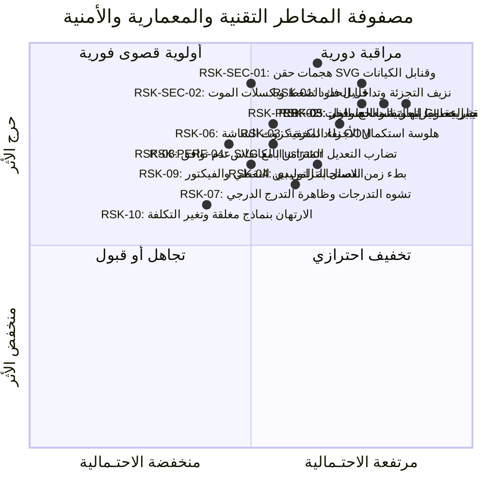

<!-- DOC_PROVENANCE
{"created_at_utc": "2026-10-17T07:55:26Z", "last_action": "EDITED", "last_change_id": "TASK-P0-DEBATE-REV-01", "last_edited_at_utc": "2026-10-17T08:18:32Z", "last_editor": "orchestrator-planner", "tracking_started_at_utc": "2026-10-17T07:55:26Z"}
END_DOC_PROVENANCE -->
# سجل المخاطر التقنية والمعمارية والأمنية وخطط التخفيف والاحتياط (`docs/architecture/RISK_REGISTER.md`)

**حالة الاعتماد المعمارية (`Architecture Approval Status`):** `NOT_APPROVED` (`PROPOSED_FOR_OWNER_REVIEW`)  
**المرحلة:** `PHASE_P0_ARCHITECTURE_RESEARCH_AND_DESIGN_REVIEW`  
**المرجع:** [docs/product/OWNER_ORIGINAL_VISION.md](../product/OWNER_ORIGINAL_VISION.md) و[docs/architecture/ARCHITECTURE_OPTIONS.md](ARCHITECTURE_OPTIONS.md)  
**المبدأ الحاكم:** الشفافية الهندسية الصارمة، ورصد كافة نقاط الفشل المحتملة مبكراً، وإدماج الأمن السيبراني وعزل العمليات وحماية الذاكرة، ووضع بدائل جاهزة ومقاسة لكل خطر تقني قبل البدء في التنفيذ.

---

## 1. مقدمة ومنهجية إدارة المخاطر في النظام

بناء نظام يجمع بين توليد الصور النقطية التوليدية وتفكيكها إلى طبقات فيكتور نظيفة وقابلة للتعديل (`Clean SVG`) يحمل تحديات غير مسبوقة على تقاطع الذكاء الاصطناعي وهندسة الرسوميات الحاسوبية والأمن السيبراني.  
تعتمد هذه الوثيقة مصفوفة تقييم احتمالية وشدة الأثر:
- **شدة الأثر (`Impact`):** حرج (`CRITICAL`) | مرتفع (`HIGH`) | متوسط (`MEDIUM`) | منخفض (`LOW`)
- **الاحتمالية (`Likelihood`):** مرتفعة (`HIGH`) | متوسطة (`MEDIUM`) | منخفضة (`LOW`)

---

## 2. السجل التفصيلي للمخاطر الفنية والمعمارية والأمنية (`Detailed Risk Log`)

### [RSK-TECH-001] نزيف التجزئة الدلالية وتداخل حواف العناصر المتشابهة (`Segmentation Bleed & Edge Ambiguity`)
- **الوصف التفصيلي:** عند معالجة تصميم يحتوي على عناصر متلاصقة أو متداخلة ألوانها متقاربة (مثل صلصة الجبن المنسكبة فوق البطاطس المقلية وفوق قطعة الخبز في `A03`)، قد تعجز نماذج التجزئة الدلالية القياسية (`SAM 2` و`Grounding DINO`) عن فصل الحدود بدقة، مما يدمج جزءاً من البطاطس في طبقة الخبز أو العكس.
- **التصنيف:** مخاطر رؤية حاسوبية وذكاء اصطناعي (`Vision AI Risk`).
- **شدة الأثر:** حرج (`CRITICAL`) — ينسف الرؤية الأصلية (`OV-02` و`OV-08`) في إتاحة التعديل المستقل لكل عنصر.
- **الاحتمالية:** مرتفعة (`HIGH`) في الأطعمة والتصاميم الحيوية المتداخلة.
- **آلية الكشف الآلية:** قياس تراكب الأقنعة و`Trimap Boundary IoU`؛ إذا هبط التطابق دون `0.84`، يُطلق إنذار جودة فوري.
- **استراتيجية التخفيف الأساسية:** التوجيه ثنائي النواة وصناديق الـ Scene Graph المحكمة، مع معالجة مورفولوجية تسبق استخراج المسار.
- **بوابة التحقق التجريبية:** التجربة `EXP-01` (عتبة القبول: `Trimap Boundary IoU >= 0.84`، ونزيف `<= 1.5%`).

---

### [RSK-TECH-002] انفجار عدد عُقد بيزييه وتفتت المسارات (`Bézier Node Explosion & Path Fragmentation`)
- **الوصف التفصيلي:** الخوارزميات التقليدية لتحويل الصور النقطية إلى فيكتور تعامل كل بكسل أو تدرج حاد كمسار مستقل، مما ينتج ملفات SVG تحتوي على عشرات الآلاف من العقد الحادة المتناثرة (`Micro-polygons`)، مما يجعل الملف ثقيلاً جداً ومستحيلاً على المصمم البشري تعديل منحنياته في Illustrator بالـ Pen Tool.
- **التصنيف:** مخاطر هندسة رسوميات وتحويل فيكتور (`Computational Geometry Risk`).
- **شدة الأثر:** حرج (`CRITICAL`) — يتعارض مباشرة مع متطلب "الفيكتور النظيف عالي الجودة المقسم لمجموعات" (`OV-04`).
- **الاحتمالية:** مرتفعة جداً (`HIGH`) في حال تطبيق التحويل دون تبسيط هندسي مسبق.
- **استراتيجية التخفيف الأساسية:** الفصل ثنائي المستويات: مسار هيكل أساسي ناعم `<= 36 عقدة`، ورقع نسيج وتظليل داخلية `<= 24 عقدة` محتواة بمسارات قص غير تدميرية `<clipPath>` وحظر التفتت المجهري (`Zero micro-shards < 16px²`).
- **بوابة التحقق التجريبية:** التجربة `EXP-02`.

---

### [RSK-TECH-003] هلوسة هندسة الأجزاء المخفية عند التفكيك (`Amodal Inpainting Hallucination`)
- **الوصف التفصيلي:** عندما يقع عنصر خلف آخر (مثل البطاطس المخفية جزئياً خلف شطيرة البرجر `OV-02` و`OV-05` أو الخبز تحت البطاطس في `A03`)، يقوم نموذج الـ Amodal Inpainting بتخمين ما يوجد خلف العائق. إذا هلوس النموذج ورسم شكلاً غير طبيعي، فإن تحريك العائق في الكانفاس سيكشف تشوهاً بصرياً واضحاً.
- **التصنيف:** مخاطر توليد ذكاء اصطناعي واكتمال بصري (`Generative Inpainting Risk`).
- **شدة الأثر:** مرتفع (`HIGH`) — يؤثر على تجربة التعديل الجراحي عند تحريك الطبقات.
- **الاحتمالية:** مرتفعة (`HIGH`) في حالات الانسداد الكبيرة (`Occlusion > 45%`).
- **استراتيجية التخفيف الأساسية:** اعتماد معمارية **Amodal Geometry-First**: استكمال المسار الخارجي للشكل المحجوب أولاً كمنحنى بيزييه C2 ناعم، واستخدام LaMa حصرياً لملء النسيج الداخلي داخل الحدود الهندسية النظيفة.
- **بوابة التحقق التجريبية:** التجربة `EXP-03` (عتبة القبول: `Zero Hollow Pixels` و`C1 Continuity Angle Deviation < 5 deg`).

---

### [RSK-TECH-004] بطء زمن الاستجابة التوليدي وموت التفاعل اللحظي (`End-to-End Latency Degradation`)
- **الوصف التفصيلي:** تشغيل سلسلة متتابعة من النماذج الكبيرة قد يستغرق وقتاً طويلاً يدمر تجربة الاستخدام التفاعلية للمصمم.
- **التصنيف:** مخاطر أداء وهندسة نظم (`Performance & Architecture Risk`).
- **شدة الأثر:** مرتفع (`HIGH`).
- **الاحتمالية:** متوسطة (`MEDIUM`).
- **استراتيجية التخفيف الأساسية:** المعالجة غير المتزامنة عبر خوادم مهام (`Async Task Workers`) وتحديث واجهة المستخدم عبر `WebSockets`، مع التحميل التدريجي للطبقات في الكانفاس (`Progressive Layer Hydration`).
- **بوابة التحقق التجريبية:** اختبار زمن الاستجابة التوليدي النهائي (`P95 Latency <= 15s`).

---

### [RSK-TECH-005] استحالة مطابقة الخطوط في التيبوجرافي العربي والخط الحر (`Arabic Typography & Calligraphy Matching Failure`)
- **الوصف التفصيلي:** في التصاميم الحقيقية (شعارات، ملصقات)، غالباً ما تكون النصوص مكتوبة بخطوط كاليجرافي عربية مركبة ومعدلة يدوياً (كشيدة، تداخل أحرف، تشكيلات). محاولة مطابقة هذه النصوص مع خط رقمي قياسي (`Google Fonts`) تؤدي حتماً إلى تدمير الشكل الجمالي للشعار أو العنوان.
- **التصنيف:** مخاطر تيبوجرافي ولغات مركبة (`Typography Domain Risk`).
- **شدة الأثر:** حرج (`CRITICAL`) — تشويه الهوية البصرية للشعارات والنصوص العربية.
- **الاحتمالية:** مرتفعة جداً (`HIGH`).
- **استراتيجية التخفيف الأساسية:**
  - اعتماد **استراتيجية المسار المزدوج الصارمة (`Dual-Path Strategy`)**:
    - **المسار الافتراضي للشعارات والكاليجرافي (المسار أ):** رسم متجهي مطابق 100% بنقاط بيزييه (`Exact Bézier Glyph Tracing`) لحفظ الهوية دون أي محاولة لمطابقة فونتات رقمية.
    - **مسار التعديل وإعادة الكتابة (المسار ب):** عند طلب المستخدم كتابة نص جديد، يتراجع النظام إلى أقرب خط رقمي مفتوح قياسي (Amiri, Cairo) مع تطبيق ستايل الشعار.
    - **قاعدة حماية التشكيل الإلزامية (`Arabic Diacritic BBox Protection`):** حظر حذف أي مسار يقع داخل المربع المحيط بالكتلة النصية مهما صغر حجمه لضمان بقاء 100% من النقاط والهمزات.
- **بوابة التحقق التجريبية:** التجربة `EXP-05`.

---

### [RSK-TECH-006] نفاد ذاكرة كروت الشاشة أثناء تعدد المستخدمين (`GPU Out-Of-Memory & Concurrency Collapse`)
- **الوصف التفصيلي:** تحميل نماذج متعددة في نفس الوقت في ذاكرة الـ VRAM يؤدي سريعاً إلى امتلاء بطاقة الرسومات وحدوث أخطاء `CUDA Out of Memory`.
- **التصنيف:** مخاطر بنية تحتية وعمليات (`Infrastructure & MLOps Risk`).
- **شدة الأثر:** حرج (`CRITICAL`).
- **الاحتمالية:** متوسطة (`MEDIUM`).
- **استراتيجية التخفيف الأساسية:** الاعتماد على الحوسبة السحابية الخادمة عند الطلب (`Serverless GPU: Modal / RunPod`) مع عزل كل طلب في حاوية مخصصة، وتفعيل التكميم (`FP16/INT8`) لتقليص استهلاك الذاكرة.
- **بوابة التحقق التجريبية:** التجربة `EXP-07`.

---

### [RSK-TECH-007] تشوه التدرجات وظاهرة التدرج الدرجي (`Gradient Banding & Color Drift`)
- **الوصف التفصيلي:** تحويل تدرجات الإضاءة والظلال الناعمة إلى عدد قليل من مسارات الفيكتور المصمتة ينتج عنه تدرج غير ناعم وظهور خطوط لونية حادة مشوهة (`Color Banding`).
- **التصنيف:** مخاطر جودة إدراكية وبصرية (`Perceptual Quality Risk`).
- **شدة الأثر:** متوسط (`MEDIUM`).
- **الاحتمالية:** مرتفعة (`HIGH`).
- **استراتيجية التخفيف الأساسية:** رصد التدرجات الخطية والشعاعية واستخراج نقاط الوقوف اللوني رياضياً في فضاء `CIE-LAB` واستخدام مسارات ألفا متراكبة.
- **بوابة التحقق التجريبية:** التجربة `EXP-02` و`EXP-04`.

---

### [RSK-TECH-008] عدم توافق كود الـ SVG مع برامج التصميم الاحترافية (`Illustrator / Figma Incompatibility`)
- **الوصف التفصيلي:** إذا استخدم المحرك خصائص غير قياسية في الـ SVG (مثل SVG 2 mesh gradients)، فإن فتح الملف المُصدَّر في Adobe Illustrator أو Figma سيفقد المجموعات المنطقية أو يعرض شاشة فارغة.
- **التصنيف:** مخاطر توافقية وتصدير (`Compatibility & Interoperability Risk`).
- **شدة الأثر:** مرتفع (`HIGH`).
- **الاحتمالية:** متوسطة (`MEDIUM`).
- **استراتيجية التخفيف الأساسية:** توليد كود SVG نقي ومتوافق 100% مع معايير W3C SVG 1.1 Valid DTD ومجموعات مسمّاة ومسارات قص قياسية `<clipPath>`.
- **بوابة التحقق التجريبية:** اختبار فتح عينات SVG على Figma ومحلل Inkscape CLI.

---

### [RSK-TECH-009] انفصال التزامن بين المسار النقطي ومسار الفيكتور (`Raster-Vector State Desynchronization`)
- **الوصف التفصيلي:** في معمارية الهجين، يمتلك النظام تمثيلاً نقطياً وتمثيلاً فيكتورياً. إذا عدل المستخدم الفيكتور ثم طلب تعديلاً بالذكاء الاصطناعي، قد تستخدم النماذج الصورة النقطية القديمة فتتجاهل تعديل المستخدم.
- **التصنيف:** مخاطر تزامن حالة وتكامل بيانات (`State Consistency Risk`).
- **شدة الأثر:** مرتفع (`HIGH`).
- **الاحتمالية:** متوسطة (`MEDIUM`).
- **استراتيجية التخفيف الأساسية:** جعل الـ Design IR هو الحقيقة المطلقة، ورندرة الفيكتور بدقة 150/300 DPI عند الحاجة لاستدعاء أي نموذج نقطي.
- **بوابة التحقق التجريبية:** اختبار دورة التعديل التبادلي الحلقية.

---

### [RSK-TECH-010] الارتهان بنماذج سحابية مغلقة وتغير تكاليف الـ API (`Vendor Lock-In & API Pricing Volatility`)
- **الوصف التفصيلي:** الاعتماد الحصري على مزود واحد للذكاء الاصطناعي يجعل المنتج عرضة لمخاطر تغير أسعار الـ API أو انقطاع الخدمة.
- **التصنيف:** مخاطر استدامة وتكاليف تشغيل (`Cost & Vendor Risk`).
- **شدة الأثر:** متوسط (`MEDIUM`).
- **الاحتمالية:** مرتفعة (`HIGH`).
- **استراتيجية التخفيف الأساسية:** تطبيق نمط الموانئ والمحولات (`Ports & Adapters`) وعزل واجهات التوليد خلف تجريدات محايدة تدعم البدائل المحلية والمفتوحة.
- **بوابة التحقق التجريبية:** اختبار تبديل المزود المحايد.

---

### [RSK-SEC-001] هجمات حقن الـ SVG والقنابل الكيانية (`SVG XXE, Billion Laughs & Quadratic Blowup`)
- **الوصف التفصيلي:** ملفات الـ SVG هي ملفات XML قابلة للتنفيذ. قيام مستخدم برفع ملف SVG خبيث أو استقبال كود غير مفحوص يحوي كيانات خارجية (`External Entity Reference`) يؤدي لقراءة ملفات السيرفر السرية (`/etc/passwd`) أو إطلاق هجوم Billion Laughs التكراري لاستهلاك الرامات حتى انهيار الخادم.
- **التصنيف:** أمن سيبراني ومعالجة مدخلات (`Cybersecurity & Input Validation Risk`).
- **شدة الأثر:** حرج (`CRITICAL`) — اختراق كامل أو حجب خدمة للنظام.
- **الاحتمالية:** مرتفعة (`HIGH`) عند غياب الفحص الصارم.
- **استراتيجية التخفيف الأساسية:**
  1. حظر استخدام مكتبات بايثون القياسية غير الآمنة (`xml.etree` و`minidom`).
  2. استخدام مكتبة **`defusedxml`** حصرياً على الخادم لتعطيل DTD والكيانات الخارجية.
  3. تشغيل **`DOMPurify`** في المتصفح قبل عرض أي كود SVG مولد.
- **بوابة التحقق التجريبية:** التجربة `SEC-EXP-01`.

---

### [RSK-SEC-002] قنابل فك الضغط وطوفان البكسلات العملاقة (`Decompression Bombs & Pixel Flood Attacks`)
- **الوصف التفصيلي:** قيام مستخدم برفع صورة مضغوطة بحجم صغير (مثلاً 2MB PNG) ولكنها عند فك الضغط في الذاكرة تتمدد إلى 40,000x40,000 بكسل (أكثر من 6 جيجابايت من الذاكرة الخام)، مما يؤدي إلى موت المعالج ونفاد فوري لذاكرة الخادم (Host OOM).
- **التصنيف:** أمن سيبراني واستهلاك موارد (`Denial of Service Risk`).
- **شدة الأثر:** حرج (`CRITICAL`).
- **الاحتمالية:** متوسطة (`MEDIUM`).
- **استراتيجية التخفيف الأساسية:**
  - فحص ترويسة الصور (`Image Headers`) قبل تحميل مصفوفات البكسل في الذاكرة، وفرض حدود قاطعة:
    - `MAX_IMAGE_DIMENSIONS = 4096 x 4096 px`
    - `MAX_PIXEL_COUNT = 16,000,000 pixels (16 MP)`
    - `MAX_FILE_SIZE = 25 MB`
- **بوابة التحقق التجريبية:** اختبار فحص الترويسة الآمن في معمارية النظم.

---

### [RSK-PERF-003] إنهاك معالج الخادم وقفل الـ GIL بحسابات بيزييه المفرطة (`Host CPU Starvation & GIL Lock`)
- **الوصف التفصيلي:** خوارزميات ملاءمة المنحنيات (Schneider Bézier Fitting) والعمليات البوليانية (Shapely) عمليات حسابية معقدة ومستهلكة للـ CPU. تشغيلها مباشرة في مسار خادم FastAPI الرئيسي يقفل مفسر بايثون (GIL Lock) ويجعل خادم الـ API عاجزاً عن الرد على المستخدمين الآخرين أو يتسبب في إسقاط اتصالات الـ WebSocket.
- **التصنيف:** أداء وتزامن خوادم (`Concurrency & GIL Risk`).
- **شدة الأثر:** مرتفع (`HIGH`).
- **الاحتمالية:** مرتفعة (`HIGH`).
- **استراتيجية التخفيف الأساسية:**
  - عزل حسابات Schneider وShapely إلزامياً داخل مجمع عمليات منفصل (`ProcessPoolExecutor`) مع سقف زمني صارم (`Hard Timeout = 2.5s`) لقطع أي عملية تتجاوز المهلة وحماية الخادم.
- **بوابة التحقق التجريبية:** التجربة `PERF-EXP-01`.

---

### [RSK-PERF-004] تضارب التعديل المتزامن على الكانفاس عبر WebSockets (`Concurrent Mutation Race Conditions`)
- **الوصف التفصيلي:** عند تعديل المستخدم لطبقة في الكانفاس بالتزامن مع استجابة خادم الذكاء الاصطناعي لطبقة مجاورة عبر WebSocket، قد تتضارب التعديلات وتكتب جلسة فوق بيانات جلسة أخرى، مما يدمر شجرة الـ Design IR.
- **التصنيف:** تزامن بيانات وتكامل حالة (`State Synchronization Risk`).
- **شدة الأثر:** مرتفع (`HIGH`).
- **الاحتمالية:** متوسطة (`MEDIUM`).
- **استراتيجية التخفيف الأساسية:**
  - اعتماد نظام عقود حيازة الطبقة المؤقتة (`Per-Layer Edit Leases`) مع نقل التعديلات بصيغة فروق JSON قياسية (`RFC 6902 JSON Patch`) لمنع التضارب وضمان تكامل الشجرة.
- **بوابة التحقق التجريبية:** التجربة `CONC-EXP-01`.

---

## 3. مصفوفة تتبع المخاطر وربطها ببوابات الجدوى (`Traceability Matrix`)

| معرف الخطر (`Risk ID`) | شدة الأثر | الاحتمالية | المسار المعماري المتأثر | بوابة التحقق التجريبية المقابلة | الأولوية |
| :--- | :--- | :--- | :--- | :--- | :--- |
| **RSK-TECH-001** | حرج (`CRITICAL`) | مرتفعة (`HIGH`) | التجزئة الدلالية وفصل الطبقات | `EXP-01` (تجزئة الأقنعة وتراكب الحدود) | قصوى فورية (P0) |
| **RSK-TECH-002** | حرج (`CRITICAL`) | مرتفعة جداً (`HIGH`) | هندسة الفيكتور وملاءمة بيزييه | `EXP-02` (تبسيط العقد ومنع التفتيت) | قصوى فورية (P0) |
| **RSK-TECH-003** | مرتفع (`HIGH`) | مرتفعة (`HIGH`) | استكمال الأجزاء المخفية (Amodal) | `EXP-03` (استكمال الشكل المغطى واقعياً) | عالية (P1) |
| **RSK-TECH-004** | مرتفع (`HIGH`) | متوسطة (`MEDIUM`) | خوادم المعالجة المتوازية والبنية التحتية | اختبار زمن الاستجابة التوليدي النهائي | عالية (P1) |
| **RSK-TECH-005** | حرج (`CRITICAL`) | مرتفعة جداً (`HIGH`) | محرك التيبوجرافي والخط العربي | `EXP-05` (مسار الخطوط والمسار المزدوج) | قصوى فورية (P0) |
| **RSK-TECH-006** | حرج (`CRITICAL`) | متوسطة (`MEDIUM`) | إدارة الـ GPU وسعة التخزين المؤقت | `EXP-07` (كفاءة استهلاك ذاكرة الـ GPU) | عالية (P1) |
| **RSK-TECH-007** | متوسط (`MEDIUM`) | مرتفعة (`HIGH`) | التكميم اللوني واستخراج التدرجات | `EXP-02` (جودة الألوان واختبار LPIPS) | متوسطة (P2) |
| **RSK-TECH-008** | مرتفع (`HIGH`) | متوسطة (`MEDIUM`) | مولد الـ Clean SVG ومحول التصدير | اختبارات التوافقية مع برامج التصميم | عالية (P1) |
| **RSK-TECH-009** | مرتفع (`HIGH`) | متوسطة (`MEDIUM`) | إدارة وثيقة الـ IR وتزامن الكانفاس | اختبار دورة التعديل التبادلي الحلقية | عالية (P1) |
| **RSK-TECH-010** | متوسط (`MEDIUM`) | مرتفعة (`HIGH`) | محولات النماذج ومجردات مزودي الـ AI | اختبار تبديل المزود المحايد | متوسطة (P2) |
| **RSK-SEC-001** | حرج (`CRITICAL`) | مرتفعة (`HIGH`) | أمان الرسوميات وتحليل XML | `SEC-EXP-01` (مقاومة هجمات SVG) | قصوى فورية (P0) |
| **RSK-SEC-002** | حرج (`CRITICAL`) | متوسطة (`MEDIUM`) | معالجة الصور وفحص المدخلات | فحص الترويسة وحظر Decompression Bombs | قصوى فورية (P0) |
| **RSK-PERF-003** | مرتفع (`HIGH`) | مرتفعة (`HIGH`) | عزل العمليات وحماية الـ GIL | `PERF-EXP-01` (عزل العمليات وسقف 2.5s) | عالية (P1) |
| **RSK-PERF-004** | مرتفع (`HIGH`) | متوسطة (`MEDIUM`) | تزامن الكانفاس والـ WebSockets | `CONC-EXP-01` (محاكاة تعديل الطبقات) | عالية (P1) |

---

## 4. خطة الحوكمة والإنذار المبكر أثناء التنفيذ

1. **حظر الانتقال للمرحلة التالية قبل ترويض المخاطر الحرجة:**
   - يُحظر بدء كتابة أي كود للمنتج في موديول التجزئة أو الفيكتور قبل نجاح التجارب `EXP-01` و`EXP-02` و`EXP-03` و`SEC-EXP-01` وتحقيق عتبات الأمان المحددة في هذا السجل.
2. **المراجعة المستمرة لسجل المخاطر:**
   - عند حدوث أي فشل في أي اختبار أداء أو تجربة جدوى، يتم تحديث هذا السجل فوراً عبر سجل الـ WAL، وتسجيل الواقعة كـ Finding مستقل، وإعادة تقييم المسار المعماري.
