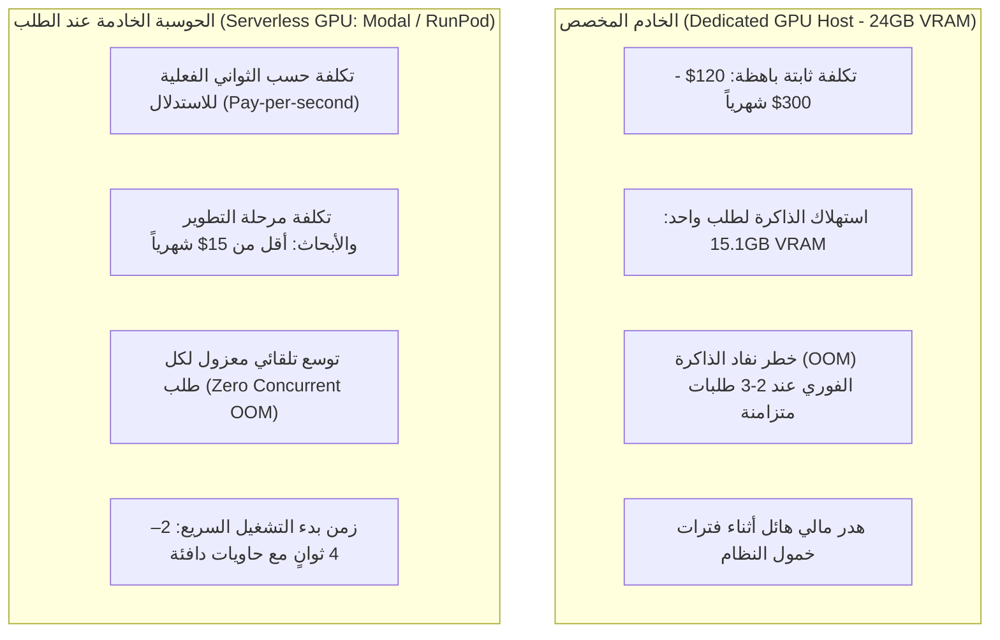

<!-- DOC_PROVENANCE
{"created_at_utc": "2026-10-17T07:52:45Z", "last_action": "EDITED", "last_change_id": "TASK-P0-DEBATE-REV-01", "last_edited_at_utc": "2026-10-17T08:16:59Z", "last_editor": "orchestrator-planner", "tracking_started_at_utc": "2026-10-17T07:52:45Z"}
END_DOC_PROVENANCE -->
# توصيات المكدس التقني وتقييم البدائل البرمجية والأمان (`docs/architecture/TECH_STACK_RECOMMENDATION.md`)

**حالة الاعتماد المعمارية (`Architecture Approval Status`):** `NOT_APPROVED` (`PROPOSED_FOR_OWNER_REVIEW`)  
**المرحلة:** `PHASE_P0_ARCHITECTURE_RESEARCH_AND_DESIGN_REVIEW`  
**المرجع:** [docs/product/OWNER_ORIGINAL_VISION.md](../product/OWNER_ORIGINAL_VISION.md) و[docs/architecture/TECHNOLOGY_COMPARISON_AND_GATES.md](TECHNOLOGY_COMPARISON_AND_GATES.md)  
**المبدأ الحاكم:** التقييم الهندسي الواقعي والمستقل، وتجنب التعقيد غير المبرر، وتفريق بيئة تطوير Antigravity عن البنية التحتية للمنتج الفعلي، وإدماج تدابير الأمن السيبراني والأداء العالي منذ اليوم الأول.

---

## 1. التمييز الحاسم بين بيئة التطوير وبيئة المنتج (`Antigravity vs. Runtime Product`)

من أهم المبادئ الهندسية التي تؤكد عليها هذه المراجعة:
> **قاعدة الفصل الدستورية:** استخدام بيئة **Google Antigravity** (IDE / Agent CLI / Custom Agents) كبيئة تطوير وبناء وحوكمة لا يعني إطلاقاً إلزام المنتج النهائي بالاعتماد على Antigravity SDK في وقت التشغيل (`Runtime`). المنتج النهائي يجب أن يكون برمجية قائمة بذاتها قابلة للنشر على أي بيئة سحابية (AWS, GCP, Azure, Bare-Metal Docker) ومتاحة للمستخدمين عبر الويب دون أي تبعية لبيئة التطوير.

---

## 2. تقييم ومقارنة البدائل التقنية لكل طبقة في النظام

### 2.1. لغة ونواة الباك إند وعزل العمليات (`Backend Core & Process Isolation`)

| الخيار | المزايا | العيوب | التقييم والتوصية |
| :--- | :--- | :--- | :--- |
| **Python 3.12 + FastAPI + Pydantic v2 + ProcessPoolExecutor** *(موصى به)* | - لغة معيارية أولى عالمياً لجميع مكتبات الذكاء الاصطناعي والرؤية الحاسوبية (PyTorch, SAM 2, OpenCV, Shapely). - تكامل أصيل غير متزامن (`async/await`) عالي الأداء مع توثيق OpenAPI فوري. - Pydantic v2 يوفر تحققاً فائق السرعة من الـ JSON Schema للـ Design IR. - عزل حسابات Schneider وShapely في `ProcessPoolExecutor` يتجاوز قفل الـ GIL ويحمي السيرفر بسقف زمني 2.5 ثانية. | استهلاك ذاكرة أعلى نسبياً من Go/Rust عند عدم ضبط عزل العمليات. | **الخيار الأمثل والموصى به لتقليل تعقيد اللغات مع تطبيق عزل العمليات لحماية الخادم.** |
| **Node.js / TypeScript (NestJS / Express)** | لغة موحدة بين الـ Frontend والـ Backend. | عاجز عن تشغيل مكتبات الـ Vision AI مباشرة دون اللجوء لـ Subprocess أو Microservice خارجية مع بايثون، مما يخلق تعقيداً إضافياً مضاعفاً. | **مرفوض كباك إند رئيسي لنواة الـ AI.** |
| **Go / Rust Core API** | أداء خام واستقرار عالي واستهلاك موارد منخفض. | دعم بدائي وضعيف جداً لنماذج الـ Deep Learning الحديثة، مما يجبر على بناء خادم بايثون جانبي منفصل. | **مرفوض في المرحلة الحالية (يمكن استخدام Rust لاحقاً كـ C-Extension فقط لتسريع العمليات الهندسية الحسابية).** |

---

### 2.2. مكتبات الرؤية الحاسوبية والذكاء الاصطناعي (`Computer Vision & AI Foundation Models`)

| المكون الوظيفي | الخيارات المقارنة | الخيار الموصى به | سبب الاختيار |
| :--- | :--- | :--- | :--- |
| **تجزئة الطبقات (Segmentation)** | 1) `SAM 2 + Grounding DINO` 2) `Florence-2` 3) `Mask2Former` | **SAM 2 + Grounding DINO** | دقة حدود فائقة (`Sub-pixel boundaries`)، فهم دلالي موجه بالنصوص عبر Grounding DINO، وترخيص تجاري مفتوح `Apache 2.0`. |
| **إكمال الأجزاء المحجوبة (Amodal Reconstruction)** | 1) `LaMa Inpainting Only` 2) `Diffusion Inpainting` 3) `Amodal Geometry-First (C2 Spline + LaMa Texture)` | **Amodal Geometry-First** | استقراء المنحنى الأملس هندسياً أولاً يمنع تشوه المسارات، واستخدام LaMa للنسيج الداخلي فقط يضمن ترخيص `Apache 2.0` وسرعة فائقة. |
| **توليد الصور المخططة (Image Generation)** | 1) `Google Gemini Image API / Nano Banana` 2) `Local Flux.1-Dev / SDXL ControlNet` 3) `Midjourney API (Unofficial)` | **Gemini Image / Nano Banana (عبر Port) + خيار Flux محلي** | جودة بصرية عالية، سرعة استدعاء، مع عزل الاستدعاء خلف `AIProviderAdapter` لتمكين التبديل لأي مزود محلي. |
| **معالجة مصفوفات البكسل** | 1) `OpenCV (cv2) + NumPy` 2) `Pillow (PIL)` | **OpenCV + NumPy** | سرعة فائقة في تحويل القنوات والعمليات المورفولوجية (`Erosion/Dilation`) اللازمة لتنعيم حدود الأقنعة. |

---

### 2.3. محرك الهندسة الحاسوبية والـ Clean SVG (`Computational Geometry & Vector Engine`)

| التقنية | الدور في النظام | معيار التقييم | التوصية |
| :--- | :--- | :--- | :--- |
| **Shapely (GEOS Engine C-bindings)** | تنفيذ العمليات البوليانية (`Boolean Union, Intersection, Difference`) لدمج مسارات الظلال وتهذيب الحواف. | سرعة وموثوقية رياضية مثبتة عبر عقود في نظم المعلومات الجغرافية والهندسة. | **موصى به أساسياً للنظام مع عزله في ProcessPool.** |
| **pyclipper (ClipperLib)** | خوارزمية Vatti لحساب الإزاحة والتداخل وقص المسارات المتجهة (`Polygon Offsetting / Clipping`). | فائق السرعة، خفيف، ولا يعاني من مشاكل الدقة الرقمية (`Robust Integer Coordinate Math`). | **موصى به كمساعد لـ Shapely.** |
| **Schneider Bézier Fitting (Python / Cython)** | تحويل سلسلة نقاط المضلع إلى أقل عدد ممكن من منحنيات Bézier التكعيبية الناعمة (`OV-04`). | ضبط دقيق لعتبة التسامح (`Tolerance`) وتقييد ميزانية النقاط (`<= 36 nodes per path`). | **موصى به كأساس لمحرك الـ Pen Tool مع سقف زمني صارم 2.5 ثانية.** |
| **defusedxml + DOMPurify** | تحليل وتطهير ملفات الـ SVG ومنع هجمات XXE وBillion Laughs وXSS. | أمان حاسم وموثق في معايير OWASP للرسوميات المتجهة. | **إلزامي أمنياً (Mandatory Security Invariant).** |

---

### 2.4. محرك الواجهة والكانفاس التفاعلي (`Interactive Vector Canvas & Frontend UI`)

| الخيار | إمكانيات الـ Pen Tool | الأداء عند التعامل مع مئات المسارات | سلايدر 50% Opacity | التقييم والتوصية |
| :--- | :--- | :--- | :--- | :--- |
| **Multi-Layer Virtualized GPU Canvas (React + Canvas 2D / WebGL)** *(موصى به)* | **ممتازة:** دعم أصيل لمقابض Bézier، تعديل النقاط الفردية، والـ Pen Tool. | **استثنائية (60 FPS ثابتة):** تقسيم الكانفاس إلى 3 طبقات: (1) طبقة خلفية مخبأة في كارت الشاشة، (2) طبقة الكائن النشط، (3) طبقة المقابض الخفيفة. | **فورية وسلسة:** تحكم شريطي فوري (0-100%) دون إعادة تصيير المسارات المتجهة. | **الخيار الموصى به لتحقيق تجربة "مصمم جرافيك بالـ Pen Tool" دون سقوط الإطارات.** |
| **Single-Context Paper.js Canvas** | ممتازة بنقاط بيزييه ومقابض التحكم. | **متواضعة (15–25 FPS):** إعادة مسح وتصيير آلاف المسارات في كل إطار تسقط معدل الإطارات عند تحريك الطبقات. | بطيئة نسبياً عند دمج الرستر والفيكتور في سياق واحد. | **مرفوض كسياق أحادي مسطح (يستخدم كعناصر حسابية ضمن الكانفاس الطبقي).** |
| **React + Direct SVG DOM** | متوسطة عبر وسوم SVG مباشرة. | **سيئة جداً:** بطء وتراجع شديد في الأداء وتجميد المتصفح عند زيادة مسارات الفيكتور. | جيدة عبر CSS Opacity. | **مرفوض ككانفاس تفاعلي رئيسي (يستخدم كمعاينة وتصدير نهائي فقط).** |

---

### 2.5. متطلبات الأمان والوقاية من الهجمات الخبيثة (`Cybersecurity Architecture`)

1. **الوقاية من هجمات حقن الـ SVG والقنابل المتفجرة (`SVG XXE & Billion Laughs Defense`):**
   - حظر استخدام مكتبات بايثون القياسية غير الآمنة (`xml.etree` و`minidom`) لتحليل ملفات الـ SVG.
   - استخدام مكتبة **`defusedxml`** حصرياً على الخادم لتعطيل استدعاء الكيانات الخارجية وDTD العملاقة.
   - تشغيل **`DOMPurify`** في المتصفح قبل عرض أي كود SVG مولد لمنع هجمات XSS.
2. **الوقاية من قنابل فك الضغط والبكسلات العملاقة (`Decompression Bombs & Pixel Floods`):**
   - فحص ترويسة الصور (`Image Headers`) قبل تحميل مصفوفات البكسل في الذاكرة.
   - فرض حدود حتمية صارمة:
     - `MAX_IMAGE_DIMENSIONS = 4096 x 4096 px`
     - `MAX_PIXEL_COUNT = 16,000,000 pixels (16 MP)`
     - `MAX_FILE_SIZE = 25 MB`
   - رفض أي صورة تتجاوز هذه الحدود قبل تمريرها لمكتبات OpenCV أو PIL لحماية ذاكرة الخادم من النفاد الفوري (OOM).

---

## 3. متطلبات الحوسبة ونماذج النشر (`GPU, Compute & Deployment Constraints`)

### 3.1. المقارنة الاقتصادية لنماذج تشغيل الذكاء الاصطناعي (Dedicated GPU vs. Serverless GPU)

### التوصية لنماذج النشر:
1. **في مرحلة البحث والتجارب (Phase P0/P1):**
   - الاعتماد على **الحوسبة السحابية الخادمة عند الطلب (`Serverless GPU: Modal / RunPod`)** لتشغيل نماذج SAM 2 وLaMa وDiffusion بتكلفة اقتصادية ضئيلة (< 15$ شهرياً) وتجنب تكبد اشتراكات خوادم مخصصة باهظة غير مبررة.
2. **في بيئة الإنتاج للمنتج النهائي:**
   - توفير معمارية هجينة مرنة: يستطيع المستخدم تشغيلها محلياً بالكامل إذا امتلك كارت شاشة لا يقل عن 16GB VRAM، أو تشغيلها عبر المزودات السحابية المدارة من خلال واجهات الـ Ports المعيارية.
