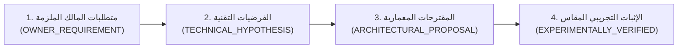

<!-- DOC_PROVENANCE
{"created_at_utc": "2026-10-17T07:48:59Z", "last_action": "CREATED", "last_change_id": "TASK-P0-ARCH-REVIEW", "last_edited_at_utc": "2026-10-17T07:48:59Z", "last_editor": "orchestrator-planner", "tracking_started_at_utc": "2026-10-17T07:48:59Z"}
END_DOC_PROVENANCE -->
# تحليل وتتبع متطلبات رؤية المالك الأصلية (`docs/architecture/VISION_REQUIREMENTS_ANALYSIS.md`)

**حالة الاعتماد المعمارية (`Architecture Approval Status`):** `NOT_APPROVED` (`PROPOSED_FOR_OWNER_REVIEW`)  
**المرحلة:** `PHASE_P0_ARCHITECTURE_RESEARCH_AND_DESIGN_REVIEW`  
**مرجع الرؤية الحاكم:** [docs/product/OWNER_ORIGINAL_VISION.md](../product/OWNER_ORIGINAL_VISION.md) (`OWNER_REQUIREMENT` Authority)  
**مصفوفة التتبع المرجعية:** [docs/product/VISION_TO_REQUIREMENTS_TRACEABILITY.md](../product/VISION_TO_REQUIREMENTS_TRACEABILITY.md)

---

## 1. المقدمة والمنهجية الصارمة لتحليل الرؤية

تضع هذه الوثيقة تحليلاً هندسياً شاملاً وتفصيلياً لكل متطلب ورد في النص العربي الحرفي لصاحب المشروع (المالك)، دون أي تبسيط صامت للمتطلبات المعقدة ودون القفز لافتراضات غير مثبتة. يلتزم التحليل بالتفريق الصارم بين أربع فئات من الحقائق:



1. **`OWNER_REQUIREMENT` (سلطة المالك الحصرية):** الأهداف والسلوكيات التي حددها المالك بنصه الصريح (مثل: عقلية Pen Tool، منع تشظي الفلافل، فصل البطاطس عن العيش، مقارنة 50% Opacity، الحفاظ على هوية الخط، عدم فرض نقطة بداية، وتجميع العنصر وظله في Group).
2. **`TECHNICAL_HYPOTHESIS` (فرضيات هندسية تحت الاختبار):** النظريات والخوارزميات التي نقترحها لتحقيق متطلب المالك (مثل: قدرة SAM 2 على منع نزيف البكسلات، أو ملاءمة Shapely Boolean Union لدمج مسارات الظلال).
3. **`ARCHITECTURAL_PROPOSAL` (المعمارية المقترحة):** التصاميم الهيكلية والحدود البرمجية المقترحة (مثل: نواة الـ Scene Graph الموحدة، نمط Modular Monolith مع عمال غير متزامنين).
4. **`EXPERIMENTALLY_VERIFIED` (قدرات مثبتة علمياً):** نتائج التجارب المقاسة رقمياً في بيئة معزولة (وحالتها الحالية في P0 هي `NONE_YET — ALL UNDER RESEARCH`).

---

## 2. التحليل التفصيلي للمتطلبات الوظيفية الثلاثة عشر (13 Core Product Capabilities)

### 2.1. توليد الصور المخطط بالطبقات (`AI Image Generation with Pre-Planned Geometry`)
- **نص المالك الأصلي (`OV-02`, `OV-03`, `OV-04`):**
  > «بيبدأ يحدد أولًا كده قبل ما يgenerate الصورة اللي هي الـfull image، بيبدأ يحدد من خلال وصف المستخدم الصورة اللي هو هيكليتها دي هتبقى كام layer... يحدد الأشكال الهندسية والdimensions، والحتة دي منين لحد فين، بكل لون، بكل حاجة، بحيث إنه لما ييجي create الصورة، هيبدأ إن هو يعملها، لو العميل وافق عليها، بيبدأ بقى يgenerate الـlayers بنفس المواصفات اللي هو كان محددها»
- **التصنيف:** `OWNER_REQUIREMENT`
- **التفسير الهندسي غير المبسط:**
  - يرفض المالك أسلوب الـ End-to-End Black Box الذي تقفز فيه الموديلات مباشرة من الـ Prompt إلى صورة صماء.
  - المتطلب يفرض عملية من مرحلتين رئيسيتين:
    1. **مرحلة التخطيط الهيكلي (`Structure Planning Phase`):** استخراج `Scene Graph Plan` مهيكل يحتوي على قائمة الطبقات، ترتيب الـ Z-order، الصناديق المحيطة (`Bounding Boxes` بالبكسل المطلق أو النسبي)، الأشكال الهندسية الأساسية (`Primitive Geometries`)، ولوحة الألوان المستهدفة لكل طبقة.
    2. **مرحلة التوليد المشروط والمعاينة (`Conditioned Generation & Preview`):** توليد صورة مدمجة كاملة للمعاينة ثم الانتظار لبوابة موافقة العميل (`Client Approval Gate`) قبل الانتقال لتوليد أصول الطبقات المفردة بنفس المعاملات.
- **التحدي الهندسي المكتشف:** موديلات التوليد الحالية (Diffusion Models مثل Flux أو SDXL أو Imagen 3) لا تلتزم تلقائياً بإحداثيات البكسل الدقيقة إذا تم تمريرها كنص فقط؛ تحقيق التوليد المشروط بالأبعاد يتطلب توجيه هندسي صريح (مثل ControlNet مع Segmentation Masks أو Bounding Box Conditioning أو Inpainting Guided Canvas).

---

### 2.2. التفكيك الدلالي للصور وتوليد الطبقات السحرية (`Magic Layers Semantic Decomposition`)
- **نص المالك الأصلي (`OV-01`, `OV-08`):**
  > «عاوز حاجة تعمل editing وتفكك كlayers... الـ magic layers بيبقى عبارة إن أنا عندي مثلاً صورة عمل لها generation بـ AI tool تانية... لازم أبدأ أعرض الصورة على AI يبدأ يشوف الصورة دي ويشوف هي تتعامل من كام layer، وكل layer فوق layer... ويحدد أنهي layer فوق أنهي layer... ويبدأ يحط الأبعاد بقى من هنا، يعني مثلاً من اليمين لحد الشمال من بيكسل كذا لبيكسل كذا، ومن فوق لتحت وcurve من الحتة الفلانية للحتة الفلانية»
- **التصنيف:** `OWNER_REQUIREMENT`
- **التفسير الهندسي غير المبسط:**
  - تفكيك أي صورة نقطية مدخلة (سواء من الموديل الداخلي أو صورة مرفوعة من العميل) إلى طبقات كائنية دلالية (`Semantic Object Layers`).
  - النظام ملزم بتحديد:
    - عدد الطبقات الكلي.
    - علاقات الاحتواء والترتيب التراكبي (`Topological Z-Index Ordering`).
    - الحدود المنحنية (`Curvilinear Boundary Paths`) لكل طبقة كإحداثيات بكسلية محددة البداية والنهاية والتقوس.
- **الفرضية التقنية (`TECHNICAL_HYPOTHESIS`):** استخدام نموذج Vision-Language متقدم (VLM) لتحديد أسماء الكيانات وعلاقات الاحتواء، متبوعاً بموديل تجزئة موجه مثل SAM 2 (Segment Anything Model 2) بالتعاون مع Grounding DINO لاستخراج الأقنعة الدقيقة.

---

### 2.3. التعديل الجراحي على الطبقات (`Layer-Aware Surgical Editing`)
- **نص المالك الأصلي (`OV-11`):**
  > «الـ image editing هو مبدئيًا كده بيعمل... نفس خطوات الـ magic layers والـ clean design، بس بيزيد عليهم... بيشوف العميل أو محتاج إيه وبيبدأ بقى إن هو ينفذ تعديلاته كـ... بينفذها على الـart layers تمام، وبيبدأ بقى ينفذ التعديلات دي»
- **التصنيف:** `OWNER_REQUIREMENT`
- **التفسير الهندسي غير المبسط:**
  - التعديل ليس "إعادة توليد كاملة للصورة" (Inpainting أعمى يغير خلفية التصميم)، بل تعديل جراحي ينعزل على طبقة الـ Vector المستهدفة (`Target Art Layer`).
  - إذا طلب المستخدم: "غيّر لون الدرع إلى الأزرق"، يتم تحديث خصائص ملء المسارات (`fill` / `gradient`) الخاصة بالدرع دون لمس الطبقات السفلية أو العلوية.
  - إذا طلب: "كبّر حجم البطاطس"، تتغير إحداثيات ومسارات مجموعة البطاطس ويُعاد حساب منطقة الظل وتعديل كشف الطبقة السفلية (العيش).

---

### 2.4. محرك الـ Clean SVG عالي الدقة وتجربة الـ Pen Tool (`High-Fidelity Editable Clean SVG`)
- **نص المالك الأصلي (`OV-04`, `OV-05`, `OV-11`):**
  > «بحيث إن أنا لو كواحد بعمل بالpen tool أقدر أرسم الحاجة دي layer فوق layer... وعندي مشكلة أنا واجهتها في كل الـAI tools لما بيجيوا يعملوا الـSVG، حتى في GPT-3.6، وهي إنه لما بيجي يعمل generation للـSVG بيبدأ إنه هو مثلًا ياخد لو صورة فيها ألوان كتيرة ودرجات مثلًا زي الفلافل فيها حتة غامقة وحتة فاتحة سيكة والكلام ده، بيبدأ يعمل كل حتة صغيرة كـart يعني كرسمة لوحدها... يبدأ يشوف هو ممكن يرسمهم على كام رسمة منتظمة كـclean design»
- **التصنيف:** `OWNER_REQUIREMENT`
- **التفسير الهندسي غير المبسط:**
  - مخرجات الـ SVG ليست نتاج Vectorization ساذج (مثل Potrace الافتراضي الذي ينشئ عشرات الآلاف من المضلعات المكسورة والشظايا المجهرية).
  - يجب أن تكون المسارات ناعمة، ممثلة بمنحنيات Bézier مكعبة (`Cubic Bézier: C x1 y1, x2 y2, x y`)، بعدد محدود من نقاط التحكم (`Minimal Anchor Nodes <= 36 per shape`)، وقابلة للسحب والتحرير بمقابض التحكم (`Control Handles`) داخل برامج التصميم الاحترافية.

---

### 2.5. التجميع الدلالي للأشكال ومجموعات `<g>` (`Semantic Grouping & Subgroups`)
- **نص المالك الأصلي (`OV-12`):**
  > «يروح عامل إيه؟ يروح عامل جروب اسمه مثلاً Potato تمام، أو بطاطس يعني حسب لغة اللي بيكلمه، تمام، ويروح عامل إيه بقى؟ يروح عامل الجروب ده، الجروب ده فيه الحاجة مثلاً، والحاجة نفسها بتصميم أو رسم نظيف، مع الشادو بتاعها مثلاً... بس مثلاً ما يبقاش شادو وينفع يترسم كقطعة واحدة ويروح عامله على كذا قطعة مع إن هو ممكن يترسم كقطعة واحدة»
- **التصنيف:** `OWNER_REQUIREMENT`
- **التفسير الهندسي غير المبسط:**
  - بناء هيكل هرمي متماسك لشجرة الـ SVG:
    ```xml
    <g id="Potato" data-name="بطاطس" data-entity-type="object">
      <path id="Potato_Base" class="base-geometry" d="..." fill="#E8A838" />
      <path id="Potato_Shadow" class="shadow-layer" d="..." fill="#9E6818" opacity="0.75" />
      <path id="Potato_Highlight" class="highlight-layer" d="..." fill="#FFD97D" />
    </g>
    ```
  - حظر تشتيت أجزاء الكيان الواحد عبر شجرة الـ DOM.
  - دعم التسمية الدلالية بلغة المستخدم (`id="Potato"` / `data-label="بطاطس"`).

---

### 2.6. تمثيل الهندسة الأساسية، التدرجات، الظلال، والإضاءة (`Geometry, Gradients, Shadows & Highlights`)
- **نص المالك الأصلي (`OV-05`, `OV-12`):**
  > «حبات الفلافل فيها حتة غامقة سنة وحتة فاتحة... مع الشادو بتاعها مثلاً... بس مثلاً ما يبقاش شادو وينفع يترسم كقطعة واحدة ويروح عامله على كذا قطعة»
- **التصنيف:** `OWNER_REQUIREMENT`
- **التفسير الهندسي غير المبسط:**
  - تحليل التباين الضوئي لكل عنصر وتفكيكه إلى:
    1. **شكل القاعدة الهندسية (`Base Geometry`):** المسار الهيكلي المحيط بالكيان.
    2. **تدرجات لونية ناعمة (`Linear / Radial Gradients`):** استخدام `<linearGradient>` و`<radialGradient>` بدلاً من تقسيم التدرج إلى أشرطة مسطحة متلاصقة (`Banding Shards`).
    3. **الظلال المتصلة (`Cohesive Shadows`):** دمج بقع الظل المتجاورة في مسار Bézier مغلق ومستمر.
    4. **مناطق اللمعان (`Specular Highlights`):** أشكال فيكتور مستقلة تعلو القاعدة.

---

### 2.7. ملكية الطبقة مقابل ترتيب الرسام (`Layer Ownership vs. Painter's Algorithm Order`)
- **نص المالك الأصلي (`OV-06`, `OV-07`, `OV-12`):**
  > «ويشوف بعد ما جمع هل فيه حاجات مثلًا طلعت فوق حاجات ولا لأ؟ لو في حاجة طلعت فوق حاجات يظبطها كـclean برضه... لو واخد حتة من البطاطس وحتة من العيش وحطتهم كـ layer واحدة، فهو لازم كـ clean design، المفروض يبقى حطط البطاطس كـ layer لوحدها والعيش بحتة لوحدها»
- **التصنيف:** `OWNER_REQUIREMENT`
- **التفسير الهندسي غير المبسط:**
  - في الـ SVG التقليدي، ترتيب الرسم هو تسلسل العناصر في الملف (Painter's Algorithm: من يرسم أولاً يقع بالأسفل).
  - لكن في التصميم الجرافيكي الاحترافي، ينقسم الترتيب إلى مفهومين:
    - **ملكية الكيان (`Semantic Layer Ownership`):** ظل البطاطس مملوك لمجموعة البطاطس، حتى لو كان بصرياً يقع تحت البطاطس وفوق العيش.
    - **الترتيب البصري التراكمي (`Global Render Z-Order`):** تسلسل العرض التراكمي.
  - يجب ألا يؤدي تقارب الألوان إلى انتقال أجزاء من العيش إلى البطاطس، ويجب فحص أي بروز غير مقصود لحواف الطبقات وقصها هندسياً (`Boundary Clipping`).

---

### 2.8. الهندسة المخفية وإكمال الأجزاء المحجوبة (`Occluded Geometry & Amodal Reconstruction`)
- **نص المالك الأصلي (`OV-08`):**
  > «يحدد أنهي layer فوق أنهي layer، لأن الحاجات دي مهمة جداً، ويبدأ يحط الأبعاد بقى من هنا... وcurve من الحتة الفلانية للحتة الفلانية. وبعد كده يبدأ ياخد بقى الحاجات دي كـ wires، يديهم بقى، يدي كل layer، يعني مثلاً layer واحدة اللي هي تحت خالص، يبدأ يديها الـ AI اللي هو يصممها»
- **التصنيف:** `OWNER_REQUIREMENT`
- **التفسير الهندسي غير المبسط:**
  - عندما تقع البطاطس فوق العيش، فإن جزءاً من سطح العيش يكون محجوباً (`Occluded`).
  - إذا حذف المستخدم طبقة البطاطس أو حرّكها في وضع التعديل، **لا يجوز أن يظهر العيش مثقوباً أو مفرغاً مكان البطاطس**!
  - يجب إعادة بناء الشكل الكامل غير المحجوب للطبقة السفلية (`Amodal Completion`):
    - إما هندسياً عبر امتداد المنحنيات (`Spline Extrapolation`) للأشكال المنتظمة.
    - أو عبر الذكاء الاصطناعي (`Amodal Inpainting`) للأشكال العضوية المعقدة.

---

### 2.9. التعرف على النصوص والطباعة القابلة للتعديل (`Text Recognition & Editable Typography`)
- **نص المالك الأصلي (`OV-10`):**
  > «لو لقى text بيسأل هل التكست ده تحب إن هو يرسمه ويطلع مطابق للنص، ولا إن هو يعمله كـ text وممكن ما يبقاش مطابق، فيبدأ يدور على أكتر text قريب ليه كشكل، تمام؟ لو لقى إن مفيش text بنفس الشكل ده، فيبدأ إن هو يرسمه، تمام. وبعد كده ممكن بعد ما يرسموا طبعًا يبدأ ياخد ستايل الفونت عنده ويبدأ إنه لو أنا احتجت إن أنا أعدل عليه تمام»
- **التصنيف:** `OWNER_REQUIREMENT`
- **التفسير الهندسي غير المبسط:**
  - كشف مناطق النصوص عبر محرك OCR دقيق.
  - تخيير المستخدم التفاعلي بين مسارين:
    - **المسار أ (Exact Vector Paths):** تحويل الحروف إلى مسارات فيكتور دقيقة 100% كما هي مرسومة بالصورة.
    - **المسار ب (Live Editable Text + Font Matching):** البحث في مكتبات الخطوط المتاحة (Google Fonts، إلخ) عن أقرب خط مطابق شكلياً، وتحويل النص إلى عنصر `<text>` حي قابل للتعديل المباشر.
  - استخلاص "بصمة الخط" (`Font Style Identity`): سمك الحرف، الزوايا، التدرجات، والظلال لتمكين التعديل لاحقاً بنفس الهوية.

---

### 2.10. التعامل مع النصوص والخطوط العربية (`Arabic Typography & Font Identity`)
- **نص المالك الأصلي (`OV-10`, `OV-12`):**
  > «حسب لغة اللي بيكلمه... بنفس الـidentity بتاعت الفونت... لو على التكست بيبدأ يعيد رسم التكست بس بنفس الـstyle فونت»
- **التصنيف:** `OWNER_REQUIREMENT`
- **التفسير الهندسي غير المبسط:**
  - الخط العربي يختلف جوهرياً عن الخط اللاتيني؛ فهو خط متصل (`Cursive`)، يتغير شكل الحرف فيه بتغير موضعه (بداية، وسط، نهاية، منفصل)، ويحتوي على تشابكات وتراكيب معقدة (`Ligatures & Kashida`)، ونقاط وعلامات تشكيل منفصلة تتبع الحرف هندسياً.
  - يتطلب النظام دعماً أصيلاً للـ Arabic Shaping والتأكد من عدم فصل نقاط الحروف (مثل حرف "ش" أو "ق") كعناصر مجهولة أو دمجها عشوائياً مع خلفية التصميم.

---

### 2.11. المراجعة البصرية وحلقة التصحيح بنسبة 50% شفافة (`Visual QA & 50% Opacity Critic Convergence`)
- **نص المالك الأصلي (`OV-09`):**
  > «بعدما الـ AI الأولاني يصممها، يبدأ AI تاني يشوفها ويحطها على الـ image اللي بيديها العميل الراجل ده أو الـ AI ده، فيبدأ مثلاً يحطهم ويقارنهم فوق بعض، يعني يعمل مثلاً opacity 50 مثلاً ويبدأ يقارن الاتنين، لو لا الأبعاد متطابقة والكلام ده كله تمام، يبدأ ي carry الـ layer التانية وهكذا»
- **التصنيف:** `OWNER_REQUIREMENT`
- **التفسير الهندسي غير المبسط:**
  - وجود حلقة تدقيق بصري آلية مستقلة (`Dual-Agent Synthesis & Verification Loop`):
    - الوكيل الأول (`Synthesizer`): يولد أو يرسم مسار الطبقة.
    - الوكيل الثاني (`Visual Critic`): يضع الـ SVG المولد فوق الصورة الأصلية بشفافية 50%، ويحسب نسبة التطابق الهندسي والبصري (مثل `IoU` و`SSIM` و`Contour Hausdorff Distance`).
    - إذا كانت نسبة الخطأ تتجاوز العتبة المسموحة، يتم إرجاع إحداثيات ومناطق الانحراف لموديل التوليد لتعديلها قبل الانتقال للطبقة التالية.

---

### 2.12. التوافق الاحترافي والتصدير لبرامج الجرافيك (`Professional Export & Illustrator/Figma Compatibility`)
- **نص المالك الأصلي (`OV-08`, `OV-11`):**
  > «وحابب إن أنا أستخدمها بقى على حاجة مثلاً زي Adobe Illustrator أو Adobe Photoshop، أو يبقى معايا كـ SVG code من غير حتى ما أخش أعدل عليها على حاجة»
- **التصنيف:** `OWNER_REQUIREMENT`
- **التفسير الهندسي غير المبسط:**
  - كود الـ SVG الناتج ليس مجرد كود يعرضه المتصفح، بل ملف SVG قياسي يتوافق بنسبة 100% مع معايير W3C وSVG 1.1 / SVG 2.
  - متوافق تماماً مع محركات قراءة برامج التصميم الاحترافية (Adobe Illustrator, Adobe Photoshop, Figma, Inkscape):
    - الحفاظ على طبقات الـ Groups (`<g id="...">`) لتظهر كـ Layers منظمة في لوحة الطبقات في Illustrator.
    - عدم استخدام وسوم خاصة غير قياسية تسبب انهيار فتح الملف أو تشوهه عند الاستيراد.

---

### 2.13. مراجعة العميل وبوابات الاعتماد التفاعلية (`Client Review & Approval Gates`)
- **نص المالك الأصلي (`OV-02`, `OV-03`, `OV-10`):**
  > «لو العميل وافق عليها، بيبدأ بقى يgenerate الـlayers بنفس المواصفات... لو لقى text بيسأل هل التكست ده تحب إن هو يرسمه... ولا إن هو يعمله كـ text»
- **التصنيف:** `OWNER_REQUIREMENT`
- **التفسير الهندسي غير المبسط:**
  - لا يعمل النظام في مسار مغلق ومظلم؛ بل يحتوي على بوابات تفاعل صريحة (`Human-in-the-Loop Gates`):
    1. **بوابة موافقة المعاينة (`Preview Approval Gate`):** عرض الصورة الكاملة أولاً، وتلقي موافقة العميل قبل استهلاك موارد الحوسبة في توليد الطبقات المنفردة وتوجيه الـ Pen Tool.
    2. **بوابة خيار التايبوجرافي (`Typography Choice Gate`):** سؤال العميل صراحة عند اكتشاف نصوص في الصورة.

---

## 3. جدول الفصل الصارم بين مستويات الحقيقة الهندسية (`Separation of Truth Table`)

| المتطلب الوظيفي | تصنيف المالك (`Owner Authority`) | الفرضية التقنية الحالية (`Technical Hypothesis`) | المقترح المعماري (`Architectural Proposal`) | حالة الإثبات العملي (`Validation Status`) |
| :--- | :--- | :--- | :--- | :--- |
| **تخطيط الطبقات قبل التوليد** | `OWNER_REQUIREMENT` (`OV-02`) | استخدام LLM لإنتاج Scene Graph JSON + Conditioning Diffusion | موديول `PromptScenePlanner` و`ConditionedGenerationPort` | `UNDER_RESEARCH` (ينتظر تجارب `EXP-01` و`EXP-02`) |
| **بوابة موافقة العميل** | `OWNER_REQUIREMENT` (`OV-03`) | واجهة مستخدم توقف تدفق الـ Job في الـ Backend حتى ورود أمر الموافقة | حالة الـ Workflow: `WAITING_USER_APPROVAL` في State Machine | `PROPOSED` (تصميم جاهز، غير مثبت بإنتاج) |
| **توليد الطبقات المستقلة** | `OWNER_REQUIREMENT` (`OV-04`) | تقييد التوليد عبر Inpainting Masks وControlNet Bounding Boxes | موديول `LayerAssetGenerator` مع عمال معالجة خلفية | `UNDER_RESEARCH` (تحدي دقة حواف الطبقات المنفردة) |
| **منع تشظي الـ SVG (الفلافل)** | `OWNER_REQUIREMENT` (`OV-05`) | تقليص لوني مورفولوجي + دمج Shapely/Clipper + تنعيم Bézier | محرك `ConsolidatedTwoPassVectorizer` | `UNDER_RESEARCH` (موضوع التجربة `EXP-02`) |
| **فصل العناصر المتقاربة (البطاطس/العيش)** | `OWNER_REQUIREMENT` (`OV-07`) | عزل الأقنعة الدلالية بنماذج Foundation Segmentation (SAM 2) | موديول `SemanticMaskExtractor` قبل الـ Vectorization | `UNDER_RESEARCH` (موضوع التجربة `EXP-01`) |
| **استنتاج الـ Z-Order والـ Amodal** | `OWNER_REQUIREMENT` (`OV-08`) | تحليل عمق بموديل Depth-Anything v2 + رسم الأجزاء بـ LaMa | موديول `ZOrderSolver` و`AmodalInpaintingEngine` | `UNDER_RESEARCH` (موضوع التجربة `EXP-03`) |
| **المراجعة البصرية بشفافية 50%** | `OWNER_REQUIREMENT` (`OV-09`) | تصيير الـ SVG برمجياً بـ CairoSVG وحساب تقاطع الأقنعة IoU/SSIM | موديول `VisualCriticGate` مع حلقة Feedback مغلقة | `UNDER_RESEARCH` (موضوع التجربة `EXP-04`) |
| **التايبوجرافي وهوية الخط** | `OWNER_REQUIREMENT` (`OV-10`) | دمج OCR مع استخلاص ميزات الخطوط Vector Glyph Warping | موديول `SmartTypographyEngine` و`FontStyleExtractor` | `UNDER_RESEARCH` (موضوع التجربة `EXP-05`) |
| **تجميع `<g>` والظل كقطعة موحدة** | `OWNER_REQUIREMENT` (`OV-12`) | تجميع هرمي في الـ Scene Graph + Boolean Union للظلال | كلاس `SvgGroupBuilder` مع وسم اللغات المزدوج | `PROPOSED` (تصميم هيكلي موثق في الـ Spec) |

---

## 4. المسائل التصميمية غير المحسومة في الرؤية والقرارات المعلقة (`Open Questions & Owner Decisions`)

لتجنب فرض إجابات مختلقة من الـ AI، يحدد التحليل النقاط التالية كمسائل معلقة تتطلب توجيه وقرار المالك:

1. **السلوك الافتراضي عند عدم استجابة المستخدم في بوابة الخطوط (`Typography Timeout Behavior`):**
   - *السؤال للمالك:* إذا لم يرد المستخدم على سؤال "هل ترسم الخط كمسار فيكتور أم تبحث عن أقرب فونت؟" خلال مهلة زمنية، هل يعتمد النظام الخيار الآمن (رسم المسار المطابق 100%) أم يحول لأقرب خط متاح؟
2. **التعامل مع النصوص العربية الخطية المركبة والشعارات المعقدة (`Complex Calligraphy vs. Standard Typography`):**
   - *السؤال للمالك:* هل تُعامل الشعارات والخطوط العربية المعقدة (مثل الثلث والديواني والكوفي المترابط) افتراضياً كـ "رسم فني Art Layer" دائماً دون محاولة مطابقتها بفونتات قياسية لأنها رسوم حرة وليست خطوط حاسوبية؟
3. **التوازن بين دقة التطابق وعدد نقاط الـ Bézier (`Fidelity vs. Node Budget Trade-off`):**
   - *السؤال للمالك:* هل تفضل الحصول على ملف SVG فائق النقاء وسهل التعديل حتى لو انخفضت نسبة التطابق مع الصورة النقطية الأصلية إلى 92%، أم تفضل تطابقاً بصرياً فائقاً (97%) حتى لو تطلب ذلك زيادة عدد نقاط التحكم بالمسار؟
4. **التعامل مع الخامات الواقعية فائقة التفاصيل (`Photorealistic Textures vs. Vector Stylization`):**
   - *السؤال للمالك:* في الصور الواقعية جداً التي تحتوي على خامات مجهرية (مثل مسام الجلد أو قماش الجينز)، هل يتم تبسيطها لطبقات فيكتور مسطحة ونظيفة (Stylized Vector Art)، أم يُسمح بوجود خامات صورية مدمجة كطبقات Raster داخل الـ SVG عند الحاجة؟
