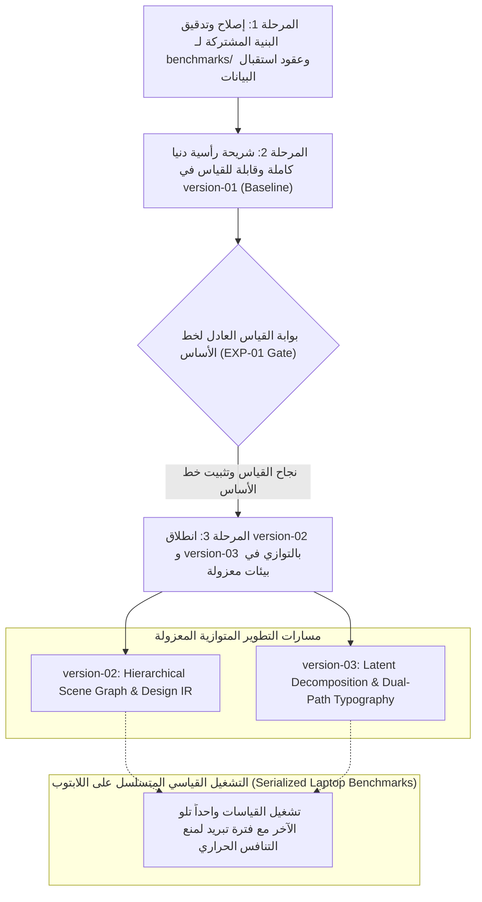
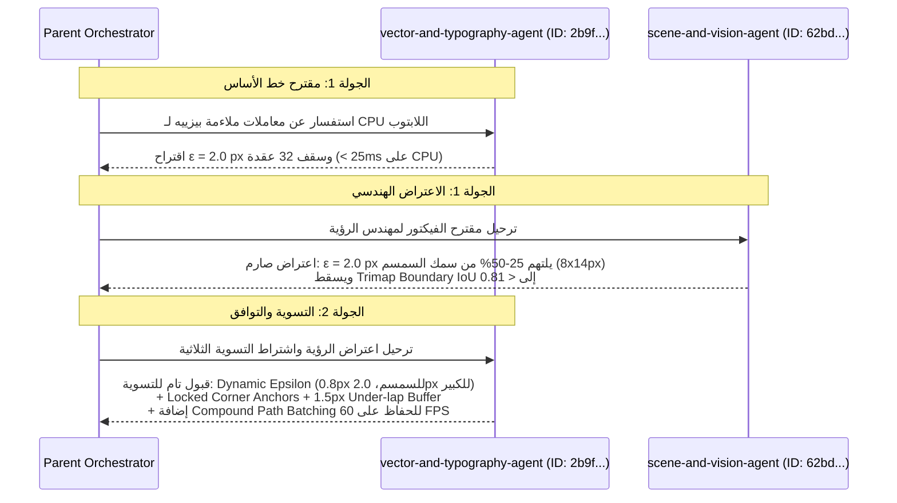
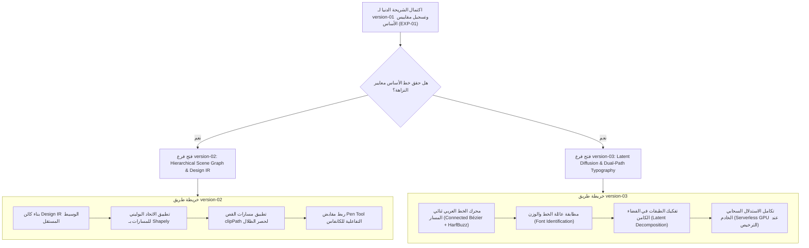

<!-- DOC_PROVENANCE
{"created_at_utc": "2026-10-17T09:38:45Z", "last_action": "CREATED", "last_change_id": "TASK-COLLAB-ENG-01", "last_edited_at_utc": "2026-10-17T09:38:45Z", "last_editor": "orchestrator-planner", "tracking_started_at_utc": "2026-10-17T09:38:45Z"}
END_DOC_PROVENANCE -->
# استراتيجية تطوير الإصدارات والعمل الهندسي التعاوني متعدد الوكلاء وحوكمة الأداء
## Collaborative Multi-Agent Engineering, Version Strategy & Performance Governance

**الحالة:** معتمدة كمرجعية حوكمية وتشغيلية ملزمة (`ACTIVE_GOVERNANCE_SPECIFICATION`)  
**حالة اعتماد المعمارية:** غير معتمدة بعد (`NOT_APPROVED — PROPOSED_FOR_OWNER_REVIEW`)  
**بيئة التشغيل:** تجارب محلية مجانية حصرياً على لابتوب المالك الشخصي (Windows Laptop) — حظر تام لأي خدمات مدفوعة أو تدريب نماذج.

---

## 1. استراتيجية تطوير الإصدارات الهجينة المحكومة (Deliverable 1: Controlled Hybrid Version Plan)

تعتمد استراتيجية التطوير مبدأ **الهجين المحكوم (Controlled Hybrid Strategy)** لمنع التشتت البرمجي ومنع هدر موارد لابتوب المالك:



### القواعد الحاكمة لاستراتيجية الإصدارات:
1. **أولوية البنية المشتركة أولاً:** يتم أولاً تثبيت وتدقيق أدوات القياس المشتركة (`benchmarks/harness/run_benchmark.py`) ومخطط التيليميتري وعقود استقبال البيانات قبل تشغيل أي نموذج.
2. **شريحة رأسية دنيا لـ `version-01` قبل فتح التوازي:**
   - يُحظر استكمال تطبيق `version-01` بالكامل قبل استكشاف البدائل.
   - المطلوب فقط هو شريحة رأسية دنيا متكاملة (End-to-End Measurable Baseline Slice): استقبال صورة -> تكميم لوني -> ملاءمة بيزييه لشنايدر -> تجميع SVG في مجموعات دلالية `<g>`، وقياس أدائها بدقة.
3. **التوازي المعزول لـ `version-02` و`version-03`:**
   - بمجرد قياس خط الأساس بدقة، يُسمح لوكلاء `version-02` و`version-03` بالعمل بالتوازي في مجلداتهم وفروعهم المعزولة دون أي تداخل في ملكية الملفات.
4. **تسلسل القياسات الثقيلة على اللابتوب (`Mandatory Serialization of Heavy Benchmarks`):**
   - يُحظر قطعياً تشغيل قياسين معياريين في نفس الوقت على جهاز المالك. تُشغل الاختبارات الحسابية بشكل متسلسل وبفارق زمني (Cooldown $\ge 10\text{s}$) لمنع اختناق المعالج (Thermal Throttling) أو تشويه زمن الاستجابة.
5. **عدم التفوق التلقائي للإصدار الأحدث وحفظ الفشل:**
   - لا يُعتبر الإصدار الأحدث أفضل بحكم تسميته؛ الفيصل الحاسم هو الأرقام التجريبية في `RESULTS_MATRIX.md`.
   - لا يُحذف أي كود أو تجربة فاشلة؛ التوثيق الشامل لأسباب الفشل يمنع تكرار المسارات العقيمة.

---

## 2. بروتوكول التواصل الحقيقي بين الوكلاء وأدلته المثبتة (Deliverable 2: Verified Inter-Agent Communication)

### أ. التحقق العملي في بيئة Antigravity الحية:
تم التحقق العملي من قدرات التواصل المباشر بين الوكلاء عبر أداة `send_message(Recipient=<conversationId>, Message=...)`:
- **استفاقة الوكلاء الخاملين (`Idle Agent Reawakening`):** تم إثبات أن إرسال رسالة لوكيل في حالة `idle` يعيده فوراً إلى حالة `running` لمعالجة الطلب والرد.
- **التواصل عبر الوساطة الشفافة للمنسق (`Transparent Parent-Mediated Relay`):** يقوم الـ Orchestrator بتمرير المقترحات والاعتراضات بين الوكلاء المتخصصين مع ذكر المعرفات الدقيقة ومسارات السجلات، مما يمنع التزييف ويحفظ تاريخ النقاش بالكامل.

### ب. السجل التدقيقي للمناظرة الهندسية الحية (Verifiable Debate Rounds):



* **مرجع رسائل الجولة الأولى:** استفسار الـ Orchestrator ورد الوكيل `2b9fedf2-a7e4-4d8b-b6b2-445f54e59a39` بتوقيت `2026-10-17T09:31:40Z`.
* **مرجع اعتراض الرؤية:** رسالة الوكيل `62bdf433-aa6e-4b60-93d2-047298deb219` بتوقيت `2026-10-17T09:33:03Z`.
* **مرجع التوافق النهائي:** رد الوكيل `2b9fedf2-a7e4-4d8b-b6b2-445f54e59a39` بتوقيت `2026-10-17T09:33:45Z`.
* **النتيجة الهندسية المثبتة:** تم الاتفاق على خوارزمية تفاوت تكيفية هجينة تضمن دقة حواف $IoU \ge 0.90$ وتعمل في أقل من `80ms` على معالج لابتوب المالك.

---

## 3. دورة تنفيذ المهام الهندسية الكبرى (Deliverable 3: Large Task Workflow Stages A–I)

تلتزم كافة الوكلاء بالدورة الصارمة المكونة من تسع مراحل:

1. **STAGE A — المتطلبات (`REQUIREMENTS`):** قراءة الرؤية الأصلية `OWNER_ORIGINAL_VISION.md`، استخراج القيود الصريحة، وتحديد معايير القبول واختبارات التحقق.
2. **STAGE B — البحث المستقل (`INDEPENDENT RESEARCH`):** استدعاء الوكلاء المعنيين للبحث في البدائل الهندسية في سياقات معزولة.
3. **STAGE C — المناظرة والتحدي المتبادل (`ENGINEERING DEBATE`):** إجراء جولة تحدٍ ورد موثقة بين الوكلاء، وحظر الادعاء بوجود مناظرة دون تبادل رسائل حقيقي.
4. **STAGE D — تركيب القرارات والاعتماد المقيد (`DECISION SYNTHESIS`):** صياغة القرار المدعوم بالأدلة، مع بقاء حالة المعمارية الشاملة `NOT_APPROVED`.
5. **STAGE E — تفكيك وحدات العمل وأقفال الملفات (`WORK DECOMPOSITION & LOCKS`):** تقسيم المهمة إلى حزم عمل حصرية؛ تسجيل أقفال الملفات في `memory/findings/subagent_ownership_locks.json` لمنع تصادم الكتابة المتوازية.
6. **STAGE F — التنفيذ التخصصي الموجه (`SPECIALIZED IMPLEMENTATION`):** كتابة الكود داخل النطاق المصرح به مع وسوم `START CHANGE` و`END CHANGE` الدقيقة وتحديث مرايا الكود وسجلات الدوال.
7. **STAGE G — التدقيق المستقل الصارم (`INDEPENDENT REVIEW`):** استدعاء المراجع الهندسي المستقل `qa-reviewer-auditor` لفحص الكود بالكامل، والتأكد من انعدام الدوال المكررة ومطابقة أرقام الأسطر.
8. **STAGE H — المعالجة وإعادة التحقق (`REPAIR AND REVERIFY`):** إعادة أي ملاحظات للوكيل المنفذ لإصلاحها، ثم إعادة تشغيل أدوات الفحص الخمس.
9. **STAGE I — الإغلاق القائم على الأدلة (`EVIDENCE-BASED COMPLETION`):** لا تُغلق المهمة إلا بعد الحصول على `AUDIT_RESULT: PASSED` وتحديث نقطة التوقف `CURRENT_TASK_CHECKPOINT.md` وسجل الـ `WAL`.

---

## 4. بطاقة تعريف دور مهندس الأداء وتحسين الموارد (Deliverable 4: Performance Specialist Role)

تم إنشاء وتسجيل الوكيل المخصص: [`.agents/agents/performance-optimization-specialist.md`](file:///c:/Users/Mohamed/Desktop/AiGraphicDesigner/.agents/agents/performance-optimization-specialist.md).

### مصفوفة الصلاحيات والقيود الحاكمة للأداء:
| البعد الهندسي | التوجيه الملزم | المؤشر الرقابي |
| :--- | :--- | :--- |
| **استهلاك الـ CPU** | الاستفادة من 6 أنوية المعالج بـ ProcessPool (2–4 خيوط كحد أقصى لمنع السخونة). | `CPU Usage <= 75%` لكل عملية. |
| **استهلاك الـ RAM** | تفريغ مصفوفات البكسل فور توليد المسارات، واستخدام المولدات (`Generators`). | `Peak RAM < 4.0 GB` لمنع الـ Paging. |
| **استهلاك الـ VRAM** | حظر تحميل نماذج ثقيلة على بطاقة MX130 (2GB VRAM) محلياً. | `VRAM Allocation = 0` (الاعتماد على CPU/ONNX محلياً). |
| **حظر التراجع في الجودة** | أي تحسين سرعة يقلل من الدقة البصرية أو قابلية تعديل الفيكتور يُلغى فوراً. | `Trimap IoU >= 0.90`, `Nodes <= 32`. |

---

## 5. الفصل الصارم للمسؤوليات بين المنفذين والمراجع المستقل (Deliverable 5: Segregation of Duties)

- **الوكلاء المنفذون (`Implementation Agents`):** يمتلكون صلاحيات القراءة والكتابة داخل نطاق ملفاتهم فقط، ويحظر عليهم اعتماد كودهم بأنفسهم (`No Self-Approval`).
- **المراجع الهندسي المستقل ([`qa-reviewer-auditor`](file:///c:/Users/Mohamed/Desktop/AiGraphicDesigner/.agents/agents/qa-reviewer-auditor.md)):**
  - **صلاحية قراءة وفحص وتشغيل أدوات التحقق فقط (`Read-Only + Audit Execution`).**
  - لا يكتب كود المنتج؛ مهمته التفتيش الصارم ومقارنة الواقع بالمكتوب واكتشاف التناقضات والدوال المكررة وإصدار أحكام الاعتماد.

---

## 6. بروتوكول تقييم المصادر المفتوحة وتتبع الأصل (Deliverable 6: Open-Source Research Protocol)

عند دراسة أي مكتبة أو خوارزمية مفتوحة المصدر (مثل خوارزميات شنايدر، ومكتبات بيزييه، وShapely، وPotrace)، يلتزم الوكلاء بمصفوفة الفحص الثمانية:

1. **مدى مطابقة المشكلة (`Problem-Fit Match`):** هل تحل المكتبة متطلباتنا حرفياً أم تتطلب تعديلات معقدة؟
2. **نضج الصيانة والتحديث (`Maintenance & Release Maturity`):** تاريخ آخر تحديث، نشاط المجتمع، وخلوها من المشاكل المهجورة.
3. **التوافقية القانونية ورخص البرمجيات (`License Compliance`):** قبول الرخص الحرة غير التقييدية (`MIT`, `Apache 2.0`, `BSD`) وحظر الرخص المعدية (`GPL/AGPL`) التي تجبر على كشف الملكية الفكرية دون إذن.
4. **حجم الاعتماديات واستهلاك الموارد (`Footprint & Dependencies`):** تفضيل الحزم الصرفة أو قليلة التبعيات التي لا تثقل لابتوب المالك.
5. **سجل الأمان والثغرات (`Security & CVE History`):** خلو المكتبة من ثغرات حقن الكود أو فيضان الذاكرة.
6. **كفاءة الأداء (`Performance Profile`):** قياس زمن التنفيذ الفعلي واستهلاك الذاكرة محلياً.
7. **تعقيد الدمج والواجهات (`Integration Complexity`):** سهولة ربطها مع عقود `Design IR` المعتمدة.
8. **مبرر إعادة الاستخدام مقابل البرمجة المستقلة (`Reuse vs. Custom Justification`):** منع إعادة اختراع العجلة للرياضيات المثبتة، مع حظر النسخ الأعمى بدون فهم.
- **التوثيق الدائم:** يُسجل كل مكون خارجي مع رابطه، نسخته المحددة، بصمة `SHA-256`، ورخصته في التوثيق المعماري.

---

## 7. عقود ومواصفات استقبال مجموعة البيانات البصرية (Deliverable 7: Benchmark Dataset Ingestion Contracts)

تخصيص بنية استقبال مجموعة الصور الـ 12 المرجعية القادمة من المالك عبر ChatGPT تحت [`benchmarks/datasets/`](file:///c:/Users/Mohamed/Desktop/AiGraphicDesigner/benchmarks/datasets/):

```text
benchmarks/datasets/
├── DATASET_INGESTION_CONTRACT.md            # عقد التحقق وشروط قبول البيانات
├── pending_chatgpt_suite/                   # مجلد الاستقبال (حالة: PENDING_OWNER_UPLOAD)
│   ├── easy/                                # المستوى السهل (3 صور: DS12-E01..E03)
│   ├── medium/                              # المستوى المتوسط (3 صور: DS12-M01..M03)
│   ├── hard/                                # المستوى الصعب (3 صور: DS12-H01..H03)
│   └── extreme/                             # المستوى المعقد والخط العربي (3 صور: DS12-X01..X03)
└── holdout_set/                             # مجموعة الاختبار المعزولة (3 صور لا تُستخدم في الضبط)
```

### مستويات الصعوبة الأربعة:
1. **المستوى السهل (`Easy - 3 Images: DS12-E01..E03`):** أشكال هندسية نظيفة، حواف مستقيمة، وتدرجات بسيطة (مثل الشعارات المسطحة والأيقونات).
2. **المستوى المتوسط (`Medium - 3 Images: DS12-M01..M03`):** ظلال ساقطة، طبقات شفافة، أشكال متداخلة، ومسارات قص (`Clipping Masks`).
3. **المستوى الصعب (`Hard - 3 Images: DS12-H01..H03`):** كائنات عضوية، أنسجة واقعية، حدود ضبابية، واحتجاب جزئي (مثل شطيرة البرجر، البطاطس، الفلافل).
4. **المستوى المعقد (`Extreme - 3 Images: DS12-X01..X03`):** شعارات إعلانية مركبة، خط عربي حر ومتشابك مع التشكيل، وتدرجات لونية معقدة.

### قواعد نزاهة مجموعة البيانات:
- **حالة المجموعة الحالية:** `PENDING_OWNER_UPLOAD` (تظل مصنفة كـ `NOT_READY` لحين رفع الملفات الحقيقية وبصماتها من المالك؛ ويُحظر استبدالها بصور عشوائية).
- **الفصل بين مستويات الحقيقة الأرضية (`Ground-Truth Layers`):**
  1. صورة المصدر النقطية (`Raw Visual Reference: .png`).
  2. أقنعة التجزئة المفحوصة (`Verified Semantic Masks: .png`).
  3. بيانات التجميع والترتيب العمقي (`Semantic Metadata: .json`).
  4. المتجه المرجعي المحترف (`Ground-Truth Clean SVG: .svg`).
- **عزل أصول الاختبارات البرمجية (`Synthetic Fixtures Isolation`):** الصور الاصطناعية المستخدمة في اختبارات الـ Unit Tests تظل معزولة داخل `tests/fixtures/` ويُحظر استخدامها في مصفوفة المقارنة الرسمية.
- **مجموعة الاختبار المحجوبة (`Fixed Holdout Set`):** تُخصص صورة واحدة من كل مستوى (إجمالي 3 صور) كـ Holdout لا يراها النموذج أو المطور أثناء ضبط المعاملات لضمان عدم التحيز.

---

## 8. تقييم عتاد لابتوب المالك وبروتوكول القياس الآمن (Deliverable 8: Laptop Hardware Assessment & Safe Benchmarking)

### أ. القياس الفعلي لعتاد جهاز المالك (Empirical Windows Telemetry):
- **المعالج المركزي (`CPU`):** `Intel(R) Core(TM) i7-8850H @ 2.60GHz` (6 Cores, 12 Logical Processors, Turbo up to 4.3 GHz).
- **الذاكرة العشوائية (`RAM`):** `16.0 GB DDR4` (المتاح الفعلي: `15.82 GB`).
- **بطاقة الرسوميات (`GPU`):** `NVIDIA GeForce MX130` (معمارية Maxwell، سعة 2GB VRAM) + `Intel UHD Graphics 630`.
- **نظام التشغيل والبيئة:** `Windows 11/10 x64`, `Python 3.14.2`.

### ب. القيود الهندسية المستنتجة لحماية اللابتوب:
1. **بطاقة الـ MX130 لا تصلح للنماذج الكبيرة:** سعة 2GB VRAM غير كافية إطلاقاً لتشغيل Stable Diffusion أو SAM 2 Large محلياً؛ أي محاولة لتحميل هذه النماذج على كارت الشاشة ستؤدي إلى `CUDA Out of Memory` فوري أو تجميد للنظام.
2. **الحل المحلي المعتمد لـ `version-01`:** تشغيل خط الأنابيب بالكامل على **المعالج المركزي (CPU)** باستخدام خوارزميات بيزييه المكتوبة بلغة C/Python (عبر Shapely/NumPy)، ونماذج التجزئة الخفيفة ذات الاستدلال السريع، وهو ما يحقق سرعة عالية دون استهلاك GPU.
3. **سقف استهلاك الذاكرة العشوائية (`Safe RAM Budget`):** حصر استهلاك العملية الواحدة في أقل من `4.0 GB RAM` لضمان بقاء أكثر من 8 GB لنظام التشغيل وبيئة التطوير ومنع الـ Disk Paging.
4. **بروتوكول القياس الآمن ومنع الاختناق الحراري (`Thermal Throttling Protection`):**
   - حظر تشغيل قياسات الأداء بالتوازي.
   - تشغيل الاختبارات القياسية واحداً تلو الآخر في خيط تحكم مفرد مع إيقاف مؤقت لمدة 10 ثوانٍ بين كل أصل وآخر لتبريد مروحة اللابتوب وضمان دقة قياسات الزمن.

---

## 9. معالم وخطة الشريحة الرأسية الدنيا لـ version-01 (Deliverable 9: Version-01 Baseline Slice Milestone)

### أ. تعريف الشريحة الرأسية الدنيا (Vertical Slice Definition):
بناء خط أنابيب متسلسل محلي خفيف الوزن ومقيد الحجم يثبت إمكانية تحويل الصورة النقطية إلى مسارات فيكتور نظيفة ومجمعة دلالياً:
$$\text{Local Raster Image} \longrightarrow \text{CIELAB Quantization} \longrightarrow \text{Contour Extraction} \longrightarrow \text{Scale-Aware Schneider Bézier} \longrightarrow \text{Clean Semantic SVG}$$

### ب. حزم العمل المحددة ومعايير القبول الصارمة:
1. **الموديول الأول (`src/quantization/cielab_quantizer.py`):**
   - تحويل الصورة إلى فضاء CIELAB وتكميم الألوان إلى مسارات رئيسية وظلال.
   - **معيار القبول:** زمن المعالجة $\le 45\text{ms}$ لصورة $1024 \times 1024$ على CPU.
2. **الموديول الثاني (`src/geometry/schneider_fitter.py`):**
   - تطبيق خوارزمية شنايدر مع التفاوت التكيفي المعتمد ($\epsilon = 0.8\text{ px}$ للمكونات الدقيقة، و$\epsilon = 2.0\text{ px}$ للمكونات الكبيرة) وتثبيت زوايا الانكسار وتمديد الطبقة السفلية $1.5\text{ px}$.
   - **معيار القبول:** $IoU \ge 0.90$، وعدد العقد $\le 32$ للمسار الأساسي.
3. **الموديول الثالث (`src/svg/semantic_group_emitter.py`):**
   - إخراج ملف SVG نظيف يحوي المجموعات الدلالية `<g id="Layer_Base">` و`<g id="Layer_Shadow">` مع دمج حبات السمسم في Compound Path موحد.
   - **معيار القبول:** حجم ملف SVG $\le 12\text{ KB}$ وتصيير سليم في المتصفح بـ 60 FPS.
4. **بوابة الاعتماد:** اجتياز الاختبارات المحلية 100%، وتدقيق `qa-reviewer-auditor`، وتسجيل التيليميتري الحقيقية في `benchmarks/RESULTS_MATRIX.md` دون أي تكلفة مالية.

---

## 10. خريطة الطريق الواعية بالاعتماديات للإصدارين version-02 و version-03 (Deliverable 10: Dependency-Aware Roadmap)



### شروط بوابات الانتقال:
1. **انطلاق `version-02`:** مشروط بنجاح قياسات `version-01` وتحديد نقاط الضعف في تفتيت المسارات ليتم حلها عبر الـ `Design IR` ومسارات الـ `<clipPath>`.
2. **انطلاق `version-03`:** مشروط ببدء تجارب الخط العربي محلياً عبر مكتبات الخطوط الحرة (`fonttools` و`uharfbuzz`) دون الحاجة لنماذج مدفوعة، مع تجميد استدعاءات نماذج الانتشار السحابية الكبيرة حتى صدور تصريح رسمي وميزانية معتمدة من المالك.
