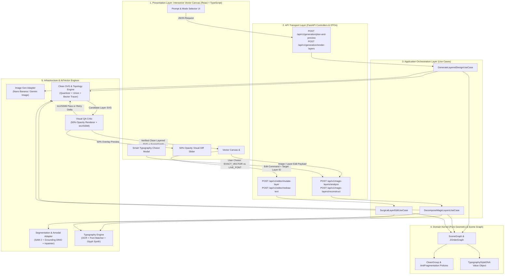

<!-- DOC_PROVENANCE
{"created_at_utc": null, "last_action": "IMPORTED_LEGACY", "last_change_id": "BASELINE-IMPORT", "last_edited_at_utc": null, "last_editor": "governance-baseline", "tracking_started_at_utc": "2026-10-17T06:52:16Z"}
END_DOC_PROVENANCE -->
# شرح المعمارية الشاملة وتدفق البيانات (`memory/ARCHITECTURE_AND_DATA_FLOW.md`)

تشرح هذه الوثيقة بالتفصيل الممل كيف يعمل مشروع **AI Graphic Designer** من الداخل، وكيف تنتقل البيانات من واجهة المستخدم (`Frontend Canvas`) إلى الـ `Backend API` ثم إلى محركات الذكاء الاصطناعي والـ `Clean SVG` والعودة، حتى يتمكن أي مطور أو Agent من فهم النظام بالكامل وتعديله بسهولة.

## 1. المخطط العام لتدفق البيانات (`End-to-End System Data Flow — مين بياخد منين وبيرمي فين`)

## 2. التفصيل الدقيق لكل طبقة وعلاقتها بباقي الطبقات

### أ. طبقة الواجهة التفاعلية (`Frontend Canvas UI — web/src/`)
- **من أين تأخذ البيانات (`Takes From`):**
  - تأخذ مدخلات المستخدم (الوصف النصي، أو الصورة المرفوعة، أو قرار الفونت، أو تحريك نقاط الـ Pen Tool).
  - وتستقبل من الـ `FastAPI Backend` كائن `SceneGraphDTO` وملف الـ `Clean SVG` المقسم إلى مجموعات `<g>` وتقارير المطابقة البصرية (`IoU / 50% Opacity Overlay`).
- **إلى أين ترمي البيانات (`Throws To`):**
  - ترسل طلبات HTTP محكمة (`Strict Zod/Pydantic Schemas`) إلى نقاط النهاية في `src/api/routes/`.

### ب. طبقة الـ API وحالات الاستخدام (`API & Application Use Cases — src/api/ & src/application/`)
- **من أين تأخذ البيانات (`Takes From`):**
  - تستقبل الـ Requests من الواجهة، وتقرأ حالة المشروع الحالية من مخزن الجلسات/قاعدة البيانات (`ProjectStateRepository`).
- **إلى أين ترمي البيانات (`Throws To`):**
  - تحول الطلب إلى كائنات مجال (`Domain Commands`) وتوزع العمل بالترتيب على محولات البنية التحتية (`Infrastructure Adapters`)، ولا تسمح بتمرير أي طبقة للمستخدم قبل أن تحصل على ختم `opacity_50_verified = True` من `VisualQaCritic`.

### ج. محرك الـ Clean SVG ومنع التشظي (`Clean Vector Engine — src/infrastructure/vector_engine/`)
- **من أين يأخذ البيانات (`Takes From`):**
  - يأخذ صورة الطبقة المفردة (في الوضع الأول) أو قناع العنصر المعزول والمكمّل (`Amodal Completed Semantic Mask` في الوضع الثاني) مع إحداثيات الـ `Bounding Box` والـ `Z-Index`.
- **ماذا يفعل بداخله؟**
  1. يفصل العنصر الأساسي عن الظل والإضاءة (`Functional Color Quantization`).
  2. يدمج الأجزاء المتجاورة من نفس اللون/الظل (`Adjacent Path Union`) حتى لا يتفتت العنصر (مثل الفلافل أو البطاطس) إلى مئات الشظايا.
  3. يحول كل شكل مدمج إلى منحنى Bézier نظيف وقليل النقاط، ويقص أي بروز يخرج عن حدود الشكل الأساسي (`Boundary Clipping`).
  4. يغلّف الشكل الأساسي + الظل داخل `<g id="Potato">` نظيف.
- **إلى أين يرمي البيانات (`Throws To`):**
  - يرمي كائن `SvgGroupNode` إلى `VisualQaCritic` لفحص تطابق الـ 50% Opacity والـ IoU، ثم إلى `SvgExporter` لإنتاج الكود النهائي.

### د. محرك الحوكمة والذاكرة الحية (`Governance & Brain Sync Tools — tools/`)
- **`tools/memory_guard/sync_code_mirrors.py`:** يقرأ جميع ملفات الكود في المستودع (`Takes From: All Code Files`) -> يستخرج شجرة الـ AST وأرقام الأسطر الدقيقة والمقتطفات -> ويرمي المخرجات (`Throws To`) في `memory/code_mirrors/*.md` و`memory/FUNCTION_REGISTRY.md`.
- **`tools/memory_guard/verify_brain_sync.py`:** يقرأ ملفات الكود وملفات `memory/` و`.agents/rules/` -> يتحقق من التطابق التام وعدم وجود دوال مكررة -> ويرمي تقرير الفحص (`Throws To`) في `tools/memory_guard/brain_validation.json` وإلى بوابة التوقف (`stop_gate_hook.py`).
