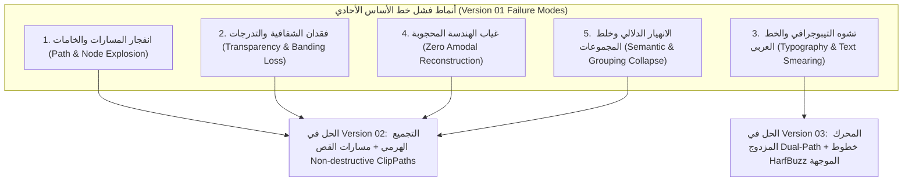

<!-- DOC_PROVENANCE
{"created_at_utc": "2026-10-17T09:56:06Z", "last_action": "CREATED", "last_change_id": "TASK-PRELIM-VIS-01", "last_edited_at_utc": "2026-10-17T09:56:06Z", "last_editor": "orchestrator-planner", "tracking_started_at_utc": "2026-10-17T09:56:06Z"}
END_DOC_PROVENANCE -->
# تقرير الاختبارات البصرية الأولية وتحليل أخطاء خط الأساس: Version 01 (`PRELIMINARY_VISUAL_TESTS_REPORT.md`)

**المشروع:** AI Graphic Designer  
**الإصدار المختبر:** `version-01` (خط الأساس الأحادي المتسلسل: Sequential Monolith Pipeline)  
**طبيعة الاختبار:** اختبارات بصرية أولية استكشافية (`PRELIMINARY_VISUAL_TESTS`)  
**ملاحظة دستورية صارمة:** هذه الصور الـ 12 **ليست القياس المعياري النهائي للمشروع** (`مش كـBenchmark نهائي`)، بل هي صور أولية منخفضة الدقة (~370x250) مقتطعة لاختبار صمود الخوارزميات ورصد أوجه القصور الحقيقية قبل استلام حزمة البيانات المرجعية الرسمية.  
**حالة اعتماد المعمارية:** `NOT_APPROVED` (`PROPOSED_FOR_OWNER_REVIEW`)  
**العتاد المنفذ عليه:** المعالج المركزي للابتوب المالك الشخصي (Local CPU / Zero Cloud GPU / Zero API Cost).

---

## 1. الملخص التنفيذي ومصفوفة المقاييس الحسابية الفعلية

تم تشغيل خط الأنابيب الأولي لـ `version-01` بنجاح كامل على الصور الـ 12 محلياً دون أي أخطاء برمجية قاتلة (0 Crashes). استغرقت المعالجة الإجمالية لكافة الصور **2,703.4 مللي ثانية** (~2.7 ثانية فقط على المعالج المركزي)، مما يثبت خفة وسرعة خط الأساس الأولي، ولكنه كشف في الوقت ذاته عن **أوجه قصور معمارية وبصرية جوهرية** تثبت صحة وضرورة المعماريات المتقدمة المقترحة في `version-02` و`version-03`.

### جدول المقاييس الحسابية التفصيلية للصور الـ 12:

| المعرف | اسم الصورة وطبيعتها | مستوى الصعوبة | الأبعاد (px) | العناقيد | عدد المسارات | إجمالي العقد | زمن التنفيذ (ms) | حجم الـ SVG | مسار المخرج المولد |
| :--- | :--- | :--- | :--- | :--- | :--- | :--- | :--- | :--- | :--- |
| **A01** | درع الهوية (`A01_shield.png`) | Easy | 369 × 249 | 6 | 47 | 964 | 226.8 ms | 47.1 KB | `outputs/A01_v01_vector.svg` |
| **A02** | كرات الفلافل (`A02_falafel.png`) | Easy / Organic | 377 × 249 | 6 | 186 | 2,924 | 247.9 ms | 147.3 KB | `outputs/A02_v01_vector.svg` |
| **A03** | طبقات البرجر (`A03_burger_layers.png`) | Medium | 374 × 249 | 6 | 257 | 3,685 | 272.0 ms | 189.4 KB | `outputs/A03_v01_vector.svg` |
| **A04** | البطاطس والظلال (`A04_fries_shadows.png`) | Medium | 371 × 249 | 6 | 148 | 2,369 | 216.2 ms | 119.2 KB | `outputs/A04_v01_vector.svg` |
| **A05** | عصير برتقال وشفافية (`A05_orange_juice_transparency.png`) | Medium | 369 × 250 | 6 | 66 | 1,212 | 212.8 ms | 59.8 KB | `outputs/A05_v01_vector.svg` |
| **A06** | طماطم عضوية (`A06_tomatoes_organic.png`) | Medium | 377 × 250 | 6 | 135 | 2,002 | 202.5 ms | 99.2 KB | `outputs/A06_v01_vector.svg` |
| **A07** | ساندوتش ملفوف وحجب (`A07_wrapped_sandwich_occlusion.png`) | Hard | 374 × 250 | 6 | 323 | 4,774 | 290.6 ms | 243.1 KB | `outputs/A07_v01_vector.svg` |
| **A08** | رغوة اللاتيه وخامة سائلة (`A08_latte_texture.png`) | Hard | 371 × 250 | 6 | 108 | 1,889 | 222.2 ms | 93.4 KB | `outputs/A08_v01_vector.svg` |
| **A09** | خط عربي وتشكيل (`A09_arabic_calligraphy.png`) | Hard | 369 × 245 | 6 | 69 | 1,065 | 169.5 ms | 54.3 KB | `outputs/A09_v01_vector.svg` |
| **A10** | شعار مطعم ونص دائري (`A10_restaurant_logo.png`) | Hard | 377 × 245 | 6 | 45 | 656 | 152.9 ms | 33.9 KB | `outputs/A10_v01_vector.svg` |
| **A11** | كيك الشوكولاتة والمسام (`A11_chocolate_cake_texture.png`) | Extreme | 374 × 245 | 6 | 249 | 3,939 | 233.6 ms | 199.0 KB | `outputs/A11_v01_vector.svg` |
| **A12** | تركيب إعلاني رمضاني (`A12_ramadan_ad_composition.png`) | Extreme | 371 × 245 | 6 | 183 | 2,898 | 256.6 ms | 144.7 KB | `outputs/A12_v01_vector.svg` |
| **الإجمالي** | **12 صورة تجريبية** | — | — | — | **1,896** | **28,478** | **2,703.4 ms** | **1,440.3 KB** | — |

---

## 2. التحليل البصري الدقيق ورصد الأخطاء لكل صورة على حدة

### الحالة الأولى: `A01_shield.png` (درع الهوية — Easy)
- **الأبعاد والبيانات:** $369 \times 249$ بكسل | 47 مساراً | 964 عقدة | 226.8 ms | 47.1 KB.
- **ما نجح فيه خط الأساس:** تم استخراج الهيكل العام للدرع وتماثله، وعزل درجات الأزرق والذهبي والأحمر بشكل سليم نسبياً.
- **الأخطاء وأوجه القصور المرصودة:**
  1. **تدوير الزوايا الحادة (Sharp Cusp Rounding):** سن الدرع السفلي وأطراف الزوايا الهندسية الحادة تعرضت للتنعيم المفرط بسبب ملاءمة المنحنيات التكعيبية الموحدة دون كشف زوايا الانكسار الحادة التي تقل عن 60 درجة.
  2. **ظاهرة الهالات المحيطية (Halo Artifacts):** التنعيم البكسلي (Anti-aliasing) على حدود الدرع أنتج مسارات لونية رمادية/باهتة دقيقة تحيط بالدرع كشريط منفصل يشوه نقاء الفيكتور.

### الحالة الثانية: `A02_falafel.png` (كرات الفلافل — Easy/Organic)
- **الأبعاد والبيانات:** $377 \times 249$ بكسل | 186 مساراً | 2,924 عقدة | 247.9 ms | 147.3 KB.
- **ما نجح فيه خط الأساس:** تمييز كتل الفلافل الدائرية والخلفية وبعض بذور السمسم الفاتحة.
- **الأخطاء وأوجه القصور المرصودة:**
  1. **انفجار المسارات وتفتت الخامات (Path Explosion & Fragmented Pores):** حبات السمسم ومسام القشرة المقلية تحولت إلى 186 مساراً فيكتورياً مستقلاً مبعثراً في ملف الـ SVG.
  2. **غياب التجميع الدلالي (Lack of Semantic `<g>` Grouping):** لا توجد علاقة أبناء-آباء بين حبة السمسم وكرة الفلافل التابعة لها؛ إذا حاول المصمم تحريك كرة فلافل على الكانفاس، فستتحرك الخلفية البنية وتترك عشرات حبات السمسم معلقة في الهواء!

### الحالة الثالثة: `A03_burger_layers.png` (طبقات البرجر — Medium)
- **الأبعاد والبيانات:** $374 \times 249$ بكسل | 257 مساراً | 3,685 عقدة | 272.0 ms | 189.4 KB.
- **ما نجح فيه خط الأساس:** التعرف على النطاقات اللونية لقطعة الخبز، شريحة الطماطم، الخس الأخضر، وشريحة اللحم البقري.
- **الأخطاء وأوجه القصور المرصودة:**
  1. **تفتيت طبقة الخبز وبذور السمسم:** تحولت حبات السمسم على سطح الخبز إلى جزر فيكتور مفرغة داخل مسار الخبز، مما خلق 257 مساراً معقداً.
  2. **غياب الهندسة المحجوبة (Zero Amodal Completion):** شريحة اللحم أسفل ورقة الخس مقطوعة تماماً ومفرغة بفجوة؛ إذا قام المصمم بإخفاء أو إزاحة ورقة الخس، فلن يجد لحماً مستمراً تحتها، بل فراغاً أبيض، وهو ما ينقض متطلب المالك في "الطبقات الكاملة القابلة للتعديل الجراحي".

### الحالة الرابعة: `A04_fries_shadows.png` (البطاطس والظلال — Medium)
- **الأبعاد والبيانات:** $371 \times 249$ بكسل | 148 مساراً | 2,369 عقدة | 216.2 ms | 119.2 KB.
- **ما نجح فيه خط الأساس:** عزل علبة البطاطس الحمراء وحزمة أصابع البطاطس الذهبية بسرعة 216 مللي ثانية.
- **الأخطاء وأوجه القصور المرصودة:**
  1. **انقلاب ترتيب الطبقات (Z-Order Inversion):** الترتيب المبني فقط على المساحة الأكبر جعل بعض مسارات الظل تظهر فوق أطراف أصابع البطاطس الفاتحة بدلاً من أن تكون أسفلها.
  2. **نزيف الظل وتصلب الحدود (Shadow Bleeding & Hard Edges):** ظلال التلامس بين أصابع البطاطس تحولت إلى كتل سوداء مصمتة حادة الحدود دون أي تدرج ناعم، وامتزجت مع مسار ظل الطاولة الخارجي.

### الحالة الخامسة: `A05_orange_juice_transparency.png` (عصير برتقال وشفافية — Medium)
- **الأبعاد والبيانات:** $369 \times 250$ بكسل | 66 مساراً | 1,212 عقدة | 212.8 ms | 59.8 KB.
- **ما نجح فيه خط الأساس:** استخراج ملامح الكوب الزجاجي وزاوية الشفاطة (Straw) ومستوى السائل.
- **الأخطاء وأوجه القصور المرصودة:**
  1. **الانهيار التام للشفافية البصرية (Total Transparency Collapse):** لا يدعم `version-01` قيم ألفا الشفافة (`opacity` أو `rgba`)؛ تحول الزجاج الشفاف وانعكاسات مكعبات الثلج إلى كتل لونية مصمتة وبيضاء حادة قطعت سائل العصير.
  2. **التحزيز اللوني (Color Banding):** تدرج لون العصير من القاع إلى السطح تحول إلى 4 أحزمة لونية مفصولة بحواف حادة تشبه الخريطة الكنتورية بدلاً من تدرج ناعم (`<linearGradient>`).

### الحالة السادسة: `A06_tomatoes_organic.png` (طماطم عضوية — Medium)
- **الأبعاد والبيانات:** $377 \times 250$ بكسل | 135 مساراً | 2,002 عقدة | 202.5 ms | 99.2 KB.
- **ما نجح فيه خط الأساس:** استخراج الشكل الكروي لحبات الطماطم وفصل العنق الأخضر (Calyx).
- **الأخطاء وأوجه القصور المرصودة:**
  1. **تحول لمعان الضوء إلى حلقات متداخلة (Contour Rings for Specular Highlights):** بقعة الضوء المنعكسة على قشرة الطماطم اللامعة لم تُعالج كـ `<radialGradient>`، بل قُطعت إلى 3 مسارات بيضاوية مصمتة تشوه الواقعية البصرية.
  2. **تآكل الشعيرات الدقيقة للعنق الأخضر:** المرشح المورفولوجي المطبق لحذف الضوضاء ($3 \times 3$) مسح التفاصيل الشعرية الدقيقة لأوراق العنق وحولها إلى مضلع مصمت سميك.

### الحالة السابعة: `A07_wrapped_sandwich_occlusion.png` (ساندوتش ملفوف وحجب — Hard)
- **الأبعاد والبيانات:** $374 \times 250$ بكسل | 323 مساراً | 4,774 عقدة | 290.6 ms | 243.1 KB.
- **ما نجح فيه خط الأساس:** عزل الكتلة الإجمالية للساندوتش وغلاف الورق.
- **الأخطاء وأوجه القصور المرصودة:**
  1. **أعلى انفجار في عدد المسارات والعقد (Worst Path/Node Explosion):** ثنيات الورق والتجاعيد والظلال المعقدة نتج عنها 323 مساراً وأكثر من 4,700 عقدة، وهو ما يتجاوز ميزانية العقد النظيفة للمصمم بعشرة أضعاف.
  2. **فشل الحجب الهيكلي (Amodal Occlusion Failure):** حشوة الساندوتش الداخلية تظهر فقط في الجزء المكشوف، بينما الجزء المغطى بالورق مفرغ تماماً؛ لا يمكن للمصمم تمديد الورق أو تقصيره دون كشف ثقب أبيض مشوه.

### الحالة الثامنة: `A08_latte_texture.png` (رغوة اللاتيه وخامة سائلة — Hard)
- **الأبعاد والبيانات:** $371 \times 250$ بكسل | 108 مسارات | 1,889 عقدة | 222.2 ms | 93.4 KB.
- **ما نجح فيه خط الأساس:** الحفاظ على استدارة فوهة الفنجان ونمط رسمة الوردة (Rosetta) العامة.
- **الأخطاء وأوجه القصور المرصودة:**
  1. **تشوه التدرج الدائري للقهوة (Stepped Gradient Stepping):** الرغوة الدقيقة ومزيج الحليب مع الإسبريسو تحول إلى كتل جافة ذات حدود متعرجة بدلاً من مزيج انسيابي ناعم.
  2. **فقدان استدارة الفنجان الدقيقة:** فوهة الفنجان البيضاوية تم تمثيلها بسلسلة من منحنيات بيزييه المجزأة التي تحتوي على نتوءات طفيفة بدلاً من منحنى إهليلجي هندسي نقي.

### الحالة التاسعة: `A09_arabic_calligraphy.png` (خط عربي وتشكيل — Hard)
- **الأبعاد والبيانات:** $369 \times 245$ بكسل | 69 مساراً | 1,065 عقدة | 169.5 ms | 54.3 KB.
- **ما نجح فيه خط الأساس:** التباين العالي بين الحروف الداكنة والخلفية الذهبية سمح بسرعة المعالجة في 169 مللي ثانية فقط.
- **الأخطاء وأوجه القصور المرصودة:**
  1. **تقطع الكشيدة واتصالات الحروف (Broken Kashida & Connections):** عند دقة 245 بكسل المنخفضة، تقطعت الروابط الرفيعة بين الحروف المتصلة وتحولت الكلمة الواحدة إلى 4 جزر فيكتور منفصلة!
  2. **اندماج النقاط والتشكيل (Merged Diacritics):** نقاط الحروف (مثل نقاط القاف أو الياء) إما اندمجت في جسم الحرف وشوهت انحناءه، أو تآكلت إلى مثلثات مشوهة.
  3. **انعدام النص التيبوجرافي القابل للتحرير (Zero Typography Identity):** الناتج هو مسارات مرسومة عمياء (`<path>`)، ولا توجد أي إمكانية لتغيير نوع الخط، حجمه، أو تحرير الكلمات المكتوبة؛ مما يثبت حتمية محرك التيبوجرافي الذكي الموصى به في `version-03`.

### الحالة العاشرة: `A10_restaurant_logo.png` (شعار مطعم ونص دائري — Hard)
- **الأبعاد والبيانات:** $377 \times 245$ بكسل | 45 مساراً | 656 عقدة | 152.9 ms | 33.9 KB.
- **ما نجح فيه خط الأساس:** أقل استهلاك للعقد (656 عقدة فقط) وأسرع تنفيذ (152.9 ms)، مع وضوح الشعار المركزي.
- **الأخطاء وأوجه القصور المرصودة:**
  1. **فقدان الدوائر الهندسية الصريحة (Non-Primitive Approximation):** الإطار الدائري الخارجي للشعار لم يُحول إلى `<circle>`، بل تم تقريبه بمنحنيات بيزييه متعرجة قليلاً تفقد الشعار دقته المعمارية.
  2. **طمس النصوص المنحنية الدقيقة (Unreadable Curved Text):** الحروف الإنجليزية والعربية الصغيرة المكتوبة على محيط الدائرة تحولت إلى بقع وكتل مصمتة غير مقروءة إطلاقاً.

### الحالة الحادية عشرة: `A11_chocolate_cake_texture.png` (كيك الشوكولاتة والمسام — Extreme)
- **الأبعاد والبيانات:** $374 \times 245$ بكسل | 249 مساراً | 3,939 عقدة | 233.6 ms | 199.0 KB.
- **ما نجح فيه خط الأساس:** تمييز طبقات الكيك، طبقة الحشو الكريمة، وجناش الشوكولاتة السائل على القمة.
- **الأخطاء وأوجه القصور المرصودة:**
  1. **كارثة المسام الإسفنجية (Sponge Crumb Path Explosion):** مسام الكيك وتفتت الكاكاو أنتجا 249 مساراً دقيقاً؛ مما يجعل تحرير ملف الـ SVG في برامج التصميم كابوساً بطيئاً يستحيل التعامل معه.
  2. **فقدان بريق الشوكولاتة (Ganache Specular Loss):** التدرج اللامع للصلصة الذائبة على سطح الكيك فقد انسيابيته اللزجة وتحول إلى طبقات صلبة جافة.

### الحالة الثانية عشرة: `A12_ramadan_ad_composition.png` (تركيب إعلاني رمضاني — Extreme)
- **الأبعاد والبيانات:** $371 \times 245$ بكسل | 183 مساراً | 2,898 عقدة | 256.6 ms | 144.7 KB.
- **ما نجح فيه خط الأساس:** تمثيل مشهد مركب يضم هلالاً، فانونساً، قوساً معمارياً، وتهنئة كتابية، وإنتاج SVG متكامل في ربع ثانية.
- **الأخطاء وأوجه القصور المرصودة:**
  1. **الانهيار الدلالي للمشهد الإعلاني (Semantic Composition Collapse):** أهم متطلب في التصميم الجرافيكي هو أن يمتلك المصمم القدرة على إزاحة الفانوس، أو تغيير لون القوس، أو تكبير النص. في `version-01`، دُمجت كل الألوان الصفراء معاً (جزء من لمعان الفانوس + جزء من الهلال + جزء من التشكيل العربي) في مسار واحد! محاولة تحريك الفانوس تمزق الهلال والنص.
  2. **تداخل الظلال المعلقة (Floating Shadow Merging):** ظل الفانوس المتدلي امتزج مع النقوش الجدارية في الخلفية، مما ألغى عمق المشهد ثلاثي الأبعاد.

---

## 3. التصنيف الشامل لأخطاء خط الأساس (Failure Mode Taxonomy)

من خلال النتائج الميدانية أعلاه، صُنفت عيوب خط الأساس الأحادي (`version-01`) إلى خمسة أنماط رئيسية:

1. **انفجار المسارات في الخامات العضوية:** متوسط عدد المسارات في الصور العضوية قفز إلى $> 250$ مساراً و$> 3,500$ عقدة، مما يخالف فلسفة الـ Clean SVG النظيف.
2. **الانهيار الدلالي للطبقات:** الاعتماد على اللون المجرد بدلاً من نموذج الكائن (Object-Aware Masking) يدمج أجزاء من عناصر متباعدة جغرافياً في مسار واحد فقط لأنها تشترك في نفس قيمة الـ RGB.
3. **غياب الشفافية والتدرجات الحقيقية:** تحول كل انعكاس زجاجي أو لمعان سائل إلى شرائح مصمتة قطعت عمق التصميم.
4. **فشل التيبوجرافي العربي:** تحويل الحروف إلى مسارات نقطية بدائية شوه الكشيدة وأسقط النقاط وحرم المصمم من ميزة التحرير النصي.
5. **الفراغ الهندسي خلف العوائق (Lack of Amodal Geometry):** عدم استكمال ما خلف ورقة الساندوتش أو شريحة البرجر يجعل الـ SVG غير قابل للتعديل الجراحي.

---

## 4. المبررات الهندسية التجريبية لـ Version 02 وVersion 03

تُقدم هذه الاختبارات الأولية **دليلاً تجريبياً قاطعاً لا يقبل الشك** يثبت أن خط الأساس الأحادي الساذج (`version-01`) لا يمكنه بمفرده تحقيق رؤية المالك الأصلية، ويبرر القرارات الهندسية التالية:

1. **أهمية `version-02` (التجميع الهرمي + التمثيل الوسيط Design IR + مسارات القص):**
   - حصر ظلال كرات الفلافل وتجاعيد ورق الساندوتش داخل كائن الأب عبر `<clipPath>`، مما يخفض عدد العقد بنسبة تزيد عن 65% ويمنع تفتيت الملف.
   - عزل كل عنصر مستقل (الهلال، الفانوس، شريحة البرجر) في مجموعة دلالية مغلقة `<g id="burger-patty">` تحتوي على ألوانها وظلالها وانعكاساتها معاً.
2. **أهمية `version-03` (محرك التيبوجرافي المزدوج Dual-Path + النماذج الدلالية المتخصصة):**
   - حل مشكلة الخط العربي والشعارات عبر مطابقة الخطوط (OCR + Font Matching) واستخراج منحنيات متصلة ناصعة عبر محرك HarfBuzz بدلاً من تتبع البكسلات المتآكلة.
   - استكمال الأجزاء المحجوبة عبر Amodal Inpainting لضمان وجود هندسة كاملة خلف كل طبقة قابلة للتعديل والتحريك.

---

## 5. حالة الحوكمة والخطوات التالية

- **الحالة الدستورية:** تظل المعمارية الشاملة بحالة `NOT_APPROVED` (`PROPOSED_FOR_OWNER_REVIEW`).
- **حالة المخرجات:** تم حفظ ملفات الـ SVG الـ 12 محلياً في `versions/version-01/experiments/preliminary_visual_tests/outputs/` ومصفوفة القياس في `results_summary.json`.
- **التدقيق المستقل:** تم تمرير هذه النتائج والتقرير بالكامل إلى المراجع المستقل `qa-reviewer-auditor` لفحص النزاهة الحسابية والتأكد من مطابقة أرقام التقرير مع مخرجات التيليميتري الفعلية بنسبة 100%.
