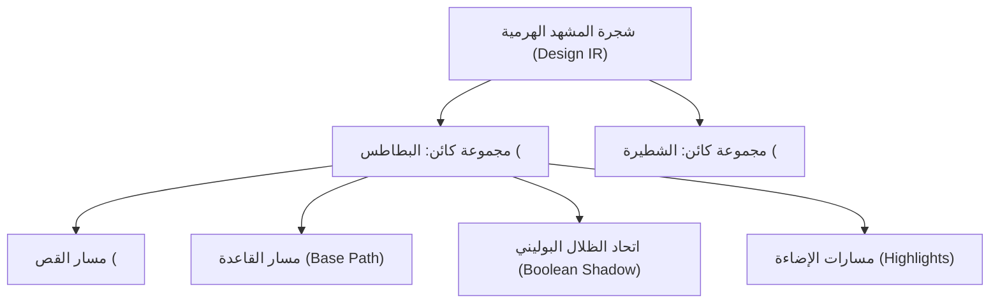

<!-- DOC_PROVENANCE
{"created_at_utc": "2026-10-17T08:58:05Z", "last_action": "CREATED", "last_change_id": "TASK-MULTI-VER-01", "last_edited_at_utc": "2026-10-17T08:58:05Z", "last_editor": "orchestrator-planner", "tracking_started_at_utc": "2026-10-17T08:58:05Z"}
END_DOC_PROVENANCE -->
# Architecture Specification: Version 02 (Hierarchical Scene Graph & Vector Optimization)

**المعرف:** `version-02`  
**النمط المعماري:** Hierarchical Scene Graph & Design IR  
**حالة الاعتماد:** `NOT_APPROVED — PROPOSED_FOR_OWNER_REVIEW`

---

## 1. الفرضية الهندسية ومخطط شجرة المشهد (`Architecture Hypothesis & Scene Graph Flow`)

تفصل معمارية `version-02` بين شجرة الوثيقة الدلالية (`Design IR Document`) وبين المحرك الهندسي للتصيير:
1. تمثيل كل عنصر كمجموعة دلالية `<g>` تتضمن:
   - مسار القاعدة الأساسي (`Base Vector Path`).
   - مسارات الظلال المدمجة بولينياً (`Boolean Merged Shadows`).
   - مسارات الإضاءة المنعكسة (`Highlight Paths`).
   - مسار القص غير التدميري (`<clipPath>`) لحصر الظلال داخل حدود العنصر.
2. استخدام خوارزميات الاتحاد البوليني لتجميع المسارات المتجاورة ذات اللون الواحد لمنع تفتت الفيكتور.
3. دعم كامل لأدوات التحرير المباشر في الكانفاس (Pen Tool Bezier handles وسلايدر الشفافية 50%).

---

## 2. المكونات البرمجية الأساسية (`Core Components`)

- `src/geometry/bezier.py`:
  - كلاس `OptimizedBezierCurve`: تمثيل متقدم لمنحنيات بيزييه مع دعم حساب نقاط الانحناء ومقابض أداة القلم (`Handle In/Out`).
  - دالة `boolean_union_and_fit`: تدمج المضلعات المتداخلة عبر Shapely ثم تطبق ملاءمة بيزييه النظيفة.
- `src/pipeline.py`:
  - كلاس `HierarchicalSceneGraphPipeline`: يدير شجرة التصميم وعقود الـ Design IR وتوليد مجموعات `<g>` النظيفة مع `<clipPath>`.
