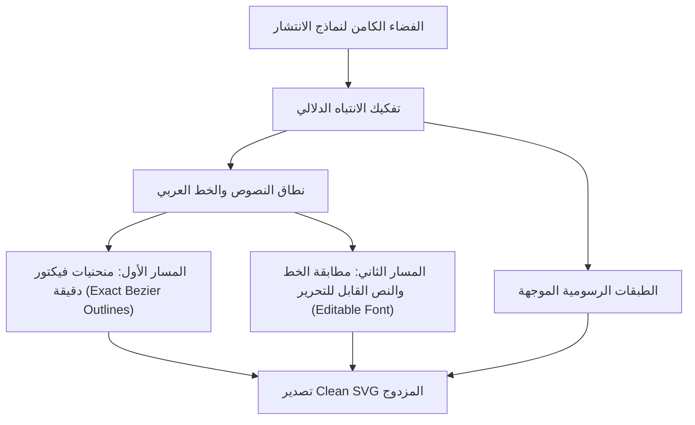

<!-- DOC_PROVENANCE
{"created_at_utc": "2026-10-17T08:58:05Z", "last_action": "CREATED", "last_change_id": "TASK-MULTI-VER-01", "last_edited_at_utc": "2026-10-17T08:58:05Z", "last_editor": "orchestrator-planner", "tracking_started_at_utc": "2026-10-17T08:58:05Z"}
END_DOC_PROVENANCE -->
# Architecture Specification: Version 03 (Diffusion Latent Decomposition & Dual-Path Typography)

**المعرف:** `version-03`  
**النمط المعماري:** Latent Diffusion & Dual-Path Typography  
**حالة الاعتماد:** `NOT_APPROVED — PROPOSED_FOR_OWNER_REVIEW`

---

## 1. الفرضية الهندسية وتدفق الفضاء الكامن (`Latent Decomposition & Typography Flow`)

تختبر معمارية `version-03` استغلال الفضاء الكامن لشبكات الانتشار (`Diffusion Attention Maps`) لاستخراج الطبقات الدلالية مباشرة مع معالجة متخصصة للخط العربي:
1. استخراج أقنعة الانتباه المتبادل (`Cross-Attention Heatmaps`) أثناء توليد الصورة لتحديد حدود الكائنات الدلالية.
2. عزل طبقات النصوص والشعارات وتوجيهها إلى محرك التيبوجرافي ثنائي المسار (`Dual-Path Engine`):
   - **المسار الأول (Visual Fidelity Path):** استخراج منحنيات بيزييه الدقيقة لحروف الخط العربي المركبة للحفاظ على الهوية البصرية بنسبة 100%.
   - **المسار الثاني (Editable Semantic Path):** التعرف الضوئي على النصوص (OCR) ومطابقة عائلة الخط (Font Identity & Weight Matching) لتوليد طبقة نصية بديلة قابلة للتعديل المباشر.
3. التصدير إلى وثيقة فيكتور نظيفة تجمع بين الطبقات الرسومية والطبقات النصية المتوافقة مع برامج التصميم الاحترافية (Illustrator / Figma).

---

## 2. المكونات البرمجية الأساسية (`Core Components`)

- `src/geometry/bezier.py`:
  - كلاس `TypographicContourPoint`: نقطة متجهية متخصصة في تمثيل تفاصيل حواف الحروف المتصلة والنقاط والتشكيل.
  - دالة `fit_typographic_bezier`: ملاءمة منحنيات بيزييه عالية الحساسية للمنحنيات الحادة والانعطافات المعقدة في الخط العربي.
- `src/pipeline.py`:
  - كلاس `DualPathTypographyPipeline`: يدير التفكيك الكامن واستراتيجية المسار المزدوج للخطوط والنصوص.
